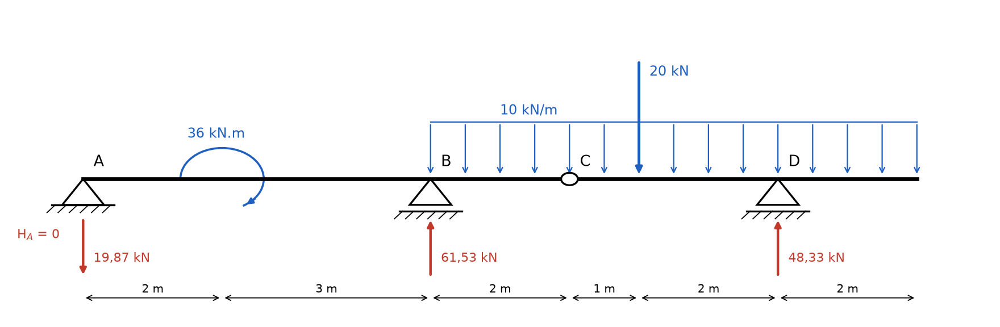
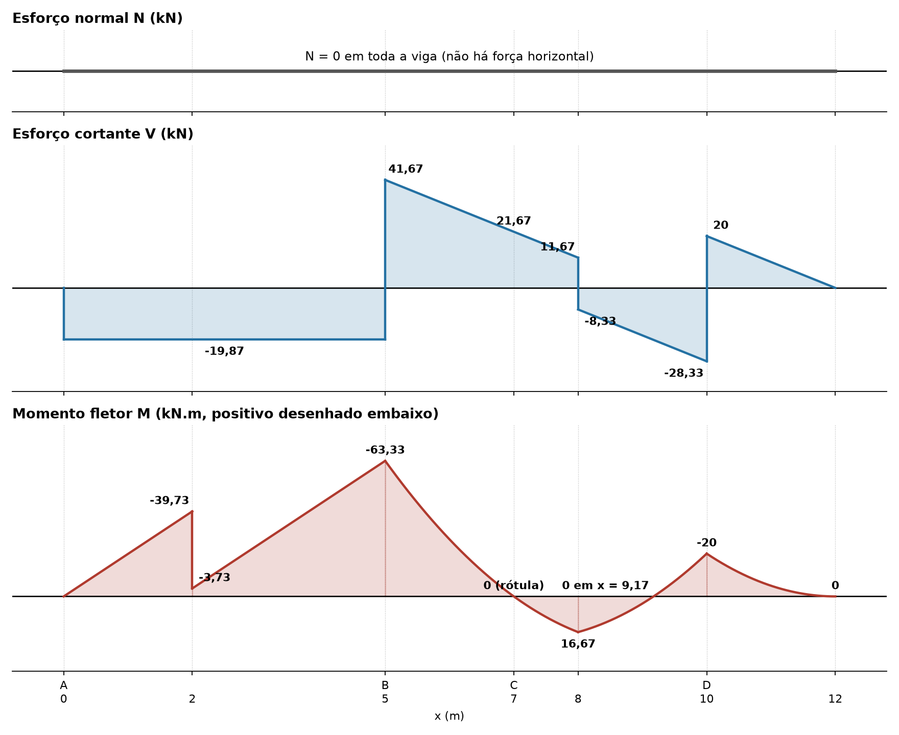

# Lista 3, exercício 01

## 1. Leitura da estrutura

Origem x = 0 em A, eixo x para a direita.

| Ponto | x (m) | O que é |
|---|---|---|
| A | 0 | apoio fixo (2º gênero): reações HA e VA |
| | 2 | momento concentrado de 36 kN.m, sentido horário |
| B | 5 | apoio móvel (1º gênero): reação VB |
| C | 7 | rótula: MC = 0, transmite força vertical e horizontal |
| | 8 | força concentrada de 20 kN para baixo |
| D | 10 | apoio móvel (1º gênero): reação VD |
| | 12 | extremidade livre |

Carga distribuída de 10 kN/m de x = 5 até x = 12.

São 4 incógnitas (HA, VA, VB, VD) e 4 equações: as 3 de equilíbrio da viga inteira mais MC = 0 da rótula. A estrutura é isostática.

A rótula divide a viga em duas partes. O trecho CD só fica parado porque se apoia em D e no trecho AC (pela rótula), então ele é resolvido primeiro e a força na rótula vira carga para o trecho AC.

Convenção: forças para cima positivas, momentos anti-horários positivos nas equações de equilíbrio.

## 2. Reações

### 2.1 Força horizontal

Não há carga horizontal, então

ΣFx = 0 ⟹ **HA = 0** e também HC = 0 na rótula.

### 2.2 Trecho CD (de x = 7 a x = 12)

Cargas nesse trecho:

- distribuída: 10 kN/m · 5 m = 50 kN, aplicada no meio do trecho, a 2,5 m de C
- concentrada: 20 kN, a 1 m de C
- VD, a 3 m de C
- VC, força que o trecho AC faz no trecho CD pela rótula

Momentos em C (o momento em C é zero, por isso VC não entra):

ΣMC = 0 ⟹ VD · 3 − 50 · 2,5 − 20 · 1 = 0

VD · 3 = 125 + 20 = 145

**VD = 145/3 = 48,33 kN** (para cima)

Forças verticais no trecho:

ΣFy = 0 ⟹ VC + 48,33 − 50 − 20 = 0

**VC = 65/3 = 21,67 kN** (o trecho AC empurra CD para cima)

Pela ação e reação, o trecho CD empurra o trecho AC **para baixo** com 21,67 kN em x = 7.

### 2.3 Trecho AC (de x = 0 a x = 7)

Cargas nesse trecho:

- momento de 36 kN.m horário em x = 2 (horário entra negativo)
- distribuída: 10 kN/m · 2 m = 20 kN, no meio do trecho BC, em x = 6
- 21,67 kN para baixo em x = 7 (vindo da rótula)
- VA em x = 0 e VB em x = 5

Momentos em A:

ΣMA = 0 ⟹ VB · 5 − 20 · 6 − 21,67 · 7 − 36 = 0

VB · 5 = 120 + 151,67 + 36 = 307,67

**VB = 923/15 = 61,53 kN** (para cima)

Forças verticais:

ΣFy = 0 ⟹ VA + 61,53 − 20 − 21,67 = 0

**VA = −298/15 = −19,87 kN**

O sinal negativo indica que VA aponta **para baixo**. O momento horário e o balanço depois de B tendem a levantar a ponta A, e o apoio segura puxando para baixo.

### 2.4 Conferência com a viga inteira

ΣFy: −19,87 + 61,53 + 48,33 = 90 kN

Cargas: 10 · 7 + 20 = 90 kN. Confere.

### Resumo

| Reação | Valor | Sentido |
|---|---|---|
| HA | 0 | |
| VA | 19,87 kN | para baixo |
| VB | 61,53 kN | para cima |
| VD | 48,33 kN | para cima |
| VC (interna, rótula) | 21,67 kN | sobe em CD, desce em AC |
| HC (interna, rótula) | 0 | |

## 3. Esforços por trecho

Convenção de sinais (seção olhada pela esquerda):

- N positivo quando traciona
- V positivo quando a resultante das forças à esquerda da seção aponta para cima
- M positivo quando traciona a fibra de baixo. O diagrama de M é desenhado do lado tracionado, então **M positivo fica embaixo do eixo**

### Esforço normal

Nenhuma força horizontal atua, então **N = 0 em toda a viga**.

### Trecho 1: 0 < x < 2

Só VA à esquerda.

- V = −19,87 kN (constante)
- M = −19,87 · x

M(0) = 0, M(2) = −39,73 kN.m

### Trecho 2: 2 < x < 5

Entra o momento horário de 36 kN.m. Um momento concentrado não muda V, mas faz M saltar. Momento horário aplicado à esquerda da seção soma +36 em M.

- V = −19,87 kN (constante)
- M = −19,87 · x + 36

M(2+) = −39,73 + 36 = −3,73 kN.m

M(5) = −19,87 · 5 + 36 = −63,33 kN.m

### Trecho 3: 5 < x < 8

Entram VB e a carga distribuída. Chamando u = x − 5:

- V = −19,87 + 61,53 − 10u = 41,67 − 10u
- M = −63,33 + 41,67u − 5u²

V(5+) = 41,67, V(7) = 21,67, V(8−) = 11,67 kN

M(5) = −63,33, M(7) = −63,33 + 83,33 − 20 = **0** (confere com a rótula), M(8) = −63,33 + 125 − 45 = 16,67 kN.m

V não chega a zero nesse trecho (zeraria em u = 4,17, fora dele), então o maior M positivo fica em x = 8, onde V muda de sinal por causa da força de 20 kN.

Note que o cortante em C vale 21,67 kN, exatamente a força VC transmitida pela rótula.

### Trecho 4: 8 < x < 10

A força de 20 kN derruba V em 20. Chamando u = x − 8:

- V = 11,67 − 20 − 10u = −8,33 − 10u
- M = 16,67 − 8,33u − 5u²

V(8+) = −8,33, V(10−) = −28,33 kN

M(10) = 16,67 − 16,67 − 20 = −20 kN.m

M cruza zero em 5u² + 8,33u − 16,67 = 0, u = 1,17, ou seja **x = 9,17 m**.

### Trecho 5: 10 < x < 12 (balanço)

Mais fácil olhar pela direita: sobra só a carga distribuída. Chamando s = 12 − x (distância até a ponta):

- V = 10s
- M = −10 · s · s/2 = −5s²

V(10+) = 20, V(12) = 0 kN

M(10) = −20, M(12) = 0 kN.m

Confere pela esquerda: V(10+) = −28,33 + 48,33 = 20.

## 4. Diagramas

| x (m) | V à esquerda (kN) | V à direita (kN) | M (kN.m) |
|---|---|---|---|
| 0 (A) | 0 | −19,87 | 0 |
| 2 | −19,87 | −19,87 | −39,73 → −3,73 |
| 5 (B) | −19,87 | 41,67 | −63,33 |
| 7 (C) | 21,67 | 21,67 | 0 |
| 8 | 11,67 | −8,33 | 16,67 |
| 9,17 | | | 0 |
| 10 (D) | −28,33 | 20 | −20 |
| 12 | 0 | | 0 |

Valores extremos: **Mmáx = +16,67 kN.m** em x = 8 e **Mmín = −63,33 kN.m** sobre o apoio B. **|V|máx = 41,67 kN** logo à direita de B.

## 5. Por que as curvas têm essa forma

Tudo sai de duas relações que valem em qualquer trecho de viga (q é a carga distribuída, positiva para baixo):

- dV/dx = −q: a inclinação do diagrama de V é a carga
- dM/dx = V: a inclinação do diagrama de M é o cortante

Juntando as duas, d²M/dx² = −q.

**Onde não há carga distribuída (0 a 5):** q = 0, então V é constante e M é uma reta. Por isso os trechos 1 e 2 são retos. Como V = −19,87 é negativo, M desce (fica mais negativo) a cada metro, com a mesma inclinação antes e depois de x = 2.

**Onde há carga distribuída (5 a 12):** q = 10 é constante, então V é uma reta com inclinação −10 (cai 10 kN a cada metro) e M é uma parábola do 2º grau.

**Concavidade da parábola:** d²M/dx² = −q < 0, então M (com positivo para cima) seria uma parábola de concavidade para baixo, como um "∩". Como o diagrama de M é desenhado com positivo **embaixo** (lado tracionado), ele aparece invertido e a "barriga" da parábola aponta para baixo, **no mesmo sentido da carga**. Essa é a regra prática: a curva do momento sempre "embarriga" no sentido em que a carga distribuída empurra, como um varal pesado. Isso vale nos três trechos parabólicos (5 a 8, 8 a 10, 10 a 12), mesmo onde M é negativo.

**Onde a curva é mais inclinada:** a inclinação de M é V. Logo à direita de B, V = 41,67 é o maior valor, então M sobe rápido. Chegando em x = 8, V = 11,67, então a parábola já está quase achatada. Se V zerasse dentro do trecho, ali seria o vértice da parábola (máximo ou mínimo local de M).

**Bicos e saltos:**

- **Força concentrada** (VB, 20 kN, VD): V dá um salto do tamanho da força. Como a inclinação de M é V, M muda de inclinação de repente e forma um bico, sem salto. Em x = 8 o V passa de +11,67 para −8,33, então M para de subir e passa a descer: é o pico de +16,67.
- **Momento concentrado** (36 kN.m em x = 2): V não muda, então as retas antes e depois têm a mesma inclinação (são paralelas), mas M dá um salto de 36 kN.m.
- **Rótula** (C): não transmite momento, então M = 0 ali. V passa direto, sem salto, porque a rótula transmite força.
- **Extremidade livre** (x = 12): sem apoio e sem força concentrada, então V = 0 e M = 0. Como V = 0 ali, a parábola chega na ponta tangente ao eixo (inclinação zero).
- **Apoio A** (x = 0): apoio de extremidade não segura momento, então M = 0.
