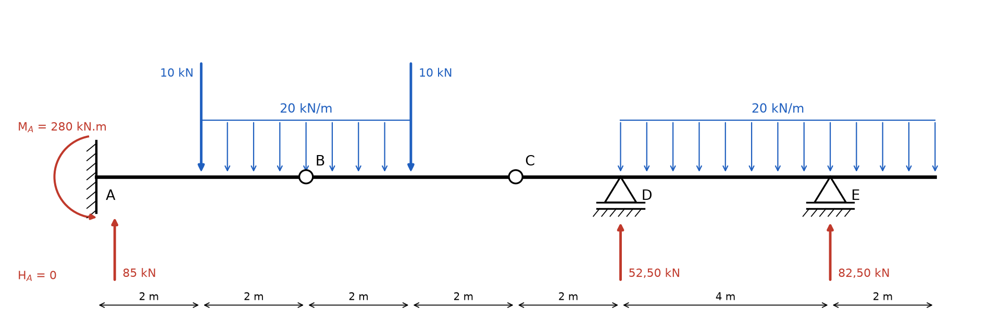
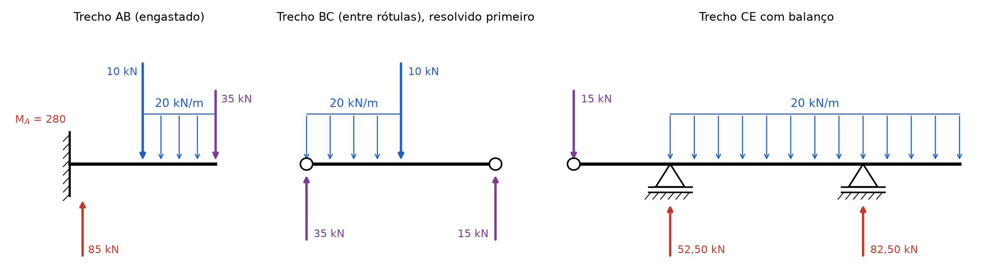
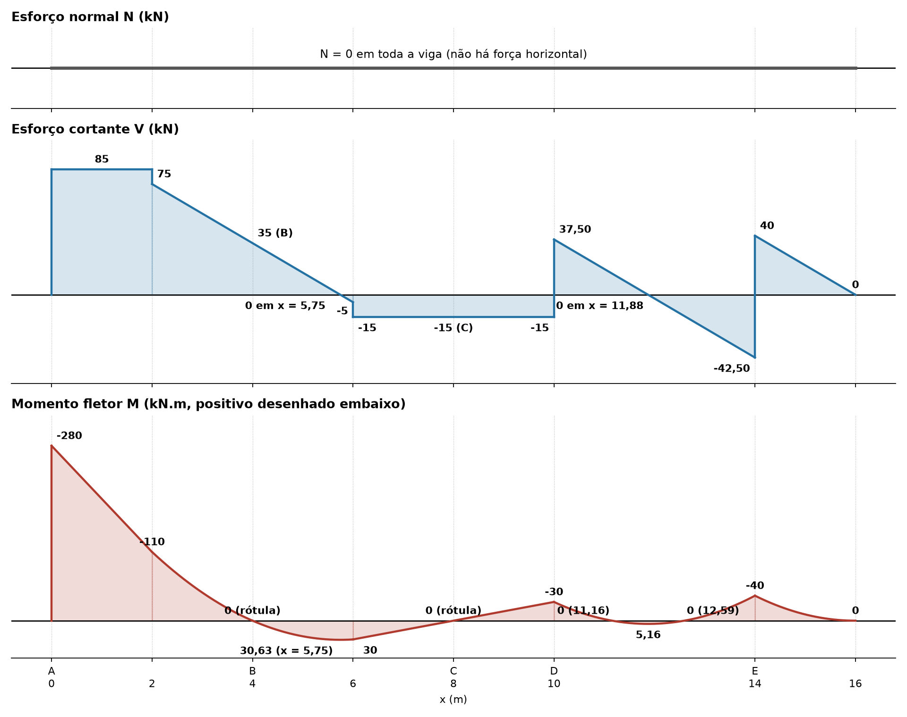

# Lista 3, exercício 02

## 1. Leitura da estrutura

Origem x = 0 em A, eixo x para a direita.

| Ponto | x (m) | O que é |
|---|---|---|
| A | 0 | engaste: reações HA, VA e momento MA |
| | 2 | força concentrada de 10 kN para baixo, início da 1ª carga distribuída |
| B | 4 | rótula: MB = 0 |
| | 6 | força concentrada de 10 kN para baixo, fim da 1ª carga distribuída |
| C | 8 | rótula: MC = 0 |
| D | 10 | apoio móvel (1º gênero): reação VD, início da 2ª carga distribuída |
| E | 14 | apoio móvel (1º gênero): reação VE |
| | 16 | extremidade livre, fim da 2ª carga distribuída |

Cargas distribuídas: 20 kN/m de x = 2 até x = 6 e 20 kN/m de x = 10 até x = 16.

Os apoios D e E aparecem no desenho com o mesmo símbolo (triângulo sobre traço duplo com hachura), que é o do apoio móvel. Foram lidos os dois como de 1º gênero.

São 5 incógnitas (HA, VA, MA, VD, VE) e 5 equações: as 3 de equilíbrio da viga inteira mais MB = 0 e MC = 0 nas rótulas. A estrutura é isostática.

As duas rótulas dividem a viga em três partes:

- **AB**: presa no engaste, fica parada sozinha
- **CE**: apoiada em D e E, também fica parada sozinha (para cargas verticais)
- **BC**: não tem apoio próprio. Ela só fica parada porque se apoia em AB (pela rótula B) e em CE (pela rótula C)

Por isso BC é resolvida primeiro, como uma viga simplesmente apoiada em B e C. As forças que ela faz nas rótulas viram cargas para AB e para CE.

Convenção nas equações de equilíbrio: forças para cima positivas, momentos anti-horários positivos.

## 2. Reações

### 2.1 Força horizontal

Não há carga horizontal, então

ΣFx = 0 ⟹ **HA = 0** e também HB = HC = 0 nas rótulas.

### 2.2 Trecho BC (de x = 4 a x = 8)

Cargas nesse trecho:

- distribuída: 20 kN/m · 2 m = 40 kN (só a parte de x = 4 a x = 6), aplicada no meio, em x = 5, a 1 m de B
- concentrada: 10 kN em x = 6, a 2 m de B
- VB e VC, forças que AB e CE fazem em BC pelas rótulas

Momentos em B (o momento em B é zero, por isso VB não entra):

ΣMB = 0 ⟹ VC · 4 − 40 · 1 − 10 · 2 = 0

VC · 4 = 60

**VC = 15 kN** (CE empurra BC para cima)

Forças verticais:

ΣFy = 0 ⟹ VB + 15 − 40 − 10 = 0

**VB = 35 kN** (AB empurra BC para cima)

Pela ação e reação, BC empurra AB **para baixo** com 35 kN em x = 4 e empurra CE **para baixo** com 15 kN em x = 8.

### 2.3 Trecho AB (de x = 0 a x = 4)

Cargas nesse trecho:

- 10 kN para baixo em x = 2
- distribuída: 20 kN/m · 2 m = 40 kN (parte de x = 2 a x = 4), no meio, em x = 3
- 35 kN para baixo em x = 4 (vindo da rótula B)
- VA e MA no engaste

Forças verticais:

ΣFy = 0 ⟹ VA − 10 − 40 − 35 = 0

**VA = 85 kN** (para cima)

Momentos em A (as forças para baixo à direita de A giram no sentido horário, entram negativas):

ΣMA = 0 ⟹ MA − 10 · 2 − 40 · 3 − 35 · 4 = 0

MA = 20 + 120 + 140

**MA = 280 kN.m** (anti-horário)

O engaste precisa girar no sentido anti-horário para impedir que as cargas, todas à direita de A e para baixo, derrubem o balanço. Isso traciona a fibra de cima junto ao engaste, então o momento fletor em A é M(0) = −280 kN.m.

### 2.4 Trecho CE (de x = 8 a x = 16)

Cargas nesse trecho:

- 15 kN para baixo em x = 8 (vindo da rótula C), a 2 m à esquerda de D
- distribuída: 20 kN/m · 6 m = 120 kN, no meio, em x = 13, a 3 m à direita de D
- VD em x = 10 e VE em x = 14, a 4 m de D

Momentos em D (força para baixo à esquerda de D gira no sentido anti-horário, entra positiva):

ΣMD = 0 ⟹ VE · 4 − 120 · 3 + 15 · 2 = 0

VE · 4 = 360 − 30 = 330

**VE = 165/2 = 82,50 kN** (para cima)

Forças verticais:

ΣFy = 0 ⟹ VD + 82,50 − 15 − 120 = 0

**VD = 105/2 = 52,50 kN** (para cima)

### 2.5 Conferência com a viga inteira

ΣFy: 85 + 52,50 + 82,50 = 220 kN

Cargas: 10 + 10 + 20 · 4 + 20 · 6 = 220 kN. Confere.

ΣMA: 280 + 52,50 · 10 + 82,50 · 14 − 10 · 2 − 10 · 6 − 80 · 4 − 120 · 13

= 280 + 525 + 1155 − 20 − 60 − 320 − 1560 = 0. Confere.

### Resumo

| Reação | Valor | Sentido |
|---|---|---|
| HA | 0 | |
| VA | 85 kN | para cima |
| MA | 280 kN.m | anti-horário |
| VD | 52,50 kN | para cima |
| VE | 82,50 kN | para cima |
| VB (interna, rótula) | 35 kN | sobe em BC, desce em AB |
| VC (interna, rótula) | 15 kN | sobe em BC, desce em CE |
| HB, HC (internas) | 0 | |

## 3. Esforços por trecho

Convenção de sinais (seção olhada pela esquerda):

- N positivo quando traciona
- V positivo quando a resultante das forças à esquerda da seção aponta para cima
- M positivo quando traciona a fibra de baixo. O diagrama de M é desenhado do lado tracionado, então **M positivo fica embaixo do eixo**

### Esforço normal

Nenhuma força horizontal atua, então **N = 0 em toda a viga**.

### Trecho 1: 0 < x < 2

À esquerda só estão VA = 85 e MA, que dá M(0) = −280.

- V = 85 kN (constante)
- M = −280 + 85x

M(0) = −280, M(2) = −110 kN.m

### Trecho 2: 2 < x < 4

A força de 10 kN derruba V em 10 e começa a carga distribuída. Chamando u = x − 2:

- V = 75 − 20u
- M = −110 + 75u − 10u²

V(2+) = 75, V(4) = 35 kN

M(4) = −110 + 150 − 40 = **0** (confere com a rótula B)

### Trecho 3: 4 < x < 6

A carga distribuída continua. Chamando u = x − 4:

- V = 35 − 20u
- M = 35u − 10u²

V(4) = 35, V(6−) = −5 kN. O cortante em B vale 35 kN, exatamente a força VB transmitida pela rótula.

V zera em u = 35/20 = 1,75, ou seja **x = 5,75 m**. Ali M tem o máximo local:

M(5,75) = 35 · 1,75 − 10 · 1,75² = 61,25 − 30,63 = **30,63 kN.m**

M(6) = 70 − 40 = 30 kN.m

### Trecho 4: 6 < x < 10

A força de 10 kN derruba V em 10 e não há mais carga até D:

- V = −15 kN (constante)
- M = 30 − 15(x − 6)

M(6) = 30, M(8) = **0** (confere com a rótula C), M(10) = −30 kN.m

O cortante em C vale −15 kN: olhando pela direita, é a força de 15 kN que CE recebe para baixo de BC.

### Trecho 5: 10 < x < 14

Entram VD = 52,50 e a segunda carga distribuída. Chamando u = x − 10:

- V = −15 + 52,50 − 20u = 37,50 − 20u
- M = −30 + 37,50u − 10u²

V(10+) = 37,50, V(14−) = −42,50 kN

V zera em u = 37,50/20 = 1,875, ou seja **x = 11,88 m**, onde M tem o máximo local:

M(11,88) = −30 + 37,50 · 1,875 − 10 · 1,875² = **5,16 kN.m**

M(14) = −30 + 150 − 160 = −40 kN.m

M cruza zero em 10u² − 37,50u + 30 = 0, u = 1,16 e u = 2,59, ou seja **x = 11,16 m** e **x = 12,59 m**.

### Trecho 6: 14 < x < 16 (balanço)

Mais fácil olhar pela direita: sobra só a carga distribuída. Chamando s = 16 − x:

- V = 20s
- M = −20 · s · s/2 = −10s²

V(14+) = 40, V(16) = 0 kN

M(14) = −40, M(16) = 0 kN.m

Confere pela esquerda: V(14+) = −42,50 + 82,50 = 40.

## 4. Diagramas

| x (m) | V à esquerda (kN) | V à direita (kN) | M (kN.m) |
|---|---|---|---|
| 0 (A) | 0 | 85 | −280 |
| 2 | 85 | 75 | −110 |
| 4 (B) | 35 | 35 | 0 |
| 5,75 | 0 | 0 | 30,63 |
| 6 | −5 | −15 | 30 |
| 8 (C) | −15 | −15 | 0 |
| 10 (D) | −15 | 37,50 | −30 |
| 11,16 | | | 0 |
| 11,88 | 0 | 0 | 5,16 |
| 12,59 | | | 0 |
| 14 (E) | −42,50 | 40 | −40 |
| 16 | 0 | | 0 |

Valores extremos: **Mmín = −280 kN.m** no engaste A e **Mmáx = +30,63 kN.m** em x = 5,75. **Vmáx = 85 kN** entre A e x = 2 e **Vmín = −42,50 kN** logo à esquerda de E.

## 5. Por que as curvas têm essa forma

Tudo sai de duas relações que valem em qualquer trecho de viga (q é a carga distribuída, positiva para baixo):

- dV/dx = −q: a inclinação do diagrama de V é a carga
- dM/dx = V: a inclinação do diagrama de M é o cortante

Juntando as duas, d²M/dx² = −q.

**Onde não há carga distribuída (0 a 2 e 6 a 10):** q = 0, então V é constante e M é uma reta. De 0 a 2, V = 85 é positivo e M sobe de −280 para −110. De 6 a 10, V = −15 é negativo e M desce de 30 para −30, passando por zero em C com a mesma inclinação.

**Onde há carga distribuída (2 a 6 e 10 a 16):** q = 20 é constante, então V é uma reta que cai 20 kN a cada metro e M é uma parábola do 2º grau.

**Concavidade das parábolas:** d²M/dx² = −q < 0, então M (com positivo para cima) seria um "∩". Como o diagrama de M é desenhado com positivo **embaixo**, ele aparece invertido e a "barriga" da parábola aponta para baixo, **no mesmo sentido da carga**, como um varal pesado. Isso vale em todos os trechos carregados, inclusive onde M é negativo: de 2 a 4 a curva sai de −110 e chega em 0 curvando para baixo, e no balanço de 14 a 16 ela sai de −40 e encosta no eixo também curvando para baixo.

**Vértices das parábolas:** o vértice fica onde V = 0. Em x = 5,75 o cortante troca de sinal dentro do trecho carregado, então M tem ali o máximo local de 30,63. Em x = 11,88 acontece o mesmo e aparece o pequeno máximo positivo de 5,16 entre os apoios D e E. Esse vão de 4 m fica com momento positivo pequeno porque os dois balanços (o de 2 m depois de E e a carga de 15 kN que vem de C antes de D) puxam os momentos negativos sobre os apoios para −30 e −40.

**Bicos e saltos:**

- **Força concentrada** (10 kN em x = 2 e x = 6, VD, VE): V dá um salto do tamanho da força. Como a inclinação de M é V, M muda de inclinação de repente e forma um bico, sem salto. Em x = 6 o V passa de −5 para −15: M já estava descendo e passa a descer mais rápido. Em D e E o V salta para cima e M faz um bico apontando para cima (os picos negativos de −30 e −40).
- **Engaste** (A): segura momento, então M não é zero ali. O diagrama começa em −280 (fibra de cima tracionada) e V começa com a própria reação de 85.
- **Rótulas** (B e C): não transmitem momento, então M = 0 ali. V passa direto, sem salto, porque a rótula transmite força: em B o cortante vale 35 e em C vale −15, exatamente as forças das rótulas.
- **Extremidade livre** (x = 16): sem apoio e sem força concentrada, então V = 0 e M = 0. Como V = 0 ali, a parábola chega na ponta tangente ao eixo.
