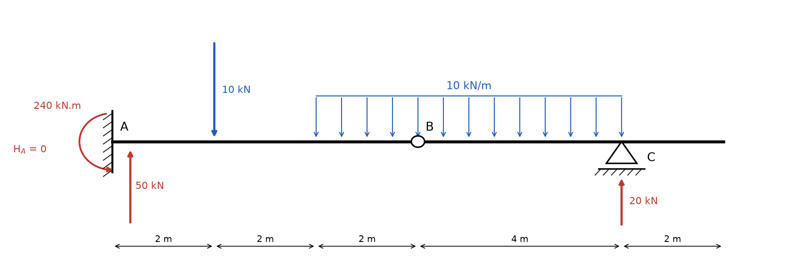
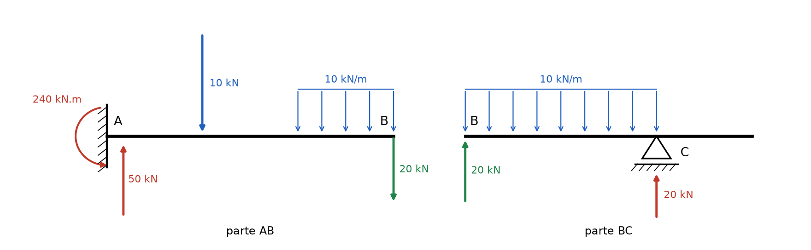
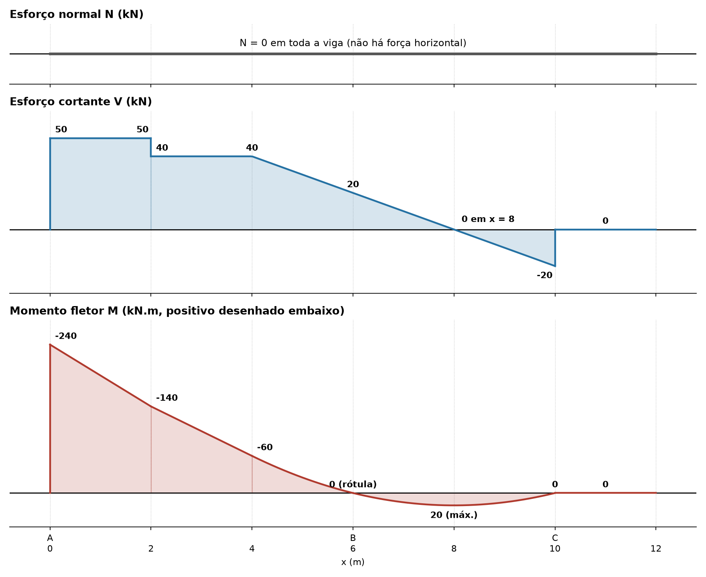

# Lista 3, exercício 03

## 1. Leitura da estrutura

Origem x = 0 em A, eixo x para a direita.

| Ponto | x (m) | O que é |
|---|---|---|
| A | 0 | engaste: reações HA, VA e momento MA |
| | 2 | força concentrada de 10 kN para baixo |
| | 4 | início da carga distribuída |
| B | 6 | rótula: MB = 0, transmite força vertical e horizontal |
| C | 10 | apoio móvel (1º gênero): reação VC, fim da carga distribuída |
| | 12 | extremidade livre, sem carga |

Carga distribuída uniforme de 10 kN/m de x = 4 até x = 10 (a última seta do desenho fica sobre o apoio C). O balanço de C até a ponta (10 a 12) não tem carga.

São 4 incógnitas (HA, VA, MA, VC) e 4 equações: as 3 de equilíbrio da viga inteira mais MB = 0 da rótula. A estrutura é isostática.

A rótula divide a viga em duas partes. A parte AB é uma viga em balanço engastada em A, estável sozinha. A parte BC só fica parada porque se apoia em C e na parte AB (pela rótula). Então BC é resolvida primeiro e a força na rótula vira carga na ponta da parte AB.

Convenção: forças para cima positivas, momentos anti-horários positivos nas equações de equilíbrio.

## 2. Reações

### 2.1 Força horizontal

Não há carga horizontal, então

ΣFx = 0 ⟹ **HA = 0** e também HB = 0 na rótula.

### 2.2 Parte BC (de x = 6 a x = 12)

Cargas nessa parte:

- distribuída: 10 kN/m · 4 m = 40 kN, aplicada no meio do trecho BC, a 2 m de B
- VC, a 4 m de B
- VB, força que a parte AB faz na parte BC pela rótula
- o balanço de 10 a 12 não tem carga e não entra nas contas

Momentos em B (VB passa por B, braço zero, então não entra):

ΣMB = 0 ⟹ VC · 4 − 40 · 2 = 0

**VC = 80/4 = 20 kN** (para cima)

Forças verticais na parte:

ΣFy = 0 ⟹ VB + 20 − 40 = 0

**VB = 20 kN** (a parte AB empurra BC para cima)

Como a carga de BC é simétrica entre B e C, cada lado segura metade dos 40 kN. Pela ação e reação, a parte BC empurra a parte AB **para baixo** com 20 kN em x = 6.

### 2.3 Parte AB (de x = 0 a x = 6)

Cargas nessa parte:

- 10 kN para baixo em x = 2 (braço de 2 m até A)
- distribuída: 10 kN/m · 2 m = 20 kN, no meio do trecho de 4 a 6, em x = 5 (braço de 5 m)
- 20 kN para baixo em x = 6, vindo da rótula (braço de 6 m)
- VA e MA no engaste

Forças verticais:

ΣFy = 0 ⟹ VA − 10 − 20 − 20 = 0

**VA = 50 kN** (para cima)

Momentos em A (VA passa por A e não entra). As três cargas para baixo, à direita de A, giram a viga no sentido horário, então entram negativas:

ΣMA = 0 ⟹ MA − 10 · 2 − 20 · 5 − 20 · 6 = 0

MA = 20 + 100 + 120

**MA = 240 kN.m** (anti-horário)

O engaste precisa girar a viga no sentido anti-horário para impedir que as cargas a "dobrem" para baixo. Isso traciona a fibra de cima junto ao engaste.

### 2.4 Conferência com a viga inteira

ΣFy: 50 + 20 = 70 kN. Cargas: 10 + 10 · 6 = 70 kN. Confere.

ΣMA: 240 + 20 · 10 − 10 · 2 − 60 · 7 = 240 + 200 − 20 − 420 = 0. Confere (a resultante da distribuída, 60 kN, fica no meio de 4 a 10, em x = 7).

### Resumo

| Reação | Valor | Sentido |
|---|---|---|
| HA | 0 | |
| VA | 50 kN | para cima |
| MA | 240 kN.m | anti-horário |
| VC | 20 kN | para cima |
| VB (interna, rótula) | 20 kN | sobe em BC, desce em AB |
| HB (interna, rótula) | 0 | |

## 3. Esforços por trecho

Convenção de sinais (seção olhada pela esquerda):

- N positivo quando traciona
- V positivo quando a resultante das forças à esquerda da seção aponta para cima
- M positivo quando traciona a fibra de baixo. O diagrama de M é desenhado do lado tracionado, então **M positivo fica embaixo do eixo**

O momento anti-horário de 240 kN.m do engaste, na parte à esquerda da seção, entra com sinal negativo em M (traciona em cima).

### Esforço normal

Nenhuma força horizontal atua, então **N = 0 em toda a viga**.

### Trecho 1: 0 < x < 2

À esquerda: VA e MA.

- V = 50 kN (constante)
- M = −240 + 50x

M(0) = −240 kN.m, M(2) = −140 kN.m

### Trecho 2: 2 < x < 4

A força de 10 kN derruba V em 10.

- V = 50 − 10 = 40 kN (constante)
- M = −240 + 50x − 10(x − 2) = −220 + 40x

M(2) = −140, M(4) = −60 kN.m

### Trecho 3: 4 < x < 6

Começa a carga distribuída. Chamando u = x − 4:

- V = 40 − 10u
- M = −60 + 40u − 5u²

V(4) = 40, V(6) = 20 kN

M(4) = −60, M(6) = −60 + 80 − 20 = **0** (confere com a rótula)

Note que o cortante em B vale 20 kN, exatamente a força VB transmitida pela rótula.

### Trecho 4: 6 < x < 10

A carga continua, e a rótula não muda V nem M (só garante M = 0 ali). Chamando u = x − 6:

- V = 20 − 10u
- M = 20u − 5u²

V(6) = 20, V(10−) = −20 kN

V zera em u = 2, ou seja **x = 8 m**, e ali M tem seu extremo:

M(8) = 40 − 20 = **20 kN.m** (máximo positivo)

M(10) = 80 − 80 = 0 kN.m

O trecho BC funciona como uma viga biapoiada (apoiada em B e C) de 4 m com carga uniforme, e o máximo bate com a fórmula conhecida q · L²/8 = 10 · 16/8 = 20 kN.m.

### Trecho 5: 10 < x < 12 (balanço)

Olhando pela direita não sobra nenhuma carga, então

- V = 0
- M = 0

Confere pela esquerda: V(10+) = −20 + 20 = 0.

## 4. Diagramas

| x (m) | V à esquerda (kN) | V à direita (kN) | M (kN.m) |
|---|---|---|---|
| 0 (A) | | 50 | −240 |
| 2 | 50 | 40 | −140 |
| 4 | 40 | 40 | −60 |
| 6 (B) | 20 | 20 | 0 |
| 8 | 0 | 0 | 20 |
| 10 (C) | −20 | 0 | 0 |
| 12 | 0 | | 0 |

Valores extremos: **Mmín = −240 kN.m** no engaste A, **Mmáx = +20 kN.m** em x = 8. **Vmáx = 50 kN** no trecho de 0 a 2, **Vmín = −20 kN** logo à esquerda de C.

## 5. Por que as curvas têm essa forma

Tudo sai de duas relações que valem em qualquer trecho de viga (q é a carga distribuída, positiva para baixo):

- dV/dx = −q: a inclinação do diagrama de V é a carga
- dM/dx = V: a inclinação do diagrama de M é o cortante

Juntando as duas, d²M/dx² = −q.

**Onde não há carga distribuída (0 a 4 e 10 a 12):** q = 0, então V é constante e M é uma reta. De 0 a 2 o V vale 50, então M sobe 50 kN.m por metro (de −240 a −140). De 2 a 4 o V vale 40, então a reta fica um pouco menos inclinada (de −140 a −60).

**Onde há carga distribuída (4 a 10):** q = 10 é constante, então V é uma única reta com inclinação −10 (cai 10 kN a cada metro, de 40 em x = 4 até −20 em x = 10) e M é uma parábola do 2º grau.

**Concavidade da parábola:** d²M/dx² = −q < 0, então M com positivo para cima seria um "∩". Como o diagrama é desenhado com positivo **embaixo** (lado tracionado), ele aparece invertido e a "barriga" aponta para baixo, **no mesmo sentido da carga**, como um varal pesado. Isso vale de 4 a 10 inteiro, tanto na parte negativa (4 a 6, onde a curva chega na rótula já achatando) quanto na positiva (6 a 10).

**Vértice da parábola:** a inclinação de M é V. Em x = 8, V = 0, então ali a tangente de M é horizontal e fica o máximo de +20 kN.m. Antes de x = 8, V > 0 e M cresce. Depois, V < 0 e M decresce até zerar em C.

**Bicos e saltos:**

- **Engaste** (A): segura momento, então M não é zero ali. Vale −240 kN.m, o maior valor da viga em módulo, com a fibra de cima tracionada. É o comportamento típico de balanço: o momento cresce em direção ao engaste.
- **Força concentrada** (10 kN em x = 2, VC em x = 10): V dá um salto do tamanho da força. Como a inclinação de M é V, M muda de inclinação de repente e forma um bico, sem salto. Em x = 2 a inclinação passa de 50 para 40. Em x = 10 passa de −20 para 0.
- **Início da carga distribuída** (x = 4): V não salta, só começa a cair. M passa de reta para parábola sem bico, porque a inclinação (V = 40) é a mesma dos dois lados.
- **Rótula** (B): não transmite momento, então M = 0 ali. V passa direto (20 kN), sem salto, porque a rótula transmite força. Por isso M cruza o zero em B sem bico.
- **Balanço sem carga** (10 a 12): olhando pela direita não há força nenhuma, então V = 0 e M = 0 em todo o trecho. O balanço não trabalha. Em C, como V salta de −20 para 0, M chega em zero com inclinação −20 e sai com inclinação zero, formando um bico em M = 0.
- **Extremidade livre** (x = 12): sem força concentrada, V = 0 e M = 0.
