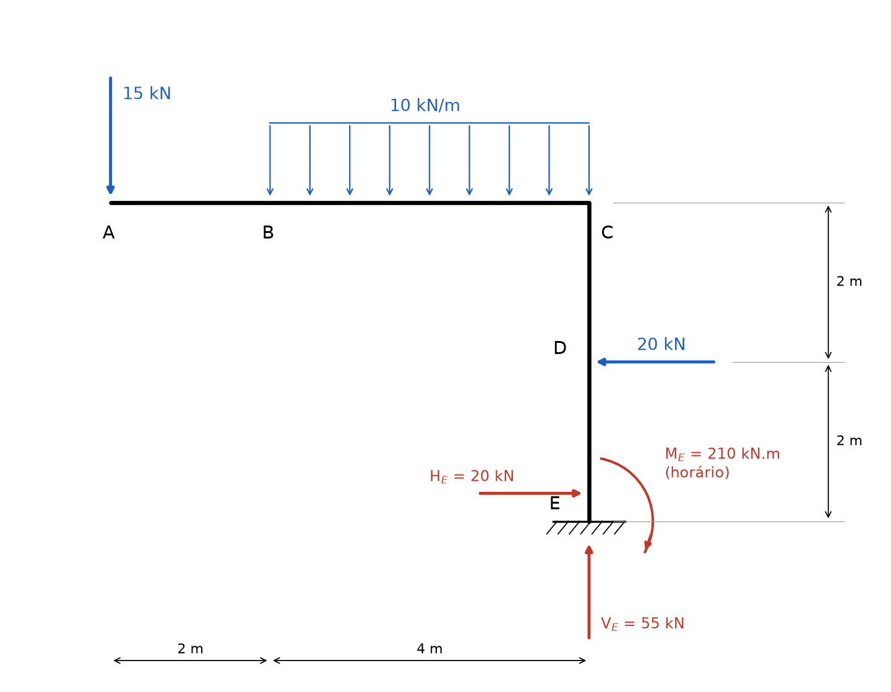
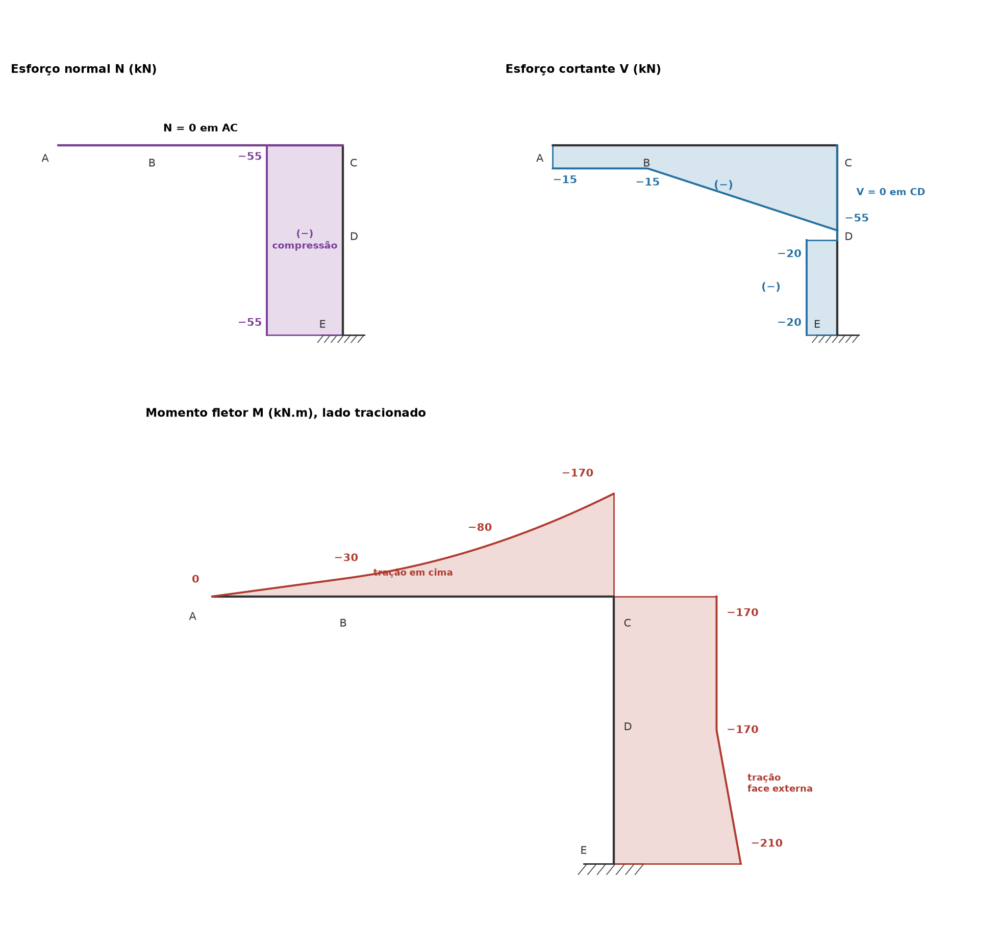

# Lista 3, exercício 04

## 1. Leitura da estrutura

Pórtico em L: uma barra horizontal AC de 6 m apoiada no topo de um pilar CE de 4 m, engastado na base. Origem em E, x para a direita e y para cima, com A em x = 0 para ficar igual às cotas do desenho.

| Ponto | Coordenadas (m) | O que é |
|---|---|---|
| A | (0, 4) | extremidade livre, força de 15 kN para baixo |
| B | (2, 4) | início da carga distribuída de 10 kN/m |
| C | (6, 4) | nó rígido (canto do pórtico), fim da carga distribuída |
| D | (6, 2) | força de 20 kN horizontal, para a esquerda |
| E | (6, 0) | engaste: reações HE, VE e ME |

Leitura da figura: o ponto em B é só o começo da carga, não é rótula (não há círculo vazio). O canto C é rígido. A base tem só a hachura, sem triângulo, então é engaste. A carga de 10 kN/m está sobre barra horizontal, então não há diferença entre "por projeção" e "por comprimento".

São 3 incógnitas (HE, VE, ME) e 3 equações de equilíbrio. Sem rótulas nem vínculos internos, a estrutura é isostática (é um balanço em L). Não há reações internas de ligação para calcular: as únicas forças internas são os esforços solicitantes, e no nó C a viga e o pilar trocam esforços que serão conferidos no item 3.4.

Convenção nas equações de equilíbrio: forças para a direita e para cima positivas, momentos anti-horários positivos.

## 2. Reações

### 2.1 Forças horizontais

A única força horizontal é a de 20 kN para a esquerda em D.

ΣFx = 0 ⟹ HE − 20 = 0

**HE = 20 kN** (para a direita)

### 2.2 Forças verticais

Resultante da distribuída: 10 kN/m · 4 m = 40 kN, aplicada no meio de BC, em x = 4.

ΣFy = 0 ⟹ VE − 15 − 40 = 0

**VE = 55 kN** (para cima)

### 2.3 Momentos em E

Tomando momentos em E, HE e VE passam pelo ponto e não entram. Braços de alavanca:

- 15 kN vertical em A: braço horizontal de 6 m (de x = 0 até x = 6). Força para baixo à esquerda de E gira no sentido anti-horário: +15 · 6 = +90
- 40 kN vertical em x = 4: braço de 2 m, também anti-horário: +40 · 2 = +80
- 20 kN horizontal em D: braço vertical de 2 m (altura de D acima de E). Força para a esquerda acima de E gira no sentido anti-horário: +20 · 2 = +40

ΣME = 0 ⟹ ME + 90 + 80 + 40 = 0

**ME = −210 kN.m**, ou seja, 210 kN.m no sentido **horário**. Todas as cargas tentam girar o pórtico no sentido anti-horário em torno da base, e o engaste reage girando ao contrário.

### 2.4 Conferência com momentos em A

ΣMA: VE está 6 m à direita de A (+55 · 6 = +330), HE para a direita está 4 m abaixo de A (+20 · 4 = +80), a carga de 40 kN está 4 m à direita (−160), a força de 20 kN para a esquerda está 2 m abaixo de A (−40) e ME = −210.

330 + 80 − 160 − 40 − 210 = 0. Confere.

### Resumo

| Reação | Valor | Sentido |
|---|---|---|
| HE | 20 kN | para a direita |
| VE | 55 kN | para cima |
| ME | 210 kN.m | horário |

## 3. Esforços por barra

### Convenções

O percurso escolhido é A → C → E: a viga é percorrida da esquerda para a direita e o pilar de cima para baixo. Em cada seção, os esforços são calculados com as forças da parte já percorrida (a parte entre A e a seção), que é a ponta livre, então não é preciso usar as reações.

- **N** positivo de tração.
- **V** positivo quando a resultante das forças da parte percorrida, perpendicular à barra, aponta para a esquerda de quem caminha no sentido do percurso. Na viga (caminhando para a direita) isso é **para cima**, a convenção usual. No pilar (caminhando para baixo) a esquerda de quem caminha é **para a direita** (+x).
- **M** positivo quando traciona a fibra do lado direito de quem caminha. Na viga essa é a fibra de baixo. No pilar é a face esquerda, a face interna do pórtico. Com isso as duas barras têm a mesma fibra "de referência" no lado de dentro do L e o momento passa contínuo pelo nó C. O diagrama é desenhado do lado tracionado.

### 3.1 Barra AC (viga), x de 0 a 6

Não existe força horizontal entre A e a seção, então **N = 0** em toda a viga.

**Trecho AB (0 < x < 2):** só a força de 15 kN para baixo.

- V = −15 kN (constante)
- M = −15 · x

M(0) = 0, M(2) = −30 kN.m

**Trecho BC (2 < x < 6):** entra a distribuída. Chamando u = x − 2:

- V = −15 − 10u
- M = −15x − 10u · u/2 = −15x − 5u²

V(2) = −15, V(4) = −35, V(6) = −55 kN

M(2) = −30, M(4) = −60 − 20 = −80, M(6) = −90 − 80 = −170 kN.m

V não muda de sinal (vai de −15 a −55), então não há extremo de M dentro da viga: o maior valor em módulo fica no nó C. M é negativo em toda a viga: a viga trabalha como balanço e traciona em cima.

### 3.2 Barra CE (pilar), s de 0 (em C) a 4 (em E), para baixo

Forças acima da seção: 15 kN e 40 kN para baixo e, depois de D, 20 kN para a esquerda.

**Normal:** a resultante vertical da parte percorrida é 55 kN para baixo, empurrando a seção no sentido do percurso, isto é, comprimindo.

- **N = −55 kN** em todo o pilar (compressão)

**Trecho CD (0 < s < 2):** não há força horizontal acima da seção.

- V = 0
- M constante. Momento das cargas acima em torno da seção: 15 · 6 + 40 · 2 = 170 kN.m anti-horário, independente da altura da seção (as forças são verticais e os braços são horizontais). Momento anti-horário das forças da parte percorrida dá M negativo (como na viga em C), então M = −170 kN.m

M(0) = −170, M(2) = −170 kN.m

**Trecho DE (2 < s < 4):** entra a força de 20 kN para a esquerda. Para quem caminha para baixo, a esquerda é +x, e a força aponta para −x, então ela entra negativa em V.

- V = −20 kN
- M = −170 − 20 · (s − 2)

M(2) = −170, M(4) = −210 kN.m

Em E o momento −210 kN.m bate com ME = 210 kN.m e o esforço normal −55 bate com VE = 55 kN para cima. O cortante −20 kN bate com HE: logo acima de E, a parte de baixo (só o engaste) empurra a seção para a direita com 20 kN, que é a mesma informação vista pelo outro lado. M negativo no pilar significa tração na face externa (face direita).

### 3.3 Expressões resumidas

| Barra | Trecho | N (kN) | V (kN) | M (kN.m) |
|---|---|---|---|---|
| AC | 0 < x < 2 | 0 | −15 | −15x |
| AC | 2 < x < 6 | 0 | −15 − 10(x − 2) | −15x − 5(x − 2)² |
| CE | 0 < s < 2 | −55 | 0 | −170 |
| CE | 2 < s < 4 | −55 | −20 | −170 − 20(s − 2) |

### 3.4 Equilíbrio do nó C

Isolando o nó C:

- **Momento:** a viga chega com M = −170 kN.m (tração em cima, que é o lado de fora do L) e o pilar sai com M = −170 kN.m (tração na face direita, também o lado de fora). Os dois momentos são iguais e de sentidos opostos sobre o nó, que fica em equilíbrio. O lado tracionado contorna o canto pelo lado externo.
- **Forças:** o cortante da viga em C (−55 kN, carga de 55 kN descendo) vira o normal do pilar (−55 kN, compressão). O normal da viga em C (0) vira o cortante do pilar logo abaixo de C (0). Nas barras ortogonais, V de uma vira N da outra.

## 4. Diagramas

Nos diagramas de N e V, o valor positivo é desenhado do lado esquerdo de quem percorre a barra (em cima da viga, à direita do pilar), então os valores negativos aparecem embaixo da viga e à esquerda do pilar. O sinal está escrito em cada trecho. O diagrama de M fica do lado tracionado: em cima da viga e à direita (face externa) do pilar.

| Ponto | N (kN) | V (kN) | M (kN.m) |
|---|---|---|---|
| A | 0 | −15 | 0 |
| B | 0 | −15 | −30 |
| x = 4 | 0 | −35 | −80 |
| C (viga) | 0 | −55 | −170 |
| C (pilar) | −55 | 0 | −170 |
| D | −55 | 0 → −20 | −170 |
| E | −55 | −20 | −210 |

Valores extremos: **Mmín = −210 kN.m** no engaste E (não há M positivo em nenhum ponto). **|V|máx = 55 kN** na viga junto ao nó C. **N = −55 kN** (compressão) em todo o pilar e N = 0 na viga.

## 5. Por que as curvas têm essa forma

As relações diferenciais valem em cada barra, com x ao longo do percurso e q a carga perpendicular à barra (positiva no sentido oposto ao de V positivo, ou seja, para baixo na viga):

- dV/dx = −q: a inclinação de V é a carga distribuída
- dM/dx = V: a inclinação de M é o cortante
- d²M/dx² = −q

**Trecho AB:** q = 0, então V é constante (−15) e M é uma reta que sai de zero em A. A extremidade livre A não tem momento aplicado, por isso M(A) = 0. V ali não é zero porque a força de 15 kN está aplicada exatamente na ponta: V salta de 0 para −15 em A.

**Trecho BC:** q = 10 constante, então V é uma reta com inclinação −10 (cai 10 kN a cada metro, de −15 a −55) e M é uma parábola do 2º grau. Como d²M/dx² = −10 < 0 e M positivo é desenhado embaixo, a parábola "embarriga" para baixo, no sentido da carga, como um varal pesado. Por isso, mesmo estando toda do lado de cima (M negativo), a curva fica côncava para baixo: perto de B ela é quase tangente à reta de AB e vai ficando mais inclinada até C. Em B não há bico, porque V é contínuo ali (a carga distribuída começa, mas não há força concentrada), então a reta de AB e a parábola se encontram com a mesma inclinação (−15).

**Inclinação crescente de M:** a inclinação de M é V, que vai de −15 em B a −55 em C. Por isso o diagrama de M fica cada vez mais íngreme chegando em C. Como V nunca zera na viga, a parábola não tem vértice dentro da barra e o maior módulo de M fica na ponta C.

**Pilar CD:** sem carga perpendicular, V = 0 e M constante (−170). As cargas da viga são verticais, paralelas ao pilar, então só comprimem o pilar (N = −55) e o momento que elas causam não muda com a altura da seção.

**Pilar DE:** a força de 20 kN em D faz V saltar de 0 para −20. Com V constante, M é uma reta, e como V muda em D, M forma um bico ali (sem salto): passa de constante para crescente em módulo, chegando a −210 no engaste.

**Normal:** N só muda onde há força concentrada ou distribuída na direção da barra. Na viga não há nenhuma força horizontal, então N = 0. No pilar a única força axial é a soma das cargas verticais (55 kN), aplicada no nó C, então N é constante.

**Pontos especiais:**

- **Extremidade livre A:** M = 0. V = −15 por causa da força concentrada aplicada na ponta.
- **Nó rígido C:** M é contínuo (−170 dos dois lados) porque o nó transmite momento, e o diagrama "dobra" o canto pelo lado tracionado (de fora). V da viga vira N do pilar.
- **Engaste E:** é o único ponto que segura momento, e é onde M é máximo em módulo, igual à reação ME = 210 kN.m.
