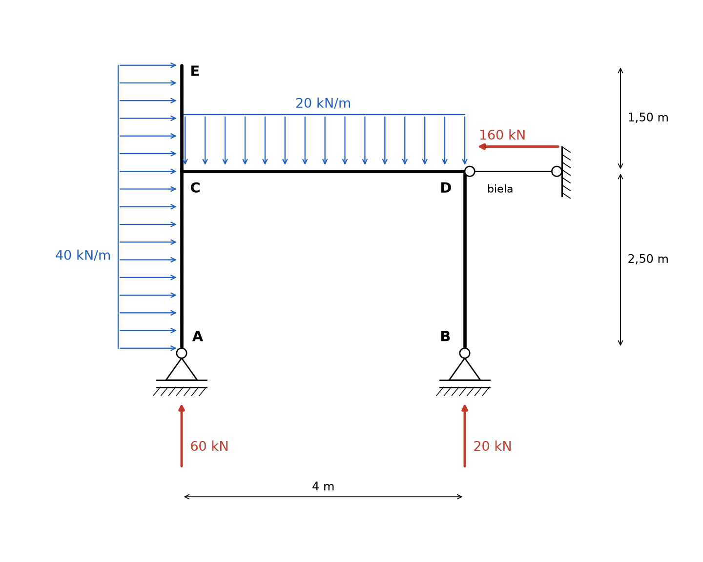
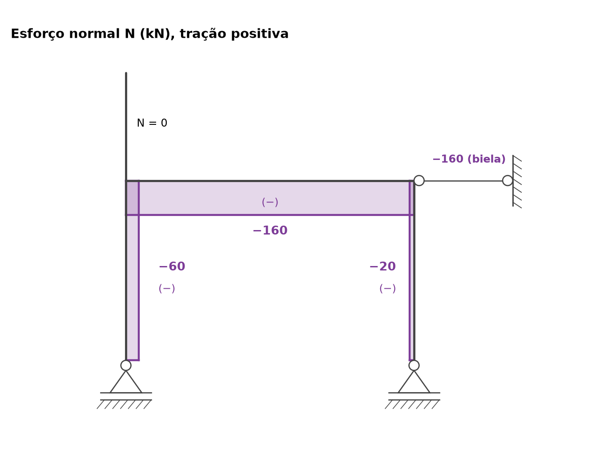
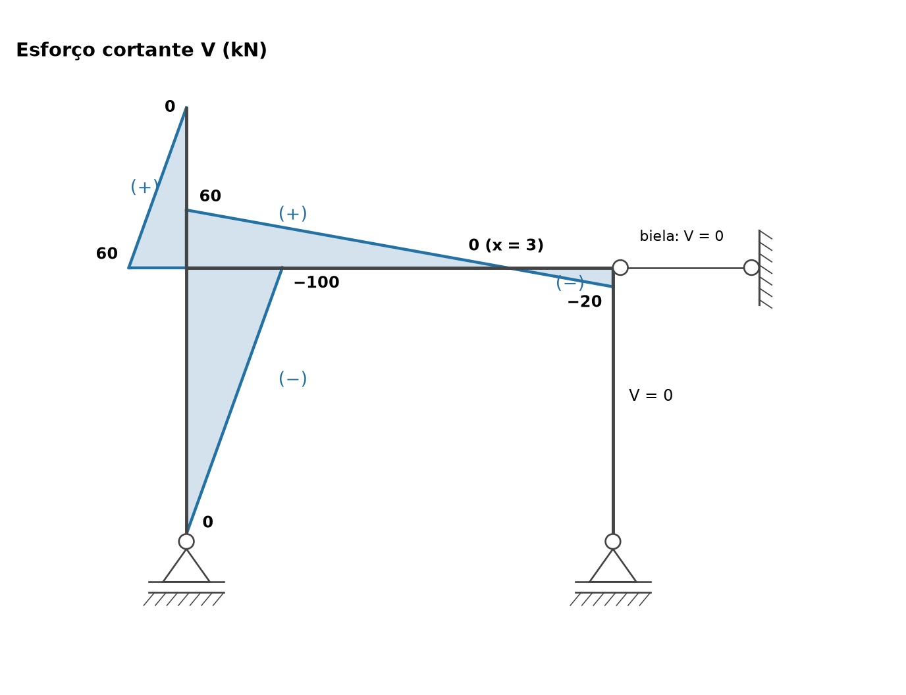
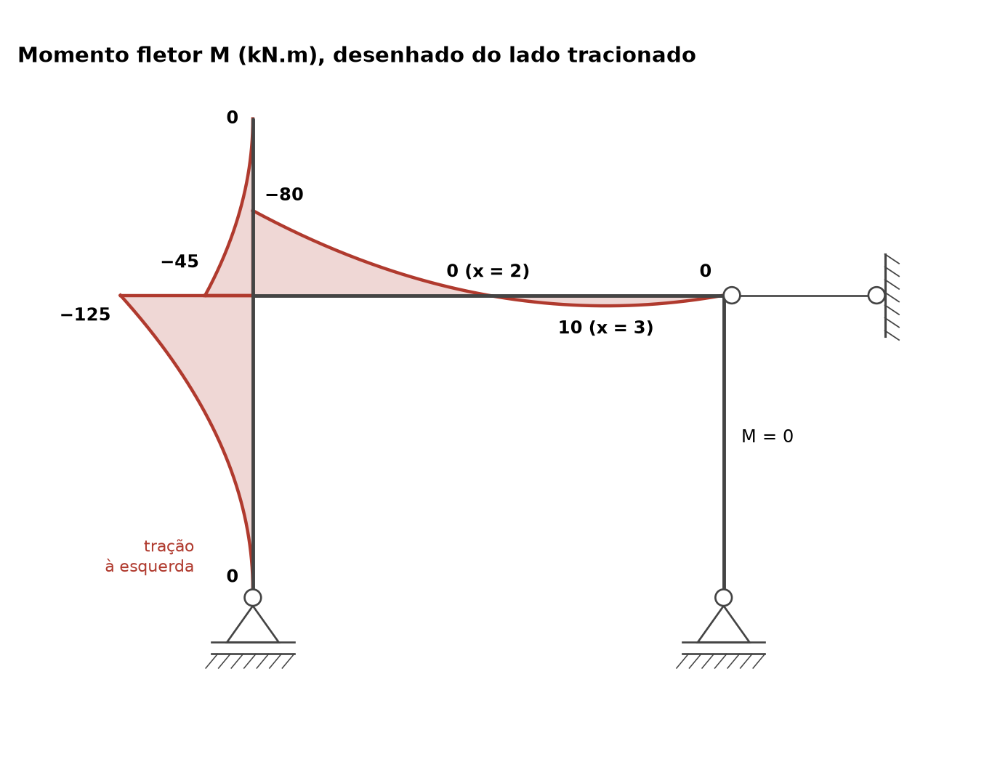

# Lista 3, exercício 05

## 1. Leitura da estrutura

Origem em A, X para a direita e Y para cima (m).

| Ponto | X (m) | Y (m) | O que é |
|---|---|---|---|
| A | 0 | 0 | apoio móvel (1º gênero), reação vertical VA |
| C | 0 | 2,5 | nó rígido onde a viga encontra o pilar da esquerda |
| E | 0 | 4 | topo do pilar, extremidade livre |
| D | 4 | 2,5 | canto rígido viga/pilar, onde se prende a biela horizontal |
| B | 4 | 0 | apoio móvel (1º gênero), reação vertical VB |

Cargas:

- 40 kN/m horizontal, para a direita, em toda a altura do pilar AE (de Y = 0 a Y = 4)
- 20 kN/m vertical, para baixo, em toda a viga CD (4 m)

**Leitura dos vínculos.** Os apoios A e B têm o triângulo sobre uma linha separada da hachura, o mesmo desenho do apoio móvel B do exercício 01 (no apoio fixo o triângulo fica direto sobre a hachura). Então A e B só dão reação vertical. Em D o canto da barra é contínuo (nó rígido), e o círculo encostado nele é a articulação da ponta da biela. A biela é uma barra com rótulas nas duas pontas e sem carga, então só transmite força na direção dela: é um vínculo de 1º gênero horizontal, com reação HD.

São 3 incógnitas (VA, VB, HD) e 3 equações de equilíbrio do pórtico inteiro, que é uma chapa só (sem rótulas internas). As três reações não são paralelas nem concorrentes num ponto, então a estrutura é **isostática**. Se A e B fossem fixos seriam 5 incógnitas, o que confirma a leitura de apoios móveis.

Convenção nas equações de equilíbrio: forças para a direita e para cima positivas, momentos anti-horários positivos.

## 2. Reações

Resultantes das cargas distribuídas:

- pilar: 40 · 4 = 160 kN para a direita, no meio da altura, em Y = 2
- viga: 20 · 4 = 80 kN para baixo, no meio do vão, em X = 2

### 2.1 Força horizontal

Só a biela segura na horizontal:

ΣFx = 0 ⟹ 160 + HD = 0

**HD = −160 kN**, ou seja, 160 kN **para a esquerda**. A biela está do lado direito de D e empurra o nó para longe da parede, então ela trabalha **comprimida** com 160 kN.

### 2.2 Momentos em A

Escolher A elimina VA. Braços de alavanca em relação a A:

- VB (vertical) tem braço horizontal 4 m e gira no sentido anti-horário: +4 VB
- 80 kN (para baixo, em X = 2) tem braço 2 m e gira no sentido horário: −80 · 2
- 160 kN (para a direita, em Y = 2) tem braço vertical 2 m e gira no sentido horário: −160 · 2
- 160 kN da biela (para a esquerda, em Y = 2,5) tem braço vertical 2,5 m e gira no sentido anti-horário: +160 · 2,5

ΣMA = 0 ⟹ 4 VB − 160 − 320 + 400 = 0

**VB = 80/4 = 20 kN** (para cima)

### 2.3 Forças verticais

ΣFy = 0 ⟹ VA + 20 − 80 = 0

**VA = 60 kN** (para cima)

### 2.4 Conferência com momentos em B

Em relação a B (X = 4, Y = 0): VA gira horário com braço 4, 80 kN gira anti-horário com braço 2, 160 kN do pilar gira horário com braço 2, biela gira anti-horário com braço 2,5:

−60 · 4 + 80 · 2 − 160 · 2 + 160 · 2,5 = −240 + 160 − 320 + 400 = 0. Confere.

### 2.5 Forças internas nas ligações

- **Biela em D:** N = −160 kN (compressão), constante, sem cortante nem momento.
- **Pilar DB:** o apoio B não tem reação horizontal e o pilar não tem carga, então ele só carrega força axial: 20 kN de compressão. Em D esse pilar empurra o nó para cima com 20 kN.
- **Nó C:** a viga recebe do pilar, no nó C, 60 kN de força vertical (que é VA subindo pelo pilar), 160 kN de compressão horizontal (soma de 100 kN da parte de baixo do pilar e 60 kN da parte de cima, equilibrada pela biela do outro lado) e um momento de 80 kN.m.

### Resumo

| Reação | Valor | Sentido |
|---|---|---|
| VA | 60 kN | para cima |
| VB | 20 kN | para cima |
| HD (biela) | 160 kN | para a esquerda (biela comprimida) |
| N no pilar DB (interna) | 20 kN | compressão |
| Força da parte de baixo do pilar no nó C | 100 kN horizontal, 60 kN vertical, 125 kN.m | |
| Força da parte de cima do pilar no nó C | 60 kN horizontal, 45 kN.m | |

## 3. Esforços por barra

**Convenção.** Cada barra tem um sentido de percurso e uma fibra de referência (tracejada) do lado de dentro do pórtico. Olhando a barra com o percurso da esquerda para a direita e a fibra tracejada embaixo, valem as regras de viga:

- N positivo quando traciona
- V positivo quando a resultante das forças antes da seção aponta para o lado oposto à fibra tracejada (o "para cima" da barra girada)
- M positivo quando traciona a fibra tracejada (de dentro). O diagrama de M é desenhado sempre do lado tracionado, então não precisa de sinal para ser lido

| Barra | Percurso | Fibra tracejada | V positivo quando as forças antes da seção apontam para |
|---|---|---|---|
| AC (pilar esquerdo, parte de baixo) | de A para C (subindo) | direita | a esquerda |
| CE (pilar esquerdo, parte de cima) | de C para E (subindo) | direita | a esquerda |
| CD (viga) | de C para D | embaixo | cima |
| DB (pilar direito) | de D para B (descendo) | esquerda | baixo (equivale às forças depois da seção apontarem para cima) |

Nos desenhos, N e V positivos ficam do lado de fora do pórtico e negativos do lado de dentro, com o sinal (+) ou (−) escrito.

### Barra AC: 0 < y < 2,5 (y medido a partir de A)

Antes da seção estão VA = 60 kN (para cima, na direção da barra) e a carga horizontal 40 · y para a direita.

- N = −60 kN (VA empurra a barra para cima, compressão)
- V = −40 y (a carga aponta para a direita, que é o lado da fibra tracejada)
- M = −40 y · y/2 = −20 y² (a resultante 40y fica a y/2 da seção)

V(0) = 0, V(2,5) = −100 kN

M(0) = 0, M(2,5) = −125 kN.m

M negativo traciona o lado de fora (esquerda). Faz sentido: com A móvel, não há nada segurando a base na horizontal, então o trecho AC funciona como um balanço pendurado no nó C e empurrado para a direita. A fibra do lado de onde vem a carga (esquerda) é a tracionada.

### Barra CE: 2,5 < y < 4

Mais fácil olhar pela parte de cima: acima da seção só existe a carga 40 · r, com r = 4 − y (distância até a ponta E).

- N = 0 (não há força vertical acima da seção)
- V = 40 r (forças depois da seção apontando para a direita dão V positivo nesta barra)
- M = −40 r · r/2 = −20 r²

V(C) = 60 kN, V(E) = 0

M(C) = −45 kN.m, M(E) = 0

Também é um balanço, agora para cima, tracionado à esquerda.

### Barra CD (viga): 0 < x < 4

Antes da seção está todo o pilar AE com suas cargas, mais a carga da viga até x.

- N = −160 kN (os 160 kN da carga do pilar empurram a viga para a direita, contra a biela)
- V = 60 − 20 x
- M = 60 x − 80 − 10 x²

O termo −80 é o momento da carga do pilar em torno do nó C: a parte de baixo (100 kN a 1,25 m abaixo de C) dá 125 kN.m em um sentido e a parte de cima (60 kN a 0,75 m acima) dá 45 kN.m no outro, sobrando 125 − 45 = 80 kN.m, que traciona a fibra de cima da viga.

V(0) = 60, V(4) = −20 kN. V zera em x = 3 m.

M(0) = −80, M(4) = 0 kN.m

M zera em 10x² − 60x + 80 = 0, ou seja, x² − 6x + 8 = 0, com raízes **x = 2** e x = 4.

Máximo positivo onde V = 0: M(3) = 180 − 80 − 90 = **10 kN.m** (traciona embaixo).

### Barra DB: pilar direito

Sem carga e com apoio B só vertical:

- N = −20 kN
- V = 0
- M = 0

Isso confere com M(D) = 0 na viga: como o pilar DB não tem momento e a biela não tem momento, o canto D só pode ter momento nulo.

### Equilíbrio de momentos no nó C

Os três trechos que chegam em C têm momento tracionando o lado de fora: 125 kN.m no pilar de baixo, 45 kN.m no pilar de cima e 80 kN.m na viga. O pilar de baixo puxa o nó num sentido e os outros dois no sentido contrário:

125 = 45 + 80. Confere.

## 4. Diagramas

| Barra, ponto | N (kN) | V (kN) | M (kN.m) |
|---|---|---|---|
| AC, em A | −60 | 0 | 0 |
| AC, em C | −60 | −100 | −125 (tração à esquerda) |
| CE, em C | 0 | 60 | −45 (tração à esquerda) |
| CE, em E | 0 | 0 | 0 |
| CD, em C | −160 | 60 | −80 (tração em cima) |
| CD, x = 2 | −160 | 20 | 0 |
| CD, x = 3 | −160 | 0 | 10 (tração embaixo) |
| CD, em D | −160 | −20 | 0 |
| DB, toda | −20 | 0 | 0 |
| biela | −160 | 0 | 0 |

Valores extremos: **|M|máx = 125 kN.m** no pilar esquerdo, logo abaixo do nó C, tracionando o lado de fora. Maior momento positivo da viga: **10 kN.m** em x = 3. **|V|máx = 100 kN** no pilar esquerdo logo abaixo de C. **Nmín = −160 kN** (compressão) na viga e na biela.

## 5. Por que as curvas têm essa forma

As relações diferenciais valem em qualquer barra, com x medido no sentido de percurso e q a carga perpendicular à barra (positiva no sentido da fibra tracejada):

- dV/dx = −q: a inclinação do diagrama de V é a carga transversal
- dM/dx = V: a inclinação do diagrama de M é o cortante
- d²M/dx² = −q
- dN/dx = −p, com p a carga na direção da barra

**Normal constante em todas as barras.** Nenhuma barra tem carga na própria direção: a carga de 40 kN/m é perpendicular ao pilar e a de 20 kN/m é perpendicular à viga. Então p = 0 e N é constante em cada barra. O N só muda nos nós, onde chegam forças de outras barras. A viga fica comprimida porque a carga do pilar empurra tudo para a direita e quem segura é a biela, do outro lado.

**Cortante reto em AC, CE e CD.** As três barras têm carga uniforme (q constante), então V é uma reta. No pilar a inclinação é 40 kN por metro, na viga é 20 kN por metro. No pilar DB e na biela não há carga e nem força transversal, por isso V = 0.

**Momento parabólico.** Com q constante, M é uma parábola do 2º grau. A regra prática é que a parábola "embarriga" no sentido em que a carga empurra, como um varal pesado:

- no pilar a carga empurra para a direita, então a curva do diagrama (desenhada à esquerda, lado tracionado) tem a barriga voltada para a direita, para dentro da barra
- na viga a carga empurra para baixo, então a parábola tem a barriga para baixo. Ela começa em −80 (em cima), cruza o eixo em x = 2, desce até +10 em x = 3 e volta a zero em D

**Onde a curva fica tangente ao eixo.** Na ponta livre E e no apoio A o cortante é zero (não há força transversal concentrada ali). Como dM/dx = V, a parábola chega nesses pontos com inclinação zero, tangente à barra. Por isso o diagrama do pilar parece um "chifre" afinando nas pontas e ficando largo perto de C.

**Vértice da parábola da viga.** O extremo local de M fica onde V = 0, em x = 3. Ali M = 10 kN.m é o maior momento positivo. Perto de C o cortante vale 60, a parábola é bem inclinada, e vai achatando até x = 3.

**M = 0 nos pontos certos.**

- A e B são apoios móveis de extremidade, não seguram momento
- E é extremidade livre
- D: o pilar DB não tem momento (nenhuma força transversal) e a biela também não, então o momento na ponta da viga tem que ser zero para o nó D ficar em equilíbrio

**Nó C.** Um nó rígido com três barras não precisa ter momentos iguais nas barras, só precisa que eles se equilibrem. O pilar de baixo leva 125 kN.m, que se dividem em 45 kN.m para o pilar de cima e 80 kN.m para a viga. O diagrama de V salta no nó C porque a viga, que chega perpendicular, aplica no pilar a força axial dela (160 kN) como força transversal ao pilar: −100 embaixo, +60 em cima, diferença de 160.
