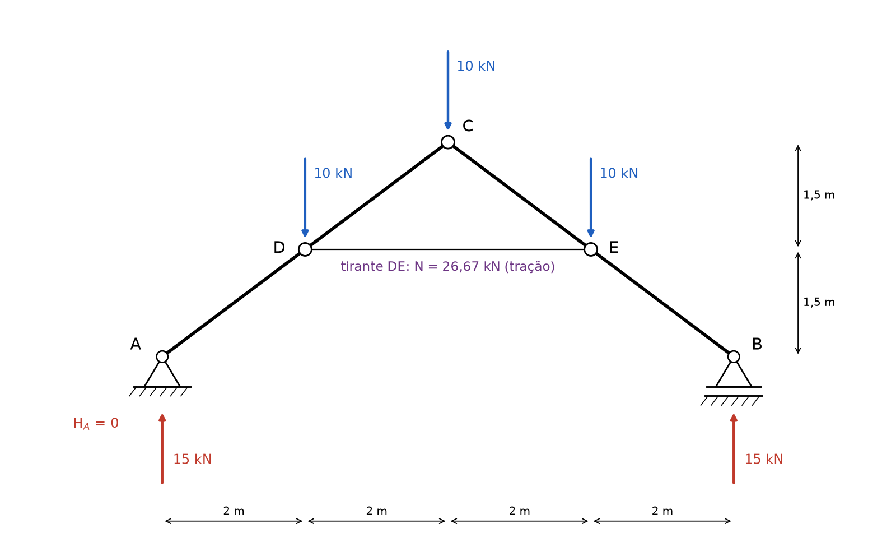
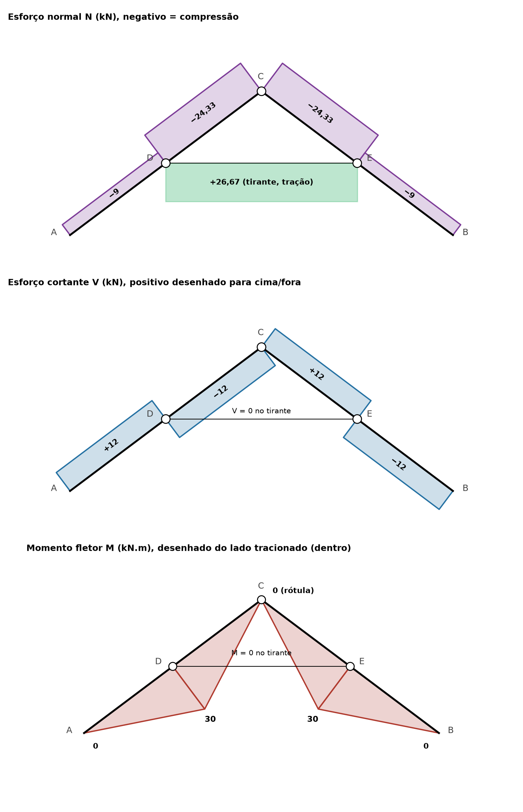

# Lista 3, exercício 06

## 1. Leitura da estrutura

Origem em A, x para a direita e y para cima.

| Ponto | (x, y) em m | O que é |
|---|---|---|
| A | (0, 0) | apoio fixo (2º gênero): reações HA e VA |
| D | (2, 1,5) | força de 10 kN para baixo, ligação articulada do tirante com a barra |
| C | (4, 3) | rótula na cumeeira, força de 10 kN para baixo |
| E | (6, 1,5) | força de 10 kN para baixo, ligação articulada do tirante com a barra |
| B | (8, 0) | apoio móvel (1º gênero, rola na horizontal): reação VB |

A estrutura tem três peças:

- a barra AC (inclinada, contínua de A até C, passando por D)
- a barra CB (inclinada, contínua de C até B, passando por E)
- o tirante DE (horizontal, articulado nas duas pontas e sem carga no meio)

Hipótese de leitura: os pequenos círculos em D e E marcam a ligação articulada do tirante com as barras, e as barras AC e CB seguem contínuas nesses pontos. Se D e E também fossem rótulas das barras, a estrutura viraria um mecanismo.

Geometria das barras inclinadas: cada trecho (AD, DC, CE, EB) tem 2 m na horizontal e 1,5 m na vertical, então comprimento √(2² + 1,5²) = 2,5 m. O ângulo com a horizontal tem cos α = 0,8 e sen α = 0,6.

Como o tirante é articulado nas duas pontas e não tem carga no meio, ele só pode ter força ao longo do próprio eixo: uma única incógnita T (positiva de tração).

Contagem: HA, VA, VB, T e as duas componentes da força na rótula C (HC, VC) dão 6 incógnitas. As duas barras dão 3 equações cada, 6 equações. A estrutura é isostática.

Ordem de resolução: primeiro as 3 equações da estrutura inteira (o tirante e a rótula são internos e não aparecem), depois MC = 0 aplicado à metade esquerda, que dá T, e por fim a força na rótula.

Convenção nas equações: forças para cima e para a direita positivas, momentos anti-horários positivos.

## 2. Reações

### 2.1 Estrutura inteira

ΣFx = 0. Nenhuma carga externa é horizontal e B não segura força horizontal, então **HA = 0**.

ΣMA = 0. As três cargas de 10 kN têm braços iguais às distâncias horizontais até A (2, 4 e 6 m), e VB tem braço 8 m:

VB · 8 − 10 · 2 − 10 · 4 − 10 · 6 = 0

VB · 8 = 120

**VB = 15 kN** (para cima)

ΣFy = 0 ⟹ VA + 15 − 30 = 0

**VA = 15 kN** (para cima)

O resultado é simétrico, como esperado: geometria e cargas são simétricas em relação à vertical por C.

### 2.2 Tirante: momento em C da metade esquerda

Corta-se a estrutura na rótula C e no tirante. Na barra AC atuam:

- VA = 15 kN para cima em A (HA = 0)
- 10 kN para baixo em D
- a força do tirante em D. Tirante tracionado puxa D na direção de E, ou seja, **T para a direita**
- a força da rótula em C (não entra no momento em C)

Braços em relação a C:

- VA é vertical, braço = distância horizontal de A até C = 4 m. Gira no sentido horário em torno de C, entra negativo
- a carga de 10 kN em D é vertical, braço = 2 m. Gira no sentido anti-horário, entra positivo
- T é horizontal, braço = distância vertical de D até C = 3 − 1,5 = 1,5 m. Puxando para a direita abaixo de C, gira no sentido anti-horário, entra positivo

ΣMC = 0 ⟹ −15 · 4 + 10 · 2 + T · 1,5 = 0

T · 1,5 = 40

**T = 80/3 = 26,67 kN** (positivo, então é tração, como deve ser num tirante)

### 2.3 Força na rótula C

Ainda na barra AC, chamando HC e VC as componentes da força que o pino C faz sobre a barra AC:

ΣFx = 0 ⟹ 0 + 26,67 + HC = 0 ⟹ **HC = −26,67 kN** (aponta para a esquerda)

ΣFy = 0 ⟹ 15 − 10 + VC = 0 ⟹ **VC = −5 kN** (aponta para baixo)

A carga de 10 kN em C foi considerada aplicada no pino. Por simetria, o pino empurra a barra CB com 26,67 kN para a direita e 5 kN para baixo. Equilíbrio do pino: as barras empurram o pino com 5 + 5 = 10 kN para cima, que equilibram a carga de 10 kN, e as componentes horizontais (26,67 para cada lado) se anulam.

Leitura física: as duas barras se apoiam uma na outra na cumeeira, comprimindo-se horizontalmente com 26,67 kN, e o tirante segura a abertura das barras puxando D e E um na direção do outro com a mesma força.

### 2.4 Conferência

Barra CB, momentos em C: VB = 15 com braço 4 (anti-horário, +60), carga em E com braço 2 (horário, −20), tirante puxando E para a esquerda com braço 1,5 (horário, −40). Soma: 60 − 20 − 40 = 0. Confere.

Estrutura inteira: ΣFy = 15 + 15 − 3 · 10 = 0, ΣFx = 0, ΣMA = 15 · 8 − 10 · (2 + 4 + 6) = 0. Confere.

### Resumo

| Reação | Valor | Sentido |
|---|---|---|
| HA | 0 | |
| VA | 15 kN | para cima |
| VB | 15 kN | para cima |
| T (interna, tirante DE) | 26,67 kN | tração |
| HC (interna, rótula) | 26,67 kN | empurra AC para a esquerda e CB para a direita |
| VC (interna, rótula) | 5 kN | empurra cada barra para baixo (com a carga de 10 kN no pino) |

## 3. Esforços por trecho

### Convenções

Vetores escritos como (componente x | componente y). Percurso das barras da esquerda para a direita: A → D → C na barra AC e C → E → B na barra CB. Em cada barra, t é o vetor unitário no sentido do percurso e n é a normal girada 90° no sentido anti-horário a partir de t, que aponta para cima e para fora do telhado:

- AC: t = (0,8 | 0,6), n = (−0,6 | 0,8)
- CB: t = (0,8 | −0,6), n = (0,6 | 0,8)

Sendo R a resultante das forças que ficam antes da seção (do lado de onde o percurso vem):

- N = −R · t, positivo de tração
- V = R · n, positivo quando a resultante antes da seção aponta para o lado de n (para cima). É a mesma regra da viga, com "para cima" trocado por "perpendicular à barra, para fora"
- M positivo quando traciona a fibra de baixo (lado de dentro do telhado, oposto a n), desenhado do lado tracionado

Não há carga distribuída, então em cada trecho N e V são constantes e M é linear. Chamando s a distância ao longo da barra a partir do início do trecho (de 0 a 2,5 m), M = Minício + V · s.

### Trecho AD

R = VA = (0 | 15).

- N = −(0 · 0,8 + 15 · 0,6) = **−9 kN** (compressão)
- V = 0 · (−0,6) + 15 · 0,8 = **+12 kN**
- M = 12 · s, M(A) = 0, M(D) = 12 · 2,5 = **30 kN.m**

Conferência de M(D) como na viga: 15 kN vezes o braço horizontal de 2 m dá 30 kN.m.

### Trecho DC

Em D entram a carga de 10 kN (para baixo) e a força do tirante (26,67 para a direita). R = (26,67 | 15 − 10) = (26,67 | 5).

- N = −(26,67 · 0,8 + 5 · 0,6) = −(21,33 + 3) = **−24,33 kN** (compressão)
- V = 26,67 · (−0,6) + 5 · 0,8 = −16 + 4 = **−12 kN**
- M = 30 − 12 · s, M(D) = 30, M(C) = 30 − 30 = **0** (confere com a rótula)

### Trecho CE

As forças antes da seção são as da barra CB que vêm de C: a força do pino sobre CB, R = (26,67 | −5).

- N = −(26,67 · 0,8 + (−5) · (−0,6)) = −(21,33 + 3) = **−24,33 kN**
- V = 26,67 · 0,6 + (−5) · 0,8 = 16 − 4 = **+12 kN**
- M = 0 + 12 · s, M(C) = 0, M(E) = **30 kN.m**

### Trecho EB

Em E entram a carga de 10 kN e o tirante puxando E para a esquerda. R = (26,67 − 26,67 | −5 − 10) = (0 | −15).

- N = −(0 + (−15) · (−0,6)) = **−9 kN**
- V = 0 + (−15) · 0,8 = **−12 kN**
- M = 30 − 12 · s, M(E) = 30, M(B) = **0** (confere com o apoio)

Conferência pela direita: em B, VB = 15 kN para cima tem componente 15 · 0,6 = 9 ao longo da barra (empurra B para dentro dela, compressão de 9) e 15 · 0,8 = 12 perpendicular. Confere.

### Tirante DE

N = **+26,67 kN** (tração) em todo o comprimento, V = 0, M = 0.

### Saltos em D e E

Em D chegam a carga de 10 kN e o tirante. Componentes ao longo de t e de n:

- carga (0 | −10): ao longo de t, −10 · 0,6 = −6. Perpendicular, −10 · 0,8 = −8
- tirante (26,67 | 0): ao longo de t, 26,67 · 0,8 = 21,33. Perpendicular, 26,67 · (−0,6) = −16

V salta −8 − 16 = −24 (de +12 para −12). N salta −(−6 + 21,33) = −15,33 (de −9 para −24,33). Em E acontece o mesmo, espelhado.

### Equilíbrio dos nós

- D e E: a barra é contínua e o tirante é articulado, então o tirante não leva momento e o momento da barra é o mesmo dos dois lados: MAD(D) = MDC(D) = 30 kN.m e MCE(E) = MEB(E) = 30 kN.m.
- C: rótula, as duas barras chegam com M = 0.

## 4. Diagramas

Os diagramas estão desenhados sobre a geometria, perpendiculares a cada barra. N tem o módulo desenhado para fora e o sinal escrito. V positivo é desenhado do lado de n (para fora), negativo para dentro. M é desenhado do lado tracionado, que aqui é sempre o de dentro do telhado.

| Trecho | N (kN) | V (kN) | M no início (kN.m) | M no fim (kN.m) |
|---|---|---|---|---|
| AD | −9 | +12 | 0 (A) | 30 (D) |
| DC | −24,33 | −12 | 30 (D) | 0 (C) |
| CE | −24,33 | +12 | 0 (C) | 30 (E) |
| EB | −9 | −12 | 30 (E) | 0 (B) |
| DE (tirante) | +26,67 | 0 | 0 | 0 |

Valores extremos: **Mmáx = 30 kN.m** em D e em E (tracionando a face de dentro), **Nmín = −24,33 kN** (compressão) nos trechos DC e CE, **Nmáx = +26,67 kN** no tirante e **|V|máx = 12 kN** em todos os trechos inclinados.

## 5. Por que as curvas têm essa forma

Ao longo de cada barra valem as mesmas relações da viga, medindo s ao longo do eixo e q como a carga perpendicular à barra por metro:

- dV/ds = −q
- dM/ds = V
- d²M/ds² = −q

e, para o normal, dN/ds = −p, sendo p a carga ao longo da barra.

**Sem carga distribuída:** todas as cargas são concentradas (as três de 10 kN, as reações e as forças do tirante). Entre elas q = 0 e p = 0, então N e V são constantes (retângulos no diagrama) e M é uma reta em cada trecho. Por isso o diagrama de M é formado por triângulos, sem nenhuma curva.

**Inclinação de M:** como dM/ds = V e |V| = 12 kN em todos os trechos, M cresce 12 kN.m por metro de barra de A até D (V = +12) e cai 12 kN.m por metro de D até C (V = −12). Em 2,5 m isso dá exatamente os 30 kN.m.

**Bicos em D e E:** ali entram forças concentradas (carga e tirante) com componente perpendicular à barra de 24 kN no total. V salta 24 kN, de +12 para −12, então M muda de inclinação de repente: sobe até D e passa a descer. É o bico do triângulo, e é onde o momento é máximo, porque V muda de sinal nesse ponto.

**Saltos em N:** a componente das forças concentradas ao longo da barra faz N saltar. Em D o tirante empurra 21,33 kN no sentido do percurso e a carga puxa 6 kN no sentido contrário, então a compressão aumenta 15,33 kN, de 9 para 24,33. A parte de cima das barras é mais comprimida porque recebe o empuxo horizontal de 26,67 kN da outra barra na cumeeira.

**Zeros de M:**

- em A e B, apoios de extremidade articulados, que não seguram momento
- em C, rótula, que não transmite momento
- no tirante inteiro, que é articulado nas pontas e não tem carga transversal (barra biarticulada só tem força normal)

**Por que o momento traciona por dentro e vale 30 em D:** antes de D só atua VA = 15 kN, vertical, com braço horizontal de 2 m até D. Ela gira o trecho AD no sentido de abrir a face de baixo, então M(D) = 15 · 2 = 30 kN.m tracionando por dentro. O tirante entra exatamente em D, por isso não diminui o momento ali. Ele age no trecho DC: o seu braço de 1,5 m até C compensa o momento de VA e da carga em D, e faz M voltar a zero na rótula.

Sem o tirante a estrutura não ficaria de pé: as barras abririam empurrando A e B para fora, e o apoio móvel B não segura força horizontal. O tirante faz o papel do empuxo horizontal que um segundo apoio fixo daria.

**Simetria:** estrutura e cargas são simétricas em relação à vertical por C. Então N e M são simétricos (mesmos valores nos dois lados) e V é antissimétrico (troca de sinal), que é o que aparece nos diagramas.
