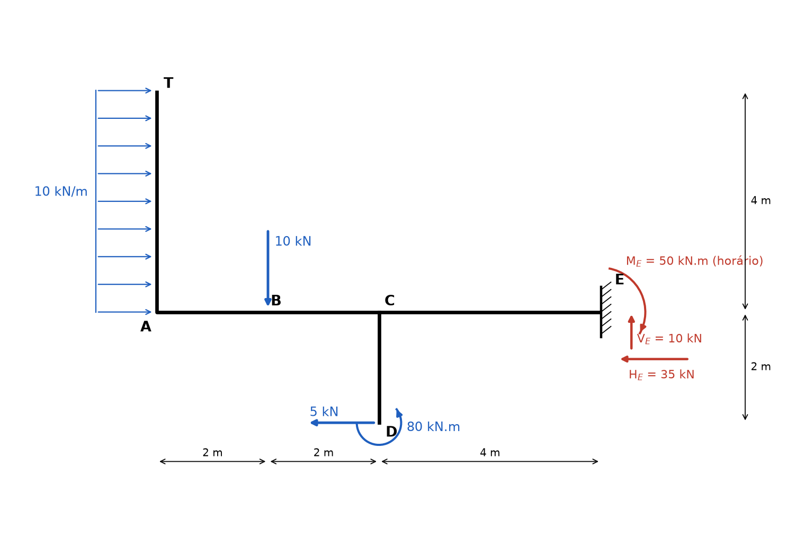
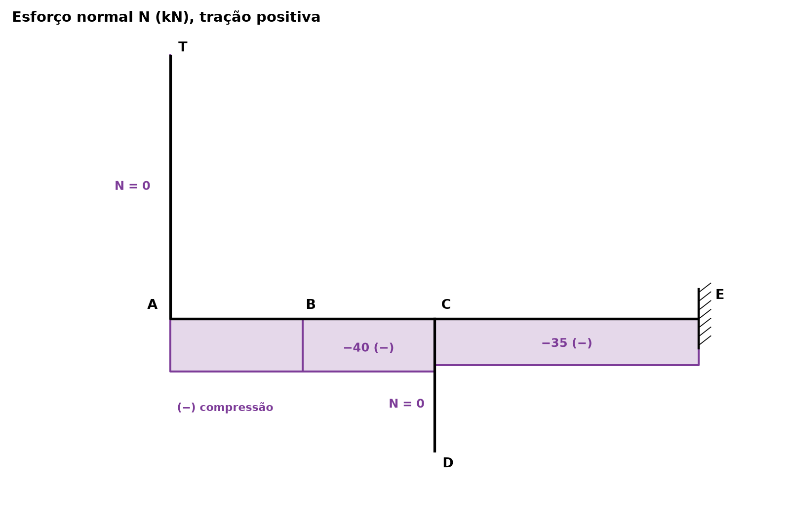
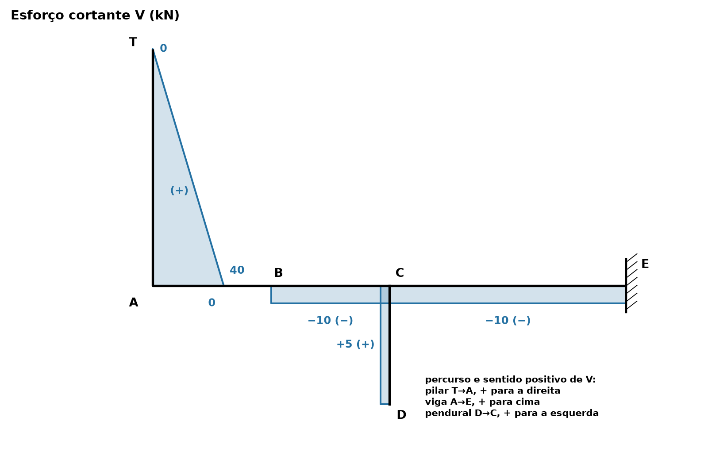
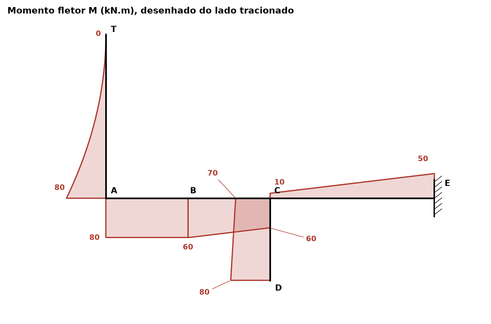

# Lista 3, exercício 07

## 1. Leitura da estrutura

Origem no canto A, x para a direita e y para cima.

| Ponto | (x, y) em m | O que é |
|---|---|---|
| T | (0, 4) | topo do pilar, extremidade livre |
| A | (0, 0) | nó rígido entre o pilar e a viga |
| B | (2, 0) | força concentrada de 10 kN para baixo |
| C | (4, 0) | nó rígido entre a viga e o pendural (barra que desce até D) |
| D | (4, −2) | extremidade livre do pendural: força de 5 kN para a esquerda e momento de 80 kN.m anti-horário |
| E | (8, 0) | engaste: reações HE, VE e ME |

Carga distribuída de 10 kN/m, horizontal para a direita, ao longo de todo o pilar AT (4 m). Resultante 10 · 4 = 40 kN, aplicada no meio do pilar, em (0, 2).

O sentido do momento de 80 kN.m foi lido pela seta da figura: o arco sai do lado esquerdo, passa por baixo do ponto D e termina subindo pelo lado direito, então gira no sentido **anti-horário**.

São 3 incógnitas (HE, VE, ME) e 3 equações de equilíbrio. Não há rótulas, e todas as ligações (A e C) são nós rígidos. A estrutura é uma única chapa engastada em E, sem vínculos sobrando nem faltando: é **isostática**.

Como o engaste é o único apoio, as reações saem direto do equilíbrio da estrutura inteira. As "reações internas" são os esforços que cada barra passa para a outra nos nós A e C, calculados na seção 2.4.

Convenção nas equações de equilíbrio: forças para a direita e para cima positivas, momentos anti-horários positivos.

## 2. Reações

### 2.1 Força horizontal

Forças horizontais: 40 kN para a direita (distribuída), 5 kN para a esquerda (em D) e HE.

ΣFx = 0 ⟹ 40 − 5 + HE = 0

**HE = −35 kN**, ou seja, 35 kN **para a esquerda**.

### 2.2 Força vertical

A única carga vertical é a de 10 kN em B.

ΣFy = 0 ⟹ −10 + VE = 0

**VE = 10 kN** (para cima)

### 2.3 Momentos em E

Tomando momentos em E, HE e VE não entram (passam por E). Braço de cada carga:

- 40 kN para a direita, aplicado em y = 2: braço vertical de 2 m até a linha da viga. Empurra para a direita acima de E, girando no sentido horário: −40 · 2 = −80
- 10 kN para baixo em x = 2: braço horizontal de 8 − 2 = 6 m. Força para baixo à esquerda de E gira no sentido anti-horário: +10 · 6 = +60
- 5 kN para a esquerda, aplicado em y = −2: braço vertical de 2 m. Força para a esquerda abaixo de E gira no sentido horário: −5 · 2 = −10
- momento aplicado de 80 kN.m anti-horário: +80 (um binário tem o mesmo valor em relação a qualquer ponto)

ΣME = 0 ⟹ −80 + 60 − 10 + 80 + ME = 0

**ME = −50 kN.m**, ou seja, 50 kN.m no sentido **horário**.

### 2.4 Conferência pelos momentos em A

Com as reações já achadas, ΣMA tem que dar zero:

- 40 kN em y = 2: −40 · 2 = −80
- 10 kN para baixo em x = 2: −10 · 2 = −20
- 5 kN para a esquerda em y = −2: −5 · 2 = −10
- binário: +80
- VE = 10 para cima em x = 8: +10 · 8 = +80
- HE = 35 para a esquerda em y = 0: braço zero
- ME: −50

Soma: −80 − 20 − 10 + 80 + 80 − 50 = 0. Confere.

### 2.5 Ligações internas (nós A e C)

**Nó A (pilar sobre a viga).** Cortando o pilar logo acima de A, a parte de cima recebe só a distribuída: 40 kN para a direita a 2 m do corte. Então o pilar entrega ao nó A uma força de **40 kN para a direita** e um momento de 40 · 2 = **80 kN.m** (horário, visto de quem está no nó). Esses 40 kN chegam na viga como força axial (compressão) e os 80 kN.m como momento fletor.

**Nó C (pendural sobre a viga).** Cortando o pendural logo abaixo de C, a parte de baixo tem 5 kN para a esquerda e 80 kN.m anti-horário. O momento dessa parte em relação a C é +80 (binário) − 5 · 2 (força para a esquerda 2 m abaixo de C, horária) = **70 kN.m anti-horário**. O pendural entrega ao nó C **5 kN para a esquerda** e **70 kN.m anti-horário**. A força de 5 kN reduz a compressão da viga de 40 para 35 kN e o momento faz o M da viga saltar 70 kN.m em C.

### Resumo

| Reação | Valor | Sentido |
|---|---|---|
| HE | 35 kN | para a esquerda |
| VE | 10 kN | para cima |
| ME | 50 kN.m | horário |
| pilar → nó A (interna) | 40 kN e 80 kN.m | força para a direita, momento horário |
| pendural → nó C (interna) | 5 kN e 70 kN.m | força para a esquerda, momento anti-horário |

## 3. Esforços por barra

### Convenções

Cada barra recebe um sentido de percurso. Imagine a barra girada até o percurso ficar da esquerda para a direita, e aplique a convenção de viga do ex01:

- N positivo quando traciona
- V positivo quando a resultante das forças do lado de onde se vem (início do percurso), na direção perpendicular à barra, aponta para o "cima" da barra girada, que é a normal à esquerda de quem caminha no sentido do percurso
- M positivo quando traciona a fibra de "baixo" da barra girada (normal à direita do percurso). O diagrama é desenhado sempre do lado tracionado

| Barra | Percurso | Coordenada | V positivo quando o lado de trás empurra para | Fibra que M positivo traciona |
|---|---|---|---|---|
| pilar | T → A (de cima para baixo) | s = distância a partir de T | a direita | face esquerda (externa) |
| viga | A → E | x = distância a partir de A | cima | face de baixo |
| pendural | D → C (de baixo para cima) | t = distância a partir de D | a esquerda | face direita |

O pilar e o pendural foram percorridos a partir da ponta livre para que o lado de trás de cada corte tenha só cargas conhecidas.

A carga do pilar é horizontal e o pilar é vertical, então ela é inteira perpendicular à barra (não há decomposição a fazer). Não há barras inclinadas.

### Pilar T → A (0 < s < 4)

Acima do corte há 10 · s kN para a direita, com braço s/2.

- N = 0 (nenhuma força na direção do pilar)
- V = 10s
- M = 10s · s/2 = 5s² (traciona a face esquerda, a de onde vem a carga)

V(0) = 0, V(4) = 40 kN

M(0) = 0, M(2) = 20, M(4) = **80 kN.m**

### Viga, trecho AB (0 < x < 2)

À esquerda do corte está o pilar inteiro: 40 kN para a direita em y = 2.

- N = −40 kN (os 40 kN empurram a viga contra o engaste: compressão)
- V = 0 (não há força vertical à esquerda)
- M = 40 · 2 = 80 kN.m (constante, o braço da força de 40 kN até a viga é sempre 2 m, qualquer que seja x)

### Viga, trecho BC (2 < x < 4)

Entra a força de 10 kN para baixo em B.

- N = −40 kN
- V = −10 kN
- M = 80 − 10(x − 2)

M(2) = 80, M(4−) = 60 kN.m

### Pendural D → C (0 < t < 2)

Abaixo do corte há 5 kN para a esquerda e o binário de 80 kN.m anti-horário.

- N = 0 (nenhuma força vertical no pendural)
- V = +5 kN (a força de trás aponta para a esquerda, que é o sentido positivo dessa barra)
- M = −80 + 5t. O binário anti-horário dá −80 (traciona a face esquerda) e a força de 5 kN, com braço t, dá +5t

M(0) = −80 kN.m (em D, logo depois do binário), M(2) = **−70 kN.m**

Os dois valores são negativos: o pendural inteiro tem a face **esquerda** tracionada.

### Viga, trecho CE (4 < x < 8)

À esquerda do corte entram agora também as cargas do pendural.

- N = −40 + 5 = −35 kN
- V = −10 kN (o pendural não traz força vertical)
- M = 60 − 70 − 10(x − 4) = −10 − 10(x − 4)

M(4+) = −10, M(8) = **−50 kN.m**

Conferência pela direita, em E: N(8) = −35 = HE (35 kN para a esquerda puxa a ponta direita contra a viga, compressão), V(8) = −VE = −10, M(8) = ME = −50 (horário na ponta direita traciona a face de cima). Confere.

### Equilíbrio dos nós

**Nó A:** o pilar chega com 80 kN.m tracionando a face esquerda e a viga sai com 80 kN.m tracionando a face de baixo. As duas faces são o lado de fora do canto, então o momento contorna o nó sem mudar de valor. O cortante do pilar em A (40 kN, horizontal) vira o normal da viga (−40 kN) e o normal do pilar (0) vira o cortante da viga em AB (0).

**Nó C:** viga à esquerda com M = 60 (traciona embaixo), viga à direita com M = −10 (traciona em cima), pendural com 70 (traciona a face esquerda). Balanço: 60 − 70 = −10. Confere. Em força horizontal: −40 + 5 = −35.

## 4. Diagramas

| Barra | Seção | N (kN) | V (kN) | M (kN.m) | Fibra tracionada |
|---|---|---|---|---|---|
| pilar | T (s = 0) | 0 | 0 | 0 | |
| pilar | s = 2 | 0 | 20 | 20 | esquerda |
| pilar | A (s = 4) | 0 | 40 | 80 | esquerda |
| viga | A (x = 0) | −40 | 0 | 80 | baixo |
| viga | B (x = 2) | −40 | 0 → −10 | 80 | baixo |
| viga | C− (x = 4) | −40 | −10 | 60 | baixo |
| viga | C+ (x = 4) | −35 | −10 | −10 | cima |
| viga | E (x = 8) | −35 | −10 | −50 | cima |
| pendural | D (t = 0) | 0 | 5 | −80 | esquerda |
| pendural | C (t = 2) | 0 | 5 | −70 | esquerda |

Valores extremos: **Nmín = −40 kN** (compressão na viga entre A e C). **|V|máx = 40 kN** no pé do pilar. **Mmáx = 80 kN.m** no nó A (pilar e trecho AB inteiro) e **80 kN.m** em D (pendural, face esquerda). No engaste, 50 kN.m tracionando em cima.

## 5. Por que as curvas têm essa forma

Em cada barra valem dV/ds = −q, dM/ds = V e d²M/ds² = −q, com s no sentido do percurso e q positivo quando aponta para o "baixo" da barra girada.

**Pilar (carga uniforme):** a carga de 10 kN/m é perpendicular ao pilar e constante, então V é uma reta (de 0 em T a 40 em A) e M é uma parábola do 2º grau (5s²). Em T a ponta é livre e sem força concentrada, então V = 0 e M = 0. Como V = 0 ali, a parábola sai de T **tangente ao eixo** e vai ficando cada vez mais inclinada para baixo, porque V cresce. A parábola embarriga no sentido da carga (para a direita, em direção ao eixo do pilar), como um varal pesado: por isso a curva fica "por dentro" da reta que ligaria 0 a 80. No meio do pilar M vale só 20, e não 40, porque cresce com o quadrado de s.

**Viga e pendural (sem carga distribuída):** q = 0, então V é constante em cada trecho e M é uma reta.

- Em AB, V = 0, então M é constante (80). A força de 40 kN do pilar tem sempre o mesmo braço (2 m) até a viga, por isso o momento não muda ao longo de AB.
- Em BC e CE, V = −10, então M desce 10 kN.m por metro (com positivo desenhado embaixo, a reta sobe em direção à face de cima). As retas de BC e CE são **paralelas**, porque V é o mesmo nos dois lados de C.
- No pendural, V = 5 é constante, e M é uma reta que vai de −80 a −70.

**Bicos e saltos:**

- **Força concentrada de 10 kN em B:** V salta de 0 para −10 e M forma um bico (passa de horizontal a inclinado), sem salto.
- **Momento concentrado de 80 kN.m em D:** é aplicado na ponta livre do pendural, então M já começa em 80 (face esquerda) ali, em vez de zero. V não é afetado por momento concentrado.
- **Força de 5 kN em D:** como D é ponta livre, o cortante do pendural começa direto em 5 kN.
- **Nó C:** o pendural despeja 70 kN.m na viga, então o M da viga dá um salto de 70 (de 60 tracionando embaixo para 10 tracionando em cima). Como as forças que o pendural traz são só horizontais, V da viga não salta, mas N salta de −40 para −35.
- **Nó A (canto rígido):** o momento passa do pilar para a viga com o mesmo valor (80), sempre do lado de fora do canto. O cortante do pilar vira normal da viga.
- **Engaste E:** é o único lugar que segura momento externo, e lá M = 50 kN.m, igual à reação ME.
- **Pontas livres:** em T, M = 0 e V = 0. Em D, M e V não são zero porque há carga concentrada (força e binário) aplicada exatamente na ponta.
