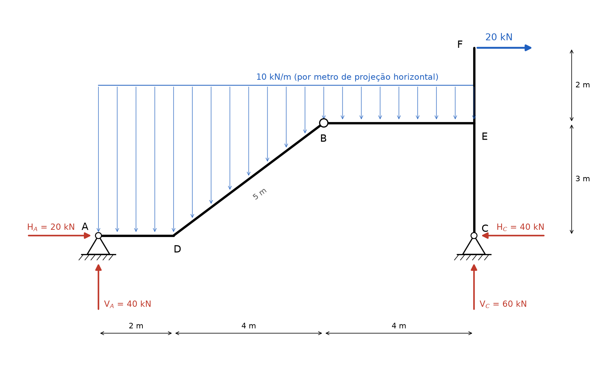
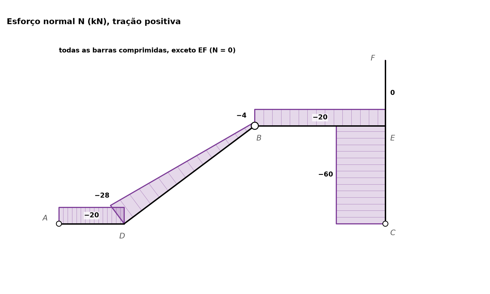
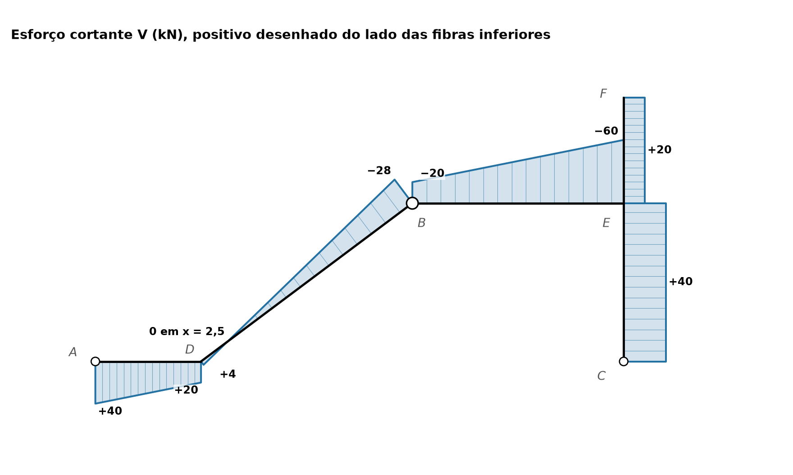
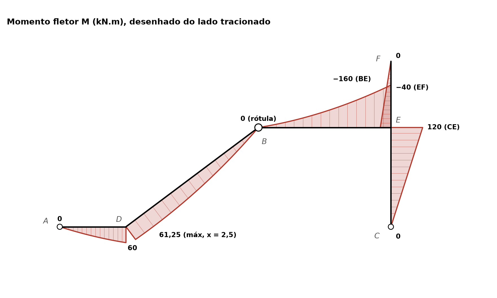

# Lista 3, exercício 08

## 1. Leitura da estrutura

Origem em A, eixo x para a direita e eixo y para cima.

| Ponto | (x, y) em m | O que é |
|---|---|---|
| A | (0, 0) | apoio fixo (2º gênero): reações HA e VA |
| D | (2, 0) | nó rígido onde a barra horizontal AD vira a barra inclinada DB |
| B | (6, 3) | rótula: MB = 0, transmite força horizontal e vertical |
| E | (10, 3) | nó rígido onde a barra BE encontra a coluna CF |
| C | (10, 0) | apoio fixo (2º gênero): reações HC e VC |
| F | (10, 5) | topo da coluna, força de 20 kN horizontal para a direita |

Barras: AD (2 m), DB (inclinada, 4 m na horizontal e 3 m na vertical, comprimento 5 m), BE (4 m), CE (3 m) e EF (2 m). Na barra DB, cos α = 4/5 = 0,8 e sen α = 3/5 = 0,6.

Os dois apoios são de 2º gênero: no desenho o triângulo está assentado direto sobre a hachura, igual ao apoio A do exercício 01 (o apoio móvel tem uma linha separando o triângulo da hachura).

**Hipótese sobre a carga:** a carga de 10 kN/m está desenhada como uma faixa horizontal de x = 0 até x = 10, cobrindo AD, DB e BE. A leitura adotada é **10 kN/m por metro de projeção horizontal** (como telhado ou laje de escada). Assim a resultante é 10 · 10 = 100 kN, aplicada em x = 5. Na barra inclinada isso equivale a 10 · 4/5 = 8 kN/m por metro de comprimento da barra, vertical.

São 4 incógnitas (HA, VA, HC, VC) e 4 equações: as 3 de equilíbrio do pórtico inteiro mais MB = 0 da rótula. A estrutura é isostática (pórtico triarticulado: articulações em A, B e C, não alinhadas).

Ordem de resolução: com ΣMA do conjunto sai VC (as duas forças horizontais dos apoios estão na mesma altura y = 0, então HC não entra). ΣFy dá VA. Depois a rótula, olhando só a parte esquerda (A, D, B), dá HA. Por fim ΣFx dá HC.

Convenção nas equações: forças para a direita e para cima positivas, momentos anti-horários positivos.

## 2. Reações

### 2.1 Momentos em A, pórtico inteiro

Cargas e braços em relação a A:

- resultante da distribuída: 100 kN para baixo, linha de ação em x = 5, braço 5 m, gira no sentido horário
- 20 kN para a direita em F, a 5 m acima de A (braço vertical 5 m), gira no sentido horário
- VC para cima em x = 10, braço 10 m, anti-horário
- HA, VA passam por A e HC está na altura de A (y = 0), então nenhuma delas tem braço

ΣMA = 0 ⟹ VC · 10 − 100 · 5 − 20 · 5 = 0

VC · 10 = 500 + 100 = 600

**VC = 60 kN** (para cima)

### 2.2 Forças verticais

ΣFy = 0 ⟹ VA + 60 − 100 = 0

**VA = 40 kN** (para cima)

### 2.3 Rótula B, parte esquerda (A, D, B)

A parte esquerda recebe a carga distribuída de x = 0 até x = 6: 10 · 6 = 60 kN, em x = 3. Em B atua a força que a parte direita faz pela rótula, mas ela passa por B e não dá momento em B.

Braços em relação a B, que está em (6, 3):

- VA = 40 para cima, a 6 m à esquerda de B: horário, −40 · 6
- HA para a direita, a 3 m abaixo de B: uma força para a direita abaixo do ponto gira no sentido anti-horário, +HA · 3
- 60 kN para baixo, a 3 m à esquerda de B: anti-horário, +60 · 3

ΣMB (parte esquerda) = 0 ⟹ −40 · 6 + HA · 3 + 60 · 3 = 0

HA · 3 = 240 − 180 = 60

**HA = 20 kN** (para a direita, empurra a estrutura para dentro)

### 2.4 Forças horizontais

ΣFx = 0 ⟹ 20 + HC + 20 = 0

**HC = −40 kN**, ou seja, 40 kN **para a esquerda**. O apoio C segura a força de 20 kN do topo e ainda equilibra o empurrão de 20 kN que vem de A.

### 2.5 Força interna na rótula B

Equilíbrio da parte esquerda, chamando HB e VB a força que a parte direita faz sobre ela em B:

ΣFx = 0 ⟹ 20 + HB = 0 ⟹ HB = −20 kN (para a esquerda)

ΣFy = 0 ⟹ 40 − 60 + VB = 0 ⟹ VB = 20 kN (para cima)

Pela ação e reação, a parte esquerda empurra a parte direita em B com 20 kN para a direita e 20 kN para baixo. A rótula trabalha comprimida nas duas direções: as duas metades se apoiam uma na outra, como num arco.

### 2.6 Conferências

Momentos em B da parte direita (B, E, C, F), que também têm que dar zero. Braços em relação a B (6, 3):

- VC = 60 para cima, a 4 m à direita: +60 · 4 = +240
- HC = 40 para a esquerda, a 3 m abaixo: força para a esquerda abaixo do ponto gira no sentido horário, −40 · 3 = −120
- carga sobre BE, 10 · 4 = 40 kN para baixo em x = 8, a 2 m à direita: −40 · 2 = −80
- 20 kN para a direita em F, 2 m acima de B: horário, −20 · 2 = −40

Soma: 240 − 120 − 80 − 40 = 0. Confere.

Pórtico inteiro: ΣFx = 20 − 40 + 20 = 0 e ΣFy = 40 + 60 − 100 = 0. Confere.

### Resumo

| Reação | Valor | Sentido |
|---|---|---|
| HA | 20 kN | para a direita |
| VA | 40 kN | para cima |
| HC | 40 kN | para a esquerda |
| VC | 60 kN | para cima |
| HB (interna, rótula) | 20 kN | para a esquerda na parte ADB, para a direita na parte BEF |
| VB (interna, rótula) | 20 kN | para cima na parte ADB, para baixo na parte BEF |

## 3. Esforços por barra

### Convenções

Cada barra tem um sentido de percurso. Para quem anda nesse sentido, a **fibra inferior** é a da direita. O "lado de antes" da seção é o trecho já percorrido.

| Barra | Percurso | Fibra inferior fica |
|---|---|---|
| AD | A → D (para a direita) | embaixo |
| DB | D → B (subindo para a direita) | embaixo, do lado de fora da rampa |
| BE | B → E (para a direita) | embaixo |
| CE | C → E (para cima) | à direita (lado de fora do pórtico) |
| EF | E → F (para cima) | à direita |

- N positivo quando traciona.
- V positivo quando a resultante das forças do lado de antes, projetada na direção perpendicular à barra, aponta para a esquerda de quem percorre (para cima nas barras horizontais, para a esquerda na coluna). Nas barras horizontais é a mesma convenção do exercício 01.
- M positivo quando traciona a fibra inferior. O diagrama de M é desenhado do lado tracionado.

Nas expressões de AD, DB e BE uso a coordenada horizontal x. Na coluna uso a altura y.

### Barra AD (0 < x < 2)

Forças antes da seção: HA = 20 para a direita, VA = 40 para cima e a carga 10x.

- N = −20 kN (HA empurra a barra: compressão)
- V = 40 − 10x
- M = 40x − 5x²

V(0) = 40, V(2) = 20 kN. M(0) = 0, M(2) = 80 − 20 = 60 kN.m. V não zera no trecho (zeraria em x = 4), então M só cresce.

### Barra DB (2 < x < 6, comprimento 5 m)

Carga na barra: 8 kN/m por metro de barra, vertical. Decomposta:

- perpendicular à barra: 8 · cos α = 8 · 0,8 = 6,4 kN/m
- paralela à barra, apontando para baixo da rampa (de B para D): 8 · sen α = 8 · 0,6 = 4,8 kN/m

A resultante das forças antes da seção é R = (20, 40 − 10x) em (horizontal, vertical). Projetando na direção da barra t = (0,8, 0,6) e na perpendicular n = (−0,6, 0,8):

- N = −(0,8 · 20 + 0,6 · (40 − 10x)) = 6x − 40
- V = −0,6 · 20 + 0,8 · (40 − 10x) = 20 − 8x

Para M, somam-se os momentos de HA, VA e da carga em relação à seção, que está na altura y = 0,75(x − 2). VA tem braço x, HA tem braço y (está abaixo da seção e empurra para a direita, o que traciona a fibra de cima, por isso entra negativo) e a carga 10x tem braço x/2:

- M = 40x − 20 · 0,75(x − 2) − 5x² = −5x² + 25x + 30

Valores:

| x | s (m, ao longo da barra a partir de D) | N (kN) | V (kN) | M (kN.m) |
|---|---|---|---|---|
| 2 (D) | 0 | −28 | 4 | 60 |
| 2,5 | 0,625 | −25 | 0 | 61,25 (máximo) |
| 6 (B) | 5 | −4 | −28 | 0 (rótula) |

V zera em 20 − 8x = 0, x = 2,5 m. Ali M tem o máximo da barra: M = −31,25 + 62,5 + 30 = 61,25 kN.m. Conferências com a carga decomposta: V cai 6,4 kN por metro de barra (4 − 6,4 · 5 = −28) e N cresce 4,8 kN por metro de barra (−28 + 4,8 · 5 = −4).

Mudança em D: a força interna é a mesma dos dois lados do nó, R = (20, 20), mas a barra muda de direção. Na AD ela se divide em N = −20 e V = 20. Na DB, projetada nos eixos da rampa, vira N = −(16 + 12) = −28 e V = −12 + 16 = 4. Por isso N e V saltam em D sem nenhuma força concentrada ali. M não salta: 60 kN.m dos dois lados, porque o nó D é rígido e não tem momento aplicado.

### Barra BE (6 < x < 10)

Forças antes da seção: as mesmas da barra AD mais toda a carga até x. A rótula não muda a soma porque é interna.

- N = −20 kN
- V = 40 − 10x
- M = 40x − 20 · 3 − 5x² = −5x² + 40x − 60

V(6) = −20, V(10) = −60 kN. M(6) = 240 − 60 − 180 = 0 (confere com a rótula), M(10) = 400 − 60 − 500 = −160 kN.m.

Conferindo pelo outro lado, em E sobra à direita só a coluna: HC = 40 para a esquerda a 3 m abaixo de E dá 120 no sentido horário, e os 20 kN do topo a 2 m acima dão 40 no sentido horário. Soma 160 horário para o trecho da direita, o que traciona a fibra de cima: M = −160. Confere.

V não zera no trecho (zeraria em x = 4, fora dele), então M desce o tempo todo de B até E.

### Barra CE (0 < y < 3)

Forças antes da seção: só a reação em C, HC = 40 para a esquerda e VC = 60 para cima.

- N = −60 kN (VC empurra a coluna para cima: compressão)
- V = +40 kN (a resultante perpendicular, 40 para a esquerda, aponta para a esquerda de quem sobe)
- M = 40y

M(0) = 0, M(3) = 120 kN.m. Positivo, traciona a fibra da direita (lado de fora do pórtico): a reação HC puxa a base da coluna para a esquerda, a coluna se curva com a barriga para a direita.

### Barra EF (3 < y < 5)

Mais fácil olhar pela parte de cima: sobra só a força de 20 kN em F.

- N = 0 (a força é perpendicular à coluna)
- V = +20 kN (pelo lado de antes, a resultante é o oposto dos 20 kN do topo: 20 para a esquerda)
- M = −20(5 − y)

M(3) = −40 kN.m, M(5) = 0. Negativo, traciona a fibra da esquerda: a coluna funciona como um balanço engastado em E, empurrado para a direita na ponta.

### Equilíbrio do nó E

Os momentos que as barras aplicam no nó E têm que se equilibrar:

- BE chega em E com M = −160 (traciona em cima): no nó, 160 kN.m anti-horário
- CE chega em E com M = 120 (traciona à direita): no nó, 120 kN.m horário
- EF sai de E com M = −40 (traciona à esquerda): no nó, 40 kN.m horário

160 − 120 − 40 = 0. Confere. Nas fibras: as tracionadas são a de cima de BE, a de fora de CE e a de dentro de EF, e |160| = |120| + |40|.

No nó D: M = 60 nas duas barras que chegam, sem salto. Confere.

## 4. Diagramas

Os diagramas são desenhados sobre a geometria do pórtico, perpendiculares a cada barra. O valor com sinal está escrito em cada extremidade, no zero e no máximo.

N: todas as barras estão comprimidas, menos EF, onde N = 0. Os valores negativos estão desenhados do lado de cima das barras horizontais e à esquerda da coluna.

V: positivo desenhado do lado da fibra inferior de cada barra (embaixo nas horizontais, à direita na coluna), negativo do lado oposto.

M: desenhado do lado tracionado. No canto E os diagramas de BE (em cima) e de EF (à esquerda) se sobrepõem, cada valor tem o nome da barra.

| Barra | Ponto | N (kN) | V (kN) | M (kN.m) |
|---|---|---|---|---|
| AD | A (x = 0) | −20 | 40 | 0 |
| AD | D (x = 2) | −20 | 20 | 60 |
| DB | D (x = 2) | −28 | 4 | 60 |
| DB | x = 2,5 | −25 | 0 | 61,25 |
| DB | B (x = 6) | −4 | −28 | 0 |
| BE | B (x = 6) | −20 | −20 | 0 |
| BE | E (x = 10) | −20 | −60 | −160 |
| CE | C (y = 0) | −60 | 40 | 0 |
| CE | E (y = 3) | −60 | 40 | 120 |
| EF | E (y = 3) | 0 | 20 | −40 |
| EF | F (y = 5) | 0 | 20 | 0 |

Valores extremos: **Mmáx = +61,25 kN.m** na barra DB, em x = 2,5 m (0,625 m de D ao longo da barra), e **Mmín = −160 kN.m** na extremidade E da barra BE. **|V|máx = 60 kN** em BE junto ao nó E. **Nmín = −60 kN** (compressão) na coluna CE.

## 5. Por que as curvas têm essa forma

Em cada barra valem as relações, com s medido ao longo da barra e q⊥ a componente da carga perpendicular à barra (positiva no sentido da fibra inferior):

- dV/ds = −q⊥: a inclinação do diagrama de V é a carga perpendicular
- dM/ds = V: a inclinação do diagrama de M é o cortante
- d²M/ds² = −q⊥
- dN/ds = −q∥: a componente da carga ao longo da barra muda o normal

**Barras com carga distribuída (AD, DB, BE):** a carga é uniforme, então V é uma reta e M é uma parábola do 2º grau. Em AD e BE a inclinação de V é −10 kN/m. Em DB, só a parte perpendicular da carga conta, 6,4 kN/m por metro de barra, e por isso a reta do cortante é menos inclinada por metro de barra. A carga paralela, 4,8 kN/m, faz o normal variar em DB (de −28 a −4), enquanto em AD e BE, que são horizontais, a carga vertical não tem componente ao longo da barra e N fica constante.

**Concavidade:** d²M/ds² = −q⊥ < 0. Como M positivo é desenhado do lado da fibra inferior, a "barriga" das parábolas aponta no sentido em que a carga empurra, para baixo, como um varal pesado. Isso aparece nas três barras carregadas:

- em AD e DB, M é positivo e a parábola embarriga para baixo, afastando-se do eixo
- em BE, M é negativo (diagrama em cima), mas a curva continua embarrigando para baixo: ela sai de B rasante ao eixo e vai ficando cada vez mais íngreme até E, porque V vai de −20 a −60

**Onde fica o máximo:** a inclinação de M é V. Em AD, V vai de 40 a 20, sempre positivo, então M sobe. Em DB, V começa em +4 e zera em x = 2,5: ali está o vértice da parábola, M = 61,25. Como V em D já é pequeno, o máximo fica muito perto de D e só 1,25 acima do valor no nó. Depois V fica negativo e M cai até zero na rótula.

**Barras sem carga distribuída (CE, EF):** q = 0, então V é constante e M é uma reta. Em CE o cortante é constante, 40, e M cresce linearmente de 0 a 120. Em EF, V = 20 constante e M é linear de −40 a 0.

**Saltos e bicos:**

- **Nó D (mudança de direção):** não há força concentrada, mas como a barra gira, a mesma força interna se decompõe de outro jeito. N passa de −20 para −28 e V de 20 para 4. M não salta (60 dos dois lados), porque o nó rígido sem momento aplicado transmite o momento inteiro.
- **Rótula B:** M = 0, e o diagrama chega e sai de B no zero. N e V saltam (de −4 para −20 e de −28 para −20) só porque as barras DB e BE têm direções diferentes. A força que passa pela rótula é uma só, 20 kN na horizontal e 20 kN na vertical.
- **Nó E:** três barras chegam. O momento se divide: os 160 de BE se repartem em 120 para CE e 40 para EF. N e V também mudam de barra para barra porque a coluna é perpendicular à viga.
- **Apoios A e C:** são articulados, não seguram momento, então M = 0 neles. O diagrama começa no zero.
- **Extremidade livre F:** M = 0. A força de 20 kN está aplicada exatamente ali, por isso V = 20 já na ponta (V não zera) e a reta de M chega em F inclinada, sem ficar tangente ao eixo. Se não houvesse força em F, V seria zero e M também seria zero na barra toda.
