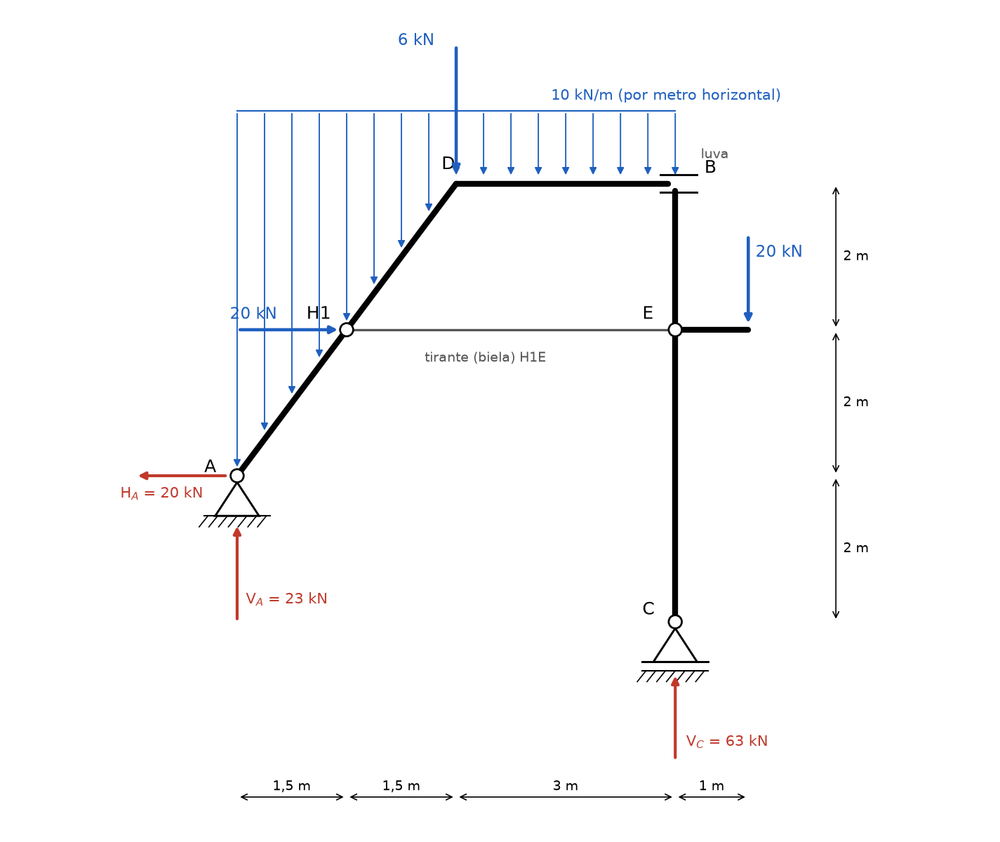
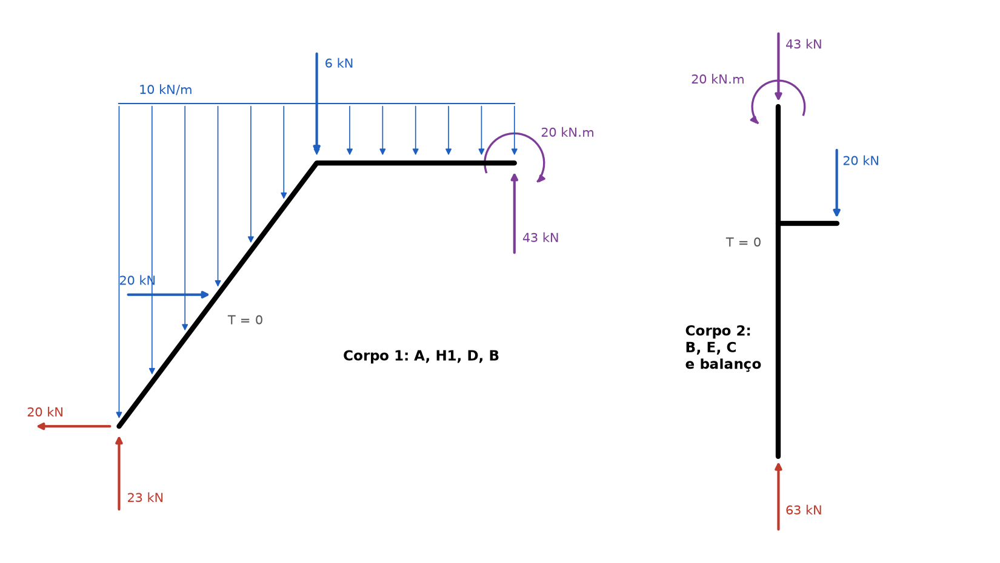
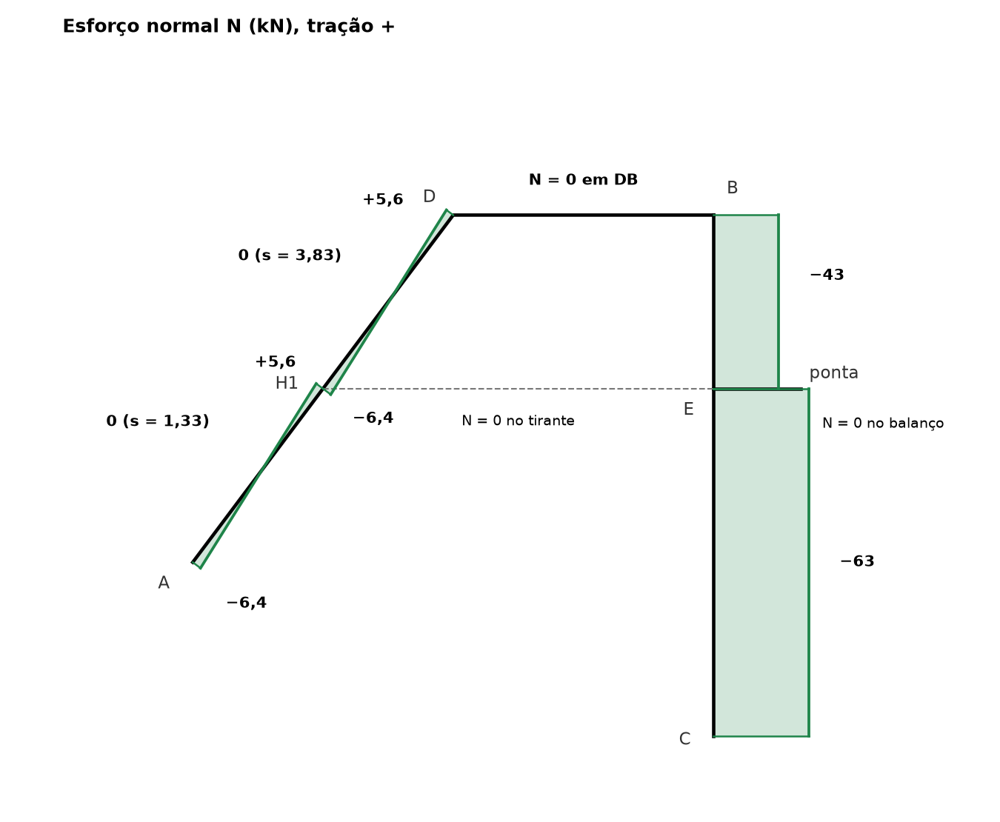
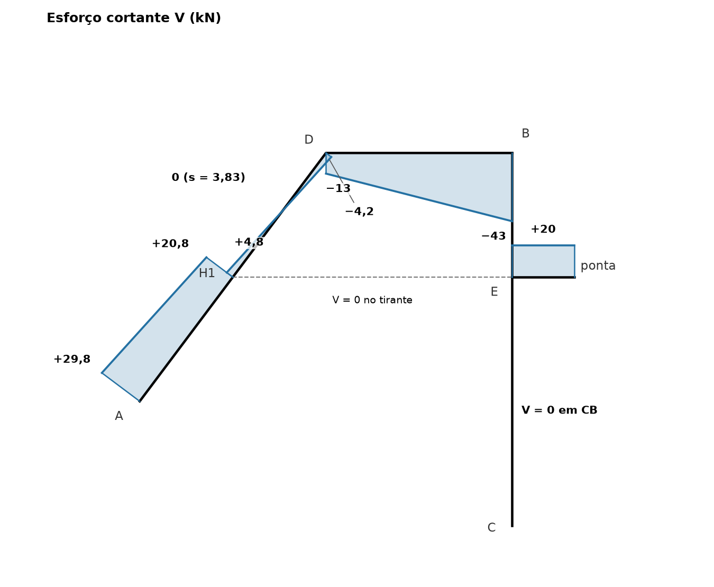
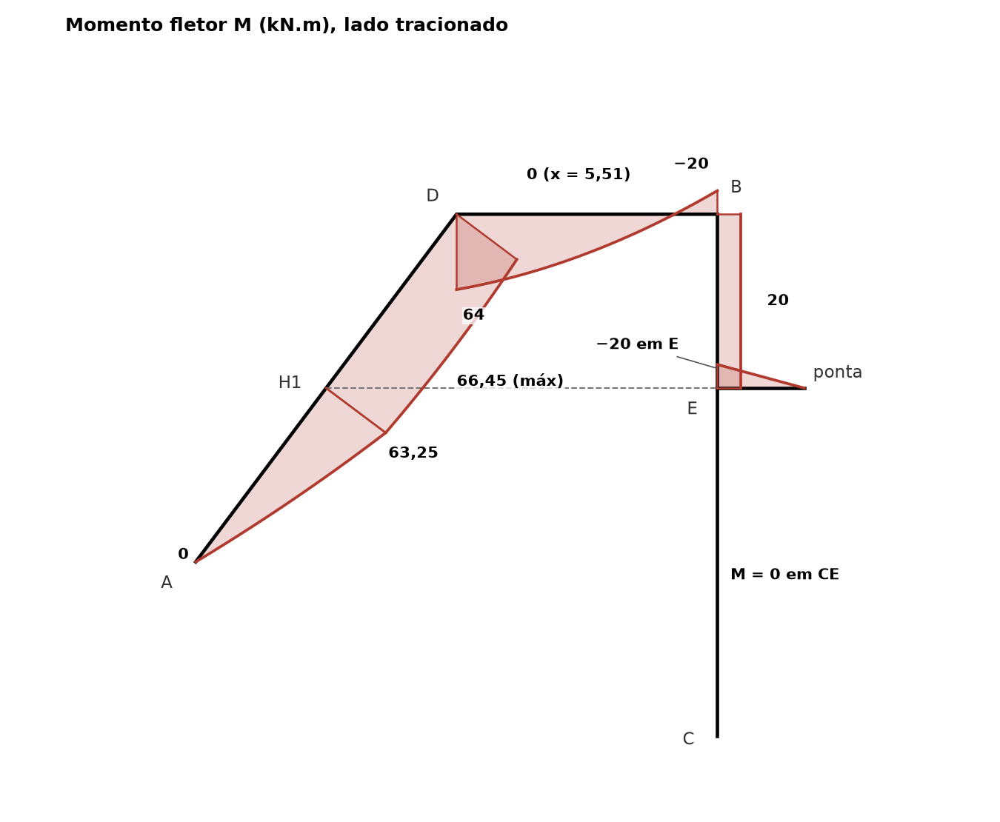

# Lista 3, exercício 09

## 1. Leitura da estrutura

Origem com x = 0 na vertical de A e y = 0 na altura de C. Eixo x para a direita, y para cima.

| Ponto | x (m) | y (m) | O que é |
|---|---|---|---|
| A | 0 | 2 | apoio fixo (2º gênero): reações HA e VA |
| H1 | 1,5 | 4 | meio da barra inclinada. Recebe a força de 20 kN para a direita e a ponta esquerda do tirante |
| D | 3 | 6 | canto entre a barra inclinada e a barra horizontal. Recebe a força de 6 kN para baixo |
| B | 6 | 6 | luva: liga a barra horizontal ao topo da coluna |
| E | 6 | 4 | ponto da coluna onde chegam a ponta direita do tirante e o balanço |
| ponta | 7 | 4 | extremidade livre do balanço, com 20 kN para baixo |
| C | 6 | 0 | apoio móvel (1º gênero): reação vertical VC |

Barras: AD inclinada (3 m na horizontal, 4 m na vertical, comprimento 5 m), DB horizontal (3 m), coluna CB vertical (6 m), balanço E até a ponta (1 m) e o tirante H1E (4,5 m, horizontal). Carga de 10 kN/m vertical de x = 0 até x = 6, cobrindo a barra inclinada e a horizontal.

**Hipóteses de leitura da figura**

- **Tirante.** Os dois semicírculos em H1 e em E estão voltados um para o outro e ligados por uma linha fina na altura y = 4: é uma barra biarticulada (tirante) entre a barra inclinada e a coluna. Só transmite força axial T (tração positiva).
- **Luva em B.** A barra horizontal chega entre dois traços paralelos a ela, presos ao topo da coluna. Esse símbolo é uma luva: a barra horizontal pode deslizar na horizontal dentro dela. A luva transmite força vertical e momento, mas **não transmite força horizontal**. É a mesma leitura do símbolo usada no exercício 10. No fim da seção 2 está o que muda se B fosse lido como rótula.
- **Carga distribuída por metro de projeção horizontal.** As setas estão desenhadas numa faixa horizontal, igualmente espaçadas em x, então 10 kN/m vale por metro medido na horizontal. Sobre a barra inclinada são 10 · 3 = 30 kN, e não 10 · 5.

**Contagem.** A luva separa a estrutura em duas partes rígidas:

- corpo 1: A, H1, D, B (barra inclinada + barra horizontal)
- corpo 2: coluna CB com o balanço

Incógnitas: HA, VA, VC, a força T no tirante, a força vertical VB e o momento MB da luva. São 6. Equações: 3 de equilíbrio para cada corpo, 6 no total. A estrutura é isostática. O tirante não é um corpo a mais com equações próprias porque, sendo biarticulado e sem carga no meio, ele só tem a força axial T.

Convenção nas equações de equilíbrio: forças para a direita e para cima positivas, momentos anti-horários positivos.

## 2. Reações

### 2.1 Força no tirante (corpo 2, forças horizontais)

No corpo 2 as forças são: VC (vertical), a carga de 20 kN no balanço (vertical), VB e MB da luva (nenhuma componente horizontal) e a força do tirante em E, que é horizontal.

ΣFx = 0 no corpo 2 ⟹ a força do tirante é a única horizontal, então **T = 0**.

O tirante fica descarregado. Com a luva em B nada empurra a coluna na horizontal, e o único vínculo horizontal da coluna é o próprio tirante. Se ele puxasse, a coluna não teria como equilibrar esse puxão.

### 2.2 Força horizontal em A (estrutura inteira)

A única carga horizontal é a de 20 kN para a direita em H1. A força do tirante é interna e se cancela.

ΣFx = 0 ⟹ HA + 20 = 0 ⟹ **HA = −20 kN**, ou seja, 20 kN **para a esquerda**.

### 2.3 VC (estrutura inteira, momentos em A)

Braços de alavanca em relação a A:

- carga distribuída: resultante 10 · 6 = 60 kN para baixo, no meio do trecho carregado, em x = 3. Braço 3 m, sentido horário
- 6 kN para baixo em D, x = 3. Braço 3 m, horário
- 20 kN para baixo na ponta do balanço, x = 7. Braço 7 m, horário
- 20 kN para a direita em H1, que está 2 m acima de A. Braço vertical 2 m. Força para a direita acima do polo gira no sentido horário
- VC para cima em x = 6. Braço 6 m, anti-horário
- HA e VA passam por A e não dão momento

ΣMA = 0 ⟹ VC · 6 − 60 · 3 − 6 · 3 − 20 · 7 − 20 · 2 = 0

VC · 6 = 180 + 18 + 140 + 40 = 378

**VC = 63 kN** (para cima)

### 2.4 VA (estrutura inteira, forças verticais)

ΣFy = 0 ⟹ VA + 63 − 60 − 6 − 20 = 0

**VA = 23 kN** (para cima)

### 2.5 Força e momento na luva (corpo 2)

VB e MB são a força e o momento que o corpo 1 faz sobre o corpo 2 no ponto B.

ΣFy = 0 no corpo 2 ⟹ VB + 63 − 20 = 0 ⟹ VB = −43 kN

O corpo 1 empurra a coluna **para baixo** com 43 kN. Pela ação e reação, a coluna empurra o corpo 1 **para cima** com 43 kN.

Momentos em B no corpo 2. VC está na mesma vertical de B (braço zero) e T = 0. A carga de 20 kN do balanço está 1 m à direita de B, sentido horário.

ΣMB = 0 ⟹ MB − 20 · 1 = 0 ⟹ **MB = 20 kN.m** anti-horário sobre a coluna

Sobre o corpo 1 o momento da luva é 20 kN.m no sentido **horário**.

### 2.6 Conferência no corpo 1

Forças no corpo 1: HA = −20, VA = 23, 20 kN para a direita em H1, tirante 0, carga de 60 kN, 6 kN em D, 43 kN para cima em B e 20 kN.m horário em B.

- ΣFx: −20 + 20 = 0. Confere
- ΣFy: 23 − 60 − 6 + 43 = 0. Confere
- ΣMA: −20 · 2 − 60 · 3 − 6 · 3 + 43 · 6 − 20 = −40 − 180 − 18 + 258 − 20 = 0. Confere (o ponto B está 6 m à direita de A, braço da força vertical de 43 kN)

Na estrutura inteira: ΣFy = 23 + 63 = 86 kN e as cargas verticais somam 60 + 6 + 20 = 86 kN. ΣFx = −20 + 20 = 0.

### Resumo

| Reação | Valor | Sentido |
|---|---|---|
| HA | 20 kN | para a esquerda |
| VA | 23 kN | para cima |
| VC | 63 kN | para cima |
| T (interna, tirante H1E) | 0 | tirante descarregado |
| VB (interna, luva) | 43 kN | sobe no corpo 1, desce na coluna |
| MB (interna, luva) | 20 kN.m | horário no corpo 1, anti-horário na coluna |
| HB (interna, luva) | 0 | a luva não transmite força horizontal |

**Se B fosse rótula.** Lendo B como rótula (transmite H e V, momento nulo), as reações externas não mudam (HA = 20 kN para a esquerda, VA = 23 kN, VC = 63 kN, porque saem só das equações da estrutura inteira). O que muda é o interno: ΣMB = 0 na coluna dá −2T − 20 = 0, T = −10 kN (a barra H1E fica **comprimida** com 10 kN), a rótula transmite 10 kN na horizontal e 43 kN na vertical, MB = 0 e o momento no canto D sobe para 84 kN.m. Os diagramas abaixo valem para a leitura da luva.

## 3. Esforços por barra

Para cada barra é escolhido um sentido de percurso, com vetor unitário t (do início para o fim) e vetor n, que é t girado 90° no sentido anti-horário (aponta para a esquerda de quem percorre a barra). Na seção, olha-se a parte de trás (do início da barra até a seção), com resultante R das forças que atuam nela:

- N = −R · t, positivo quando traciona
- V = R · n, positivo quando a resultante de trás aponta para o lado n. Numa barra horizontal percorrida da esquerda para a direita, n aponta para cima e isso é a convenção de viga
- M positivo quando traciona o lado direito de quem percorre a barra (lado −n). Numa barra horizontal percorrida da esquerda para a direita, é a fibra de baixo

O diagrama de M é desenhado do lado tracionado. Nos diagramas de N e V o positivo é desenhado do lado n e o sinal vem escrito.

| Barra | Percurso | t (componentes x e y) | n (lado de V positivo) | lado tracionado por M positivo |
|---|---|---|---|---|
| AD | de A para D | 0,6 e 0,8 | −0,8 e 0,6, acima e à esquerda | abaixo e à direita (lado de dentro) |
| DB | de D para B | 1 e 0 | para cima | embaixo |
| CB | de C para B (subindo) | 0 e 1 | para a esquerda | face direita |
| balanço | de E para a ponta | 1 e 0 | para cima | embaixo |
| tirante | de H1 para E | 1 e 0 | para cima | embaixo |

### Barra AD (s de 0 em A até 5 em D, x = 0,6 s)

A carga vertical por metro de projeção vira, por metro de barra, 10 · 3/5 = 6 kN/m vertical. Decompondo em relação à barra (cos α = 0,6 e sen α = 0,8, com α = inclinação da barra):

- perpendicular à barra: 6 · 0,6 = **3,6 kN/m**, empurrando para o lado −n (o "para baixo" da barra)
- paralela à barra: 6 · 0,8 = **4,8 kN/m**, apontando de D para A

Até a seção, a carga distribuída acumulada é 10 · x = 6s kN para baixo.

**Trecho 1: 0 < s < 2,5 (de A até H1).** Rx = −20 e Ry = 23 − 6s.

- N = −(−20 · 0,6 + (23 − 6s) · 0,8) = −6,4 + 4,8s
- V = (−20)(−0,8) + (23 − 6s) · 0,6 = 29,8 − 3,6s
- M = 29,8s − 1,8s²

N(0) = −6,4, N(2,5−) = +5,6 kN. N zera em s = 6,4/4,8 = **1,33 m**.

V(0) = 29,8, V(2,5−) = 20,8 kN.

M(0) = 0 (apoio), M(2,5) = 74,5 − 11,25 = **63,25 kN.m**.

**Trecho 2: 2,5 < s < 5 (de H1 até D).** Entra a força de 20 kN para a direita, que cancela HA. Rx = 0 e Ry = 23 − 6s, só vertical.

A força de 20 kN tem componente 20 · 0,6 = 12 kN ao longo de t e 20 · (−0,8) = −16 kN ao longo de n. Por isso N cai 12 e V cai 16 em H1.

- N = −0,8 · (23 − 6s) = −18,4 + 4,8s
- V = 0,6 · (23 − 6s) = 13,8 − 3,6s
- M = 40 + 13,8s − 1,8s²

N(2,5+) = −6,4, N(5) = +5,6 kN. N zera em s = 23/6 = **3,83 m**.

V(2,5+) = 4,8, V(5) = −4,2 kN. V zera em s = 23/6 = **3,83 m** (x = 2,3 m).

M(2,5) = 63,25, M(3,83) = **66,45 kN.m** (máximo, onde V = 0), M(5) = **64 kN.m**.

N e V zeram no mesmo ponto porque ali a resultante de trás é nula: as forças horizontais já se cancelaram e 23 kN de VA equilibram exatamente 10 · 2,3 = 23 kN de carga.

Conferência direta de M(D) com momentos em D: VA a 3 m dá 69 horário, HA (para a esquerda, 4 m abaixo de D) dá 80 horário, os 20 kN em H1 (2 m abaixo de D) dão 40 anti-horário e a carga de 30 kN a 1,5 m dá 45 anti-horário. 69 + 80 − 40 − 45 = 64. Confere.

### Barra DB (u = x − 3, de 0 em D até 3 em B)

Entra a força de 6 kN em D. Rx = 0 e Ry = 23 − 30 − 6 − 10u = −13 − 10u.

- N = 0 (nenhuma força horizontal resultante atrás, coerente com a luva que não transmite força horizontal)
- V = −13 − 10u
- M = 64 − 13u − 5u²

V(0) = −13, V(3) = −43 kN. Não zera no trecho.

M(0) = 64, M(3) = 64 − 39 − 45 = **−20 kN.m**. M zera em 5u² + 13u − 64 = 0, u = 2,51, ou seja **x = 5,51 m**.

O valor V(3) = −43 é a força de 43 kN da luva, e M(3) = −20 é o momento de 20 kN.m que a luva transmite (traciona em cima).

### Coluna CB (y de 0 em C até 6 em B)

Atrás da seção está VC = 63 kN para cima, passando pelo eixo da coluna.

**Trecho 0 < y < 4 (C até E).** Rx = 0 e Ry = 63.

- N = −63 kN (compressão)
- V = 0
- M = 0 (a única força passa pelo eixo da barra)

**Trecho 4 < y < 6 (E até B).** Entram o balanço com seus 20 kN e o tirante (T = 0). Rx = 0 e Ry = 63 − 20 = 43.

- N = −43 kN
- V = 0
- M = 20 kN.m constante, tracionando a face direita (a carga de 20 kN a 1 m da coluna dá esse momento em qualquer seção acima de E)

No topo, M = 20 kN.m é o momento recebido da luva.

### Balanço (u de 0 em E até 1 na ponta)

Mais fácil olhar pela frente: só a força de 20 kN na ponta.

- N = 0
- V = +20 kN (constante)
- M = −20 · (1 − u)

M(E) = **−20 kN.m** (traciona em cima), M(ponta) = 0.

### Tirante H1E

N = T = 0, V = 0, M = 0.

### Equilíbrio de momentos nos nós

- **D:** M no fim de AD = 64 e no início de DB = 64, os dois tracionando o lado de dentro do canto. Sem momento externo em D, os valores são iguais. Confere. Também confere em força: no fim de AD a resultante de trás é vertical, 7 kN para baixo. Somando os 6 kN de D dá 13 kN para baixo, que é a de DB.
- **E:** coluna abaixo com M = 0, coluna acima com 20 (face direita) e balanço com 20 (face de cima). A fibra de cima do balanço e a face direita da coluna acima formam o mesmo canto, então o momento do balanço passa inteiro para a coluna de cima e nada vai para baixo. Confere: 0 + 20 = 20.
- **B:** DB chega com −20 (traciona em cima) e a coluna chega com +20 (face direita). As duas fibras tracionadas são as de fora do canto, e a luva transmite esses 20 kN.m de uma barra para a outra.

## 4. Diagramas

Distâncias s medidas ao longo da barra inclinada a partir de A.

| Seção | N (kN) | V (kN) | M (kN.m) |
|---|---|---|---|
| A (AD, s = 0) | −6,4 | 29,8 | 0 |
| AD, s = 1,33 | 0 | 25 | 36,53 |
| H1 à esquerda (s = 2,5) | 5,6 | 20,8 | 63,25 |
| H1 à direita | −6,4 | 4,8 | 63,25 |
| AD, s = 3,83 | 0 | 0 | 66,45 |
| D, fim de AD | 5,6 | −4,2 | 64 |
| D, início de DB | 0 | −13 | 64 |
| DB, x = 5,51 | 0 | −38,07 | 0 |
| B, fim de DB | 0 | −43 | −20 |
| coluna, C até E | −63 | 0 | 0 |
| coluna, E até B | −43 | 0 | 20 |
| balanço em E | 0 | 20 | −20 |
| ponta do balanço | 0 | 20 | 0 |
| tirante | 0 | 0 | 0 |

Valores extremos: **Mmáx = 66,45 kN.m** na barra inclinada (s = 3,83 m, x = 2,3 m), **Mmín = −20 kN.m** em B (barra DB) e em E (balanço). **|V|máx = 43 kN** em B, na barra DB. **Nmín = −63 kN** (compressão) na coluna entre C e E, **Nmáx = +5,6 kN** na barra inclinada, logo antes de H1 e em D.

## 5. Por que as curvas têm essa forma

Em cada barra, com qn a carga perpendicular (positiva para o lado −n, o "para baixo" da barra) e qt a carga ao longo da barra:

- dV/ds = −qn: a inclinação do diagrama de V é a carga perpendicular
- dM/ds = V: a inclinação do diagrama de M é o cortante
- d²M/ds² = −qn
- dN/ds = −qt (com qt positivo no sentido de t): a carga ao longo da barra faz N variar

**Barra inclinada AD.** A carga de 6 kN/m por metro de barra tem as duas componentes. A perpendicular, 3,6 kN/m, faz V cair em reta (29,8 → 20,8 e 4,8 → −4,2, sempre 3,6 kN por metro) e M ser parábola do 2º grau. A paralela, 4,8 kN/m apontando para A, faz N **subir** em reta 4,8 kN por metro (−6,4 → 5,6 nos dois trechos). Numa viga horizontal com carga vertical isso não aparece: N só varia ao longo da barra porque ela é inclinada.

**Concavidade.** d²M/ds² = −3,6 < 0. Desenhado do lado tracionado, a parábola "embarriga" no sentido em que a carga empurra, como um varal: para baixo e para dentro do pórtico. No trecho H1D o V passa de positivo para negativo, então M tem o vértice ali dentro, em s = 3,83 m, que é o máximo de 66,45 kN.m. No trecho AH1 o V é todo positivo e grande, então M sobe rápido, mais inclinado perto de A (V = 29,8) do que perto de H1 (V = 20,8).

**Bico em H1.** A força concentrada de 20 kN tem componente perpendicular à barra (16 kN), então V salta de 20,8 para 4,8 e M muda de inclinação de repente, sem salto. A componente ao longo da barra (12 kN) faz N saltar de +5,6 para −6,4. Depois de H1 a parábola de M fica quase plana porque V é pequeno.

**Barra DB.** Carga de 10 kN/m: V é reta caindo 10 kN por metro (−13 → −43) e M é parábola com a barriga para baixo. Como V é todo negativo, M só desce: começa em 64 (traciona embaixo), passa por zero em x = 5,51 e chega a −20 (traciona em cima) na luva. Perto de B a curva é mais inclinada porque |V| é maior. N = 0 porque a luva não deixa passar força horizontal e as forças horizontais de trás (HA e os 20 kN) já se cancelaram.

**Coluna CB.** Não tem carga distribuída e nenhuma força horizontal chega nela (T = 0, a luva não transmite horizontal, C é apoio móvel vertical). Por isso V = 0 em toda a coluna e M é constante em cada trecho. Abaixo de E, a única força é VC, que passa pelo eixo da coluna: M = 0. Acima de E, o momento constante de 20 kN.m vem do balanço. N é constante por trecho e só salta em E, onde entram os 20 kN do balanço (−63 → −43).

**Balanço.** Força só na ponta: V constante (20 kN) e M em reta, de −20 em E até 0 na ponta livre. A extremidade livre sem momento aplicado tem M = 0.

**Pontos com M = 0.** A (apoio de extremidade, não segura momento), ponta do balanço (livre), a coluna toda entre C e E e o tirante (biarticulado, sem carga no meio). Em B não há M = 0, porque a luva transmite momento: é exatamente essa a diferença entre luva e rótula. Ao trocar a luva por rótula, o momento em B zeraria e o tirante passaria a trabalhar.

**Por que o tirante não trabalha.** O tirante só puxaria (ou empurraria) a coluna na horizontal. Com a luva, a coluna não tem mais nenhum vínculo horizontal (C é móvel e a luva desliza), então não haveria como equilibrar uma força horizontal do tirante. Toda a força horizontal de 20 kN aplicada em H1 desce pela barra inclinada até o apoio A, e é por isso que, depois de H1, a resultante de trás na barra AD é só vertical.
