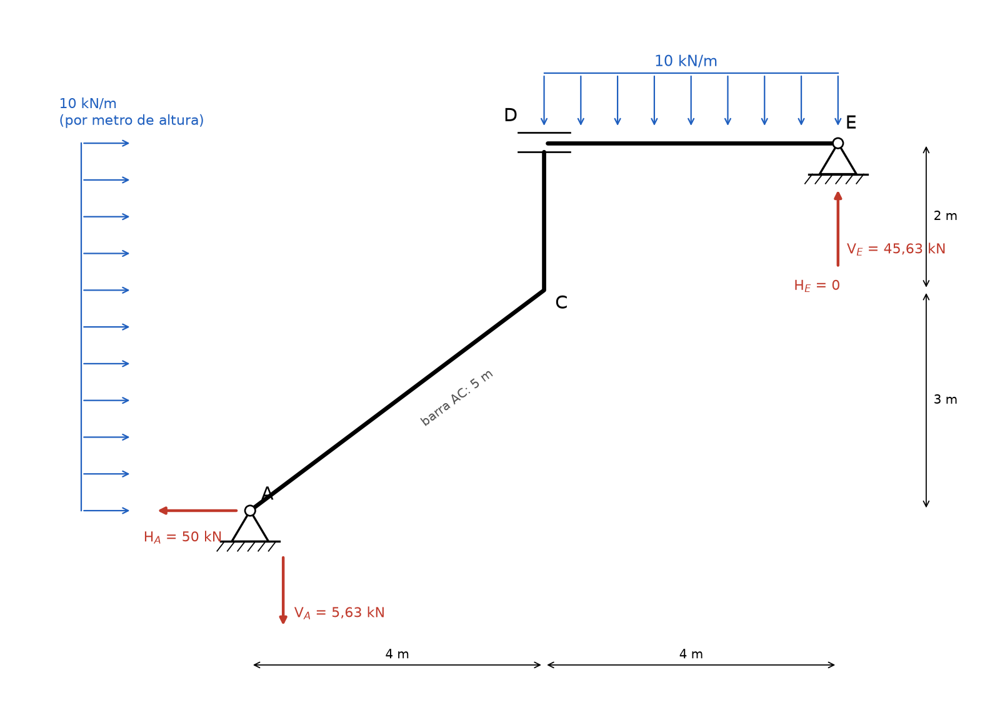
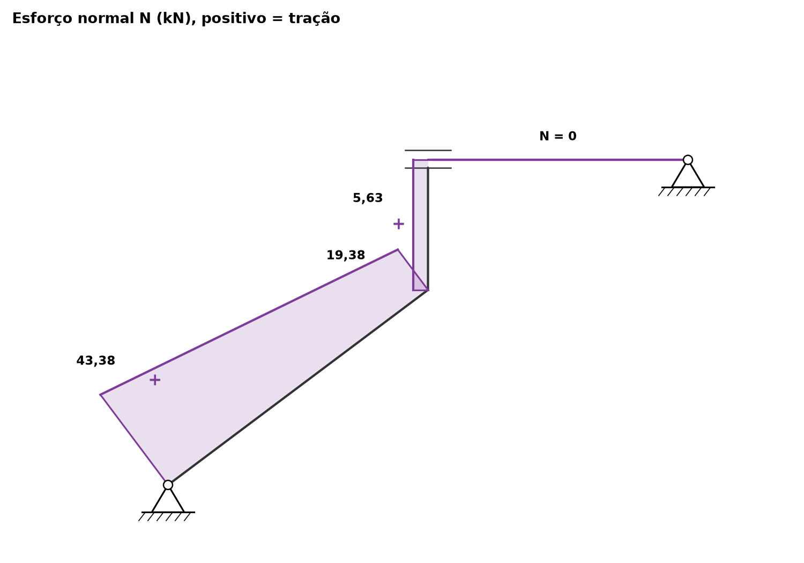
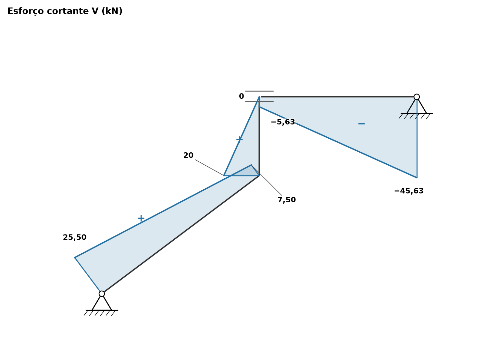
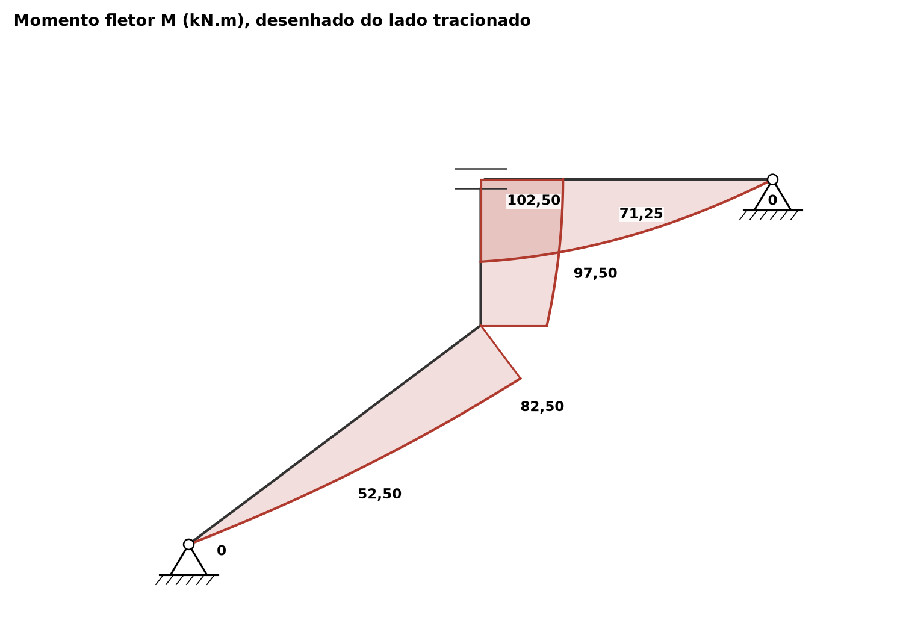

# Lista 3, exercício 10

## 1. Leitura da estrutura

Origem em A, x para a direita, y para cima.

| Ponto | (x, y) em m | O que é |
|---|---|---|
| A | (0, 0) | apoio fixo (2º gênero): reações HA e VA |
| C | (4, 3) | nó rígido entre a barra inclinada AC e a coluna CD |
| D | (4, 5) | topo da coluna, ligação com a viga DE por luva (ver abaixo) |
| E | (8, 5) | apoio fixo (2º gênero): reações HE e VE |

Barras:

- **AC**, inclinada, de A até C: 4 m na horizontal e 3 m na vertical, comprimento √(4² + 3²) = 5 m. cos θ = 0,8 e sen θ = 0,6 (θ = 36,87° com a horizontal).
- **CD**, vertical, 2 m.
- **DE**, horizontal, 4 m.

Cargas:

- 10 kN/m **horizontal, para a direita**, ao longo de toda a altura de 0 a 5 m. O desenho mostra a carga como uma faixa vertical cotada em altura, então a leitura adotada é **10 kN/m por metro de altura (projeção vertical)**. Ela atua na barra AC (de y = 0 a y = 3, resultante 30 kN) e na coluna CD (de y = 3 a y = 5, resultante 20 kN). Total 50 kN, com resultante a y = 2,5 m.
- 10 kN/m **vertical, para baixo**, na viga DE (4 m, resultante 40 kN em x = 6).

**A ligação em D.** A ponta da viga entra entre duas chapas horizontais presas no topo da coluna. Esse é o símbolo de **luva (engaste deslizante)**: a viga pode escorregar na horizontal em relação à coluna, mas não pode subir, descer nem girar em relação a ela. Então a luva transmite **força vertical e momento**, e **não transmite força horizontal** (HD = 0).

Contagem: as incógnitas externas são 4 (HA, VA, HE, VE). As equações são as 3 de equilíbrio da estrutura inteira mais a condição da luva (força horizontal transmitida nula). São 4 equações para 4 incógnitas e a estrutura é **isostática**.

Outra forma de contar: separando nas duas partes (ACD e DE) há 6 equações (3 por parte) e 6 incógnitas: as 4 externas mais VD e MD da luva.

Se a ligação fosse lida como um simples apoio de rolete (só força vertical), seriam 2 condições extras e 5 equações para 4 incógnitas: a estrutura seria hipostática. Isso confirma a leitura de luva.

Convenção nas equações de equilíbrio: forças para a direita e para cima positivas, momentos anti-horários positivos.

## 2. Reações

### 2.1 Viga DE: força horizontal

Na viga DE só atuam a carga vertical, a reação em E e o que vem da luva. A luva não transmite força horizontal e a carga é vertical, então

ΣFx (viga DE) = 0 ⟹ **HE = 0**

### 2.2 Estrutura inteira: força horizontal

ΣFx = 0 ⟹ HA + HE + 10 · 5 = 0

**HA = −50 kN**, ou seja, 50 kN **para a esquerda**. Toda a carga horizontal desce pelo apoio A, porque o apoio E não recebe nada na horizontal.

### 2.3 Estrutura inteira: momentos em A

Braços de alavanca em relação a A:

- VE está em x = 8, braço 8 m, para cima: gira anti-horário (+)
- a carga vertical de 40 kN está em x = 6, braço 6 m, para baixo: gira horário (−)
- a carga horizontal de 50 kN tem resultante a y = 2,5 m, braço 2,5 m, para a direita: gira horário (−)
- HE = 0 e as reações de A não dão momento

ΣMA = 0 ⟹ VE · 8 − 40 · 6 − 50 · 2,5 = 0

VE · 8 = 240 + 125 = 365

**VE = 365/8 = 45,63 kN** (para cima)

### 2.4 Estrutura inteira: força vertical

ΣFy = 0 ⟹ VA + 45,63 − 40 = 0

**VA = −45/8 = −5,63 kN**, ou seja, 5,63 kN **para baixo**. A carga horizontal empurra a estrutura para a direita e tende a girá-la no sentido horário em torno de E, levantando o pé A. O apoio segura puxando A para baixo.

### 2.5 Esforços na luva D (ligação interna)

Isolando a viga DE. Na ponta D atuam a força vertical VD e o momento MD que a coluna faz sobre a viga.

ΣFy = 0 ⟹ VD + 45,63 − 40 = 0 ⟹ VD = −5,63 kN

A coluna empurra a viga **para baixo** com 5,63 kN. Pela ação e reação, a viga puxa o topo da coluna **para cima** com 5,63 kN.

Momentos em D (VD passa por D e não entra). VE tem braço 4 m e gira anti-horário, a carga de 40 kN tem braço 2 m e gira horário:

ΣMD = 0 ⟹ MD + 45,63 · 4 − 40 · 2 = 0

MD = 80 − 182,50 = −102,50 kN.m

O sinal negativo indica que a coluna aplica na viga um momento de **102,50 kN.m horário**. Na coluna, a viga aplica 102,50 kN.m **anti-horário**.

### 2.6 Conferências

Estrutura inteira:

- ΣFx: −50 + 0 + 50 = 0
- ΣFy: −5,63 + 45,63 − 40 = 0
- ΣME (outro ponto, para conferir): as forças com braço em relação a E(8, 5) são HA, VA, a carga horizontal e a vertical.
  HA = 50 kN para a esquerda em A, 5 m abaixo de E: gira horário, −50 · 5 = −250.
  VA = 5,63 kN para baixo em A, 8 m à esquerda de E: gira anti-horário, +5,63 · 8 = +45.
  Carga horizontal 50 kN para a direita a 2,5 m abaixo de E: gira anti-horário, +50 · 2,5 = +125.
  Carga vertical 40 kN para baixo, 2 m à esquerda de E: gira anti-horário, +40 · 2 = +80.
  Soma: −250 + 45 + 125 + 80 = 0. Confere.

Parte ACD isolada (momentos em A): carga horizontal −50 · 2,5 = −125, força da viga no topo da coluna (5,63 para cima em x = 4) +5,63 · 4 = +22,50, momento da viga na coluna +102,50. Soma: −125 + 22,50 + 102,50 = 0. Confere.

### Resumo

| Reação | Valor | Sentido |
|---|---|---|
| HA | 50 kN | para a esquerda |
| VA | 5,63 kN | para baixo |
| HE | 0 | |
| VE | 45,63 kN | para cima |
| HD (interna, luva) | 0 | a luva não transmite força horizontal |
| VD (interna, luva) | 5,63 kN | desce na viga, sobe na coluna |
| MD (interno, luva) | 102,50 kN.m | horário na viga, anti-horário na coluna |

## 3. Esforços por barra

### Convenções

Cada barra é percorrida em um sentido: **A → C**, **C → D** e **D → E** (o caminho do apoio A até o apoio E). Os esforços numa seção são calculados com as forças do trecho que fica **antes** da seção (do lado de A).

Para cada barra, t é o vetor unitário no sentido de percurso e n é t girado 90° no sentido anti-horário:

| Barra | t | n |
|---|---|---|
| AC | horizontal 0,8 e vertical 0,6, subindo para a direita | horizontal −0,6 e vertical 0,8, perpendicular à barra, para cima e para a esquerda |
| CD | vertical, para cima | horizontal, para a esquerda |
| DE | horizontal, para a direita | vertical, para cima |

- **N** positivo de tração.
- **V** positivo quando a resultante das forças antes da seção aponta no sentido de n. Na viga DE isso é a regra usual (resultante à esquerda para cima). Em todas as barras isso equivale a V positivo quando gira o elemento no sentido horário.
- **M** positivo quando traciona o lado direito de quem percorre a barra: o lado de baixo e da direita em AC, o lado direito (voltado para E) em CD e o lado de baixo em DE. O diagrama de M é desenhado do lado tracionado.
- Nos diagramas, N e V positivos são desenhados do lado de n, com o sinal indicado.

### Carga na barra inclinada AC

A carga é 10 kN/m por metro de altura. A barra sobe 3 m em 5 m de comprimento, então por metro de barra a carga horizontal vale 10 · 3/5 = **6 kN/m**. Decompondo:

- paralela à barra (no sentido de A para C): 6 · cos θ = 6 · 0,8 = **4,8 kN/m**
- perpendicular à barra (apontando para baixo e para a direita, sentido de −n): 6 · sen θ = 6 · 0,6 = **3,6 kN/m**

Conferência: 4,8 · 5 = 24 kN e 3,6 · 5 = 18 kN, e √(24² + 18²) = 30 kN, que é a resultante 10 · 3.

### Barra AC (0 ≤ s ≤ 5 m, s medido de A ao longo da barra)

Antes da seção estão a reação em A, com HA = −50 e VA = −5,63, e a carga distribuída entre A e a seção.

Componentes da reação em A:

- na direção t: (−50) · 0,8 + (−5,63) · 0,6 = −40 − 3,38 = −43,38
- na direção n: (−50) · (−0,6) + (−5,63) · 0,8 = 30 − 4,50 = 25,50

Então:

- N = −(componente em t das forças antes da seção) = 43,38 − 4,8s
- V = (componente em n) = 25,50 − 3,6s
- M = 25,50s − 1,8s² (a carga perpendicular 3,6s tem braço s/2, dando 3,6 · s²/2 = 1,8s²)

| s (m) | N (kN) | V (kN) | M (kN.m) |
|---|---|---|---|
| 0 (A) | 43,38 | 25,50 | 0 |
| 2,5 (meio) | 31,38 | 16,50 | 52,50 |
| 5 (C) | 19,38 | 7,50 | 82,50 |

V zeraria em s = 25,50/3,6 = 7,08 m, fora da barra. Por isso M cresce o tempo todo de A até C. A barra AC está **tracionada** em todo o comprimento.

### Coluna CD (0 ≤ h ≤ 2 m, h medido de C para cima)

Antes da seção estão a reação em A, toda a carga sobre AC (30 kN para a direita a y = 1,5 m) e a carga na coluna entre C e a seção (10h para a direita).

Resultante dessas forças: horizontal −50 + 30 + 10h = −20 + 10h, vertical −5,63.

- N = −(componente vertical) = **5,63 kN** (constante, tração)
- V = (componente na direção n, para a esquerda) = 20 − 10h
- M = 82,50 + 20h − 5h²

| h (m) | N (kN) | V (kN) | M (kN.m) |
|---|---|---|---|
| 0 (C) | 5,63 | 20 | 82,50 |
| 1 | 5,63 | 10 | 97,50 |
| 2 (D) | 5,63 | 0 | 102,50 |

O valor de M em C pela coluna (82,50) é o mesmo da barra AC em C. A tração de 5,63 kN é a força com que a viga puxa o topo da coluna pela luva. V chega a zero exatamente em D, o que tem que acontecer: o cortante da coluna é horizontal e a luva não transmite força horizontal.

### Viga DE (0 ≤ u ≤ 4 m, u medido de D para a direita)

Antes da seção estão a coluna inteira (resultante horizontal −50 + 50 = 0, vertical −5,63) e a carga da viga até a seção.

- N = 0 (nenhuma força horizontal chega à viga)
- V = −5,63 − 10u
- M = 102,50 − 5,63u − 5u²

Conferência pela direita, com r = 4 − u (distância até E): M = 45,63r − 5r². Em r = 4: 182,50 − 80 = 102,50. Confere.

| u (m) | V (kN) | M (kN.m) |
|---|---|---|
| 0 (D) | −5,63 | 102,50 |
| 2 (meio) | −25,63 | 71,25 |
| 4 (E) | −45,63 | 0 |

V é negativo em toda a viga, então M decresce sempre de D até E e não há extremo interno.

### Conferência dos nós

**Nó C.** A resultante das forças antes de C tem componente horizontal −20 e vertical −5,63. Projetada nas direções da barra AC dá N = 19,38 e V = 7,50. Projetada nas direções da coluna dá N = 5,63 e V = 20. São a mesma força vista por duas barras com direções diferentes, então o nó está em equilíbrio. Não há momento externo em C, então o momento das duas barras é o mesmo: **82,50 kN.m**, tracionando o lado de baixo e da direita de AC e o lado direito da coluna, que é a mesma face contínua do pórtico.

**Nó D (luva).** O topo da coluna tem M = 102,50 kN.m tracionando a face direita e a ponta da viga tem M = 102,50 kN.m tracionando a face de baixo. As duas faces formam o lado de dentro do canto em D, e a luva passa o momento inteiro de uma barra para a outra. A força vertical de 5,63 kN aparece como N na coluna e como V na viga. A força horizontal é nula dos dois lados (V = 0 no topo da coluna e N = 0 na viga).

## 4. Diagramas

No diagrama de M, o trecho da coluna (desenhado à direita dela) e o trecho da viga (desenhado embaixo dela) se sobrepõem no canto interno de D. Isso é esperado: os dois lados tracionados são as faces internas do canto.

| Ponto | N (kN) | V (kN) | M (kN.m) |
|---|---|---|---|
| A (barra AC) | 43,38 | 25,50 | 0 |
| meio de AC | 31,38 | 16,50 | 52,50 |
| C (barra AC) | 19,38 | 7,50 | 82,50 |
| C (coluna) | 5,63 | 20 | 82,50 |
| meio de CD | 5,63 | 10 | 97,50 |
| D (coluna) | 5,63 | 0 | 102,50 |
| D (viga) | 0 | −5,63 | 102,50 |
| meio de DE | 0 | −25,63 | 71,25 |
| E (viga) | 0 | −45,63 | 0 |

Valores extremos: **Mmáx = 102,50 kN.m** em D (topo da coluna e começo da viga). **Nmáx = 43,38 kN** de tração no pé A da barra inclinada. **|V|máx = 45,63 kN** na viga junto ao apoio E. Não há compressão em nenhuma barra.

## 5. Por que as curvas têm essa forma

Em cada barra, com s ao longo do sentido de percurso, qn a carga perpendicular (positiva quando aponta para o lado oposto a n, como "para baixo" numa viga) e qt a carga paralela (positiva no sentido de t):

- dN/ds = −qt
- dV/ds = −qn
- dM/ds = V e, juntando, d²M/ds² = −qn

**Normal.**

- Em AC há carga paralela de 4,8 kN/m no sentido de A para C. Ela vai sendo "entregue" ao longo da barra, então N cai em linha reta, 4,8 kN por metro, de 43,38 em A para 19,38 em C.
- Em CD a carga é horizontal, perpendicular à coluna, então não há carga paralela e N é constante (5,63).
- Em DE nenhuma força horizontal chega à viga, então N = 0.
- Em C, N salta de 19,38 para 5,63 porque muda a direção da barra: a mesma força passa a ser projetada em outra direção.

**Cortante.**

- As três barras têm carga perpendicular uniforme (3,6 kN/m em AC, 10 kN/m em CD e em DE), então V é uma **reta** em cada barra, com inclinação igual a menos a carga.
- Em C, V salta de 7,50 para 20 pela mesma razão do salto de N: mudança de direção.
- Em D, V passa de 0 (coluna) para −5,63 (viga). Na viga, o cortante inicial é a força vertical que a luva transmite.
- Em E, V = −45,63 é fechado pela reação VE = 45,63 para cima.

**Momento.**

- Carga perpendicular uniforme dá V linear e **M parabólico** (2º grau) nas três barras.
- **Concavidade:** d²M/ds² = −qn < 0 em todas as barras. Com M desenhado do lado tracionado, a "barriga" da parábola aponta sempre **no sentido em que a carga empurra**: para baixo e para a direita em AC (a carga horizontal tem componente perpendicular para esse lado), para a direita em CD (a carga empurra a coluna para a direita) e para baixo em DE.
- **Inclinação:** dM/ds = V. Em AC, V vai de 25,50 a 7,50, então M sobe rápido perto de A e vai achatando perto de C. Em CD, V vai de 20 a 0: em D a inclinação é zero, ali fica o **vértice da parábola** e o máximo do pórtico, 102,50 kN.m. O diagrama chega em D tangente à direção da coluna. Em DE, V é negativo e cada vez mais negativo, então M cai cada vez mais rápido e chega em E com inclinação −45,63, cortando o eixo de forma inclinada (não tangente).
- **M = 0 nos apoios A e E**: apoios fixos de 2º gênero não seguram momento.
- **Nó C:** sem momento externo, o M é contínuo (82,50 nas duas barras), mas a curva muda de inclinação porque V muda de 7,50 para 20 com a mudança de direção.
- **Luva D:** diferente de uma rótula, a luva **transmite momento**, por isso M não zera em D. O que ela anula é a força horizontal, e isso aparece como V = 0 no topo da coluna e N = 0 na viga.
