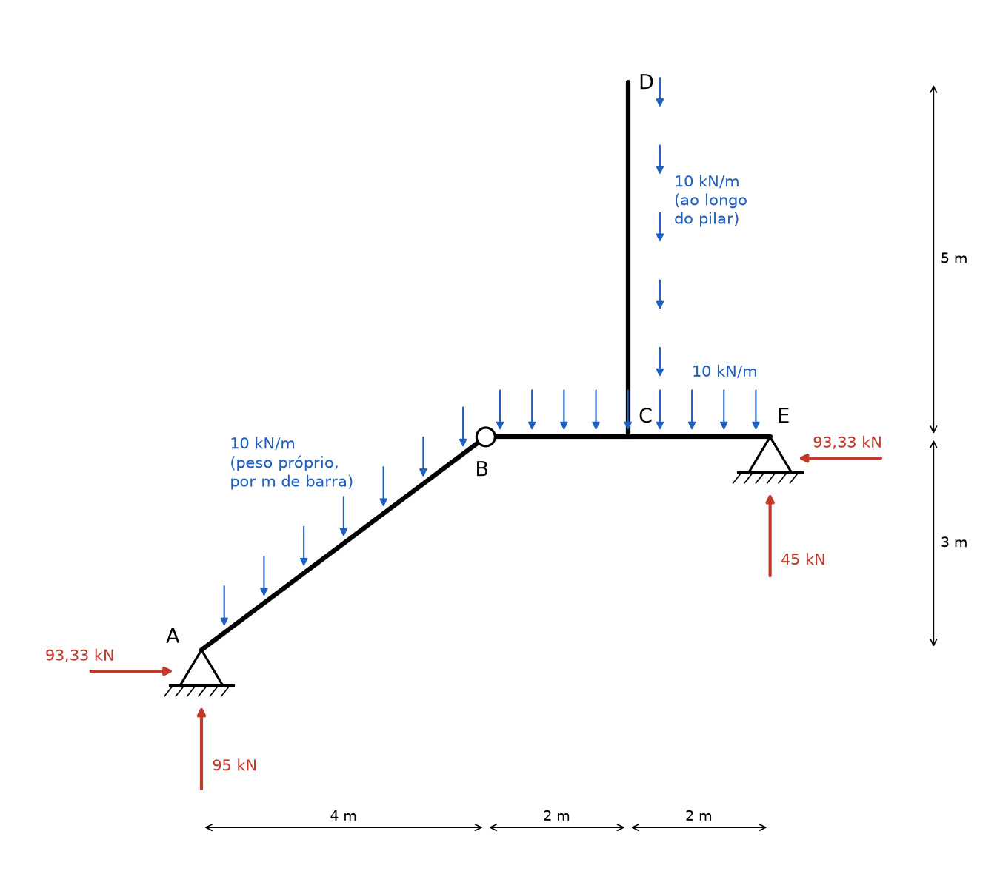
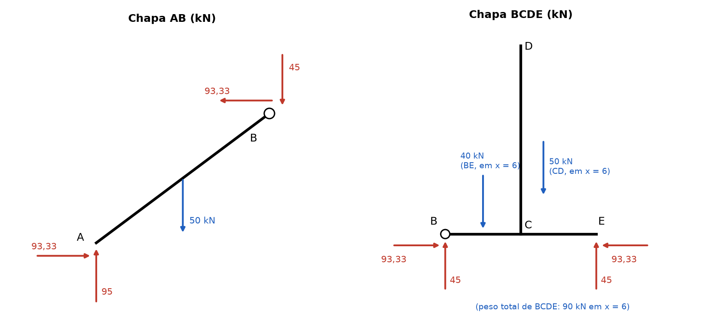
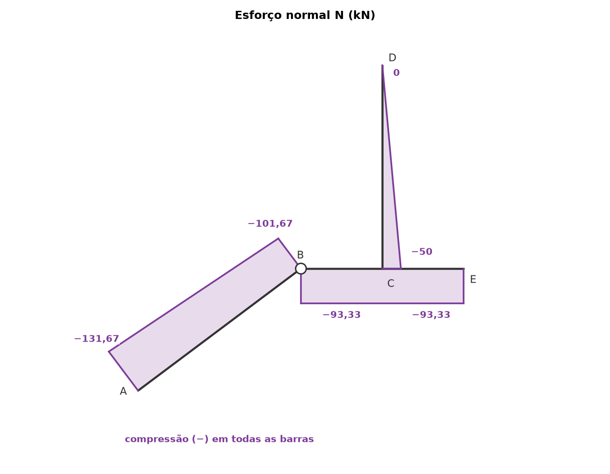
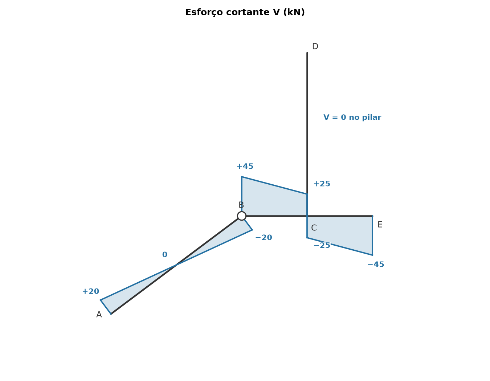
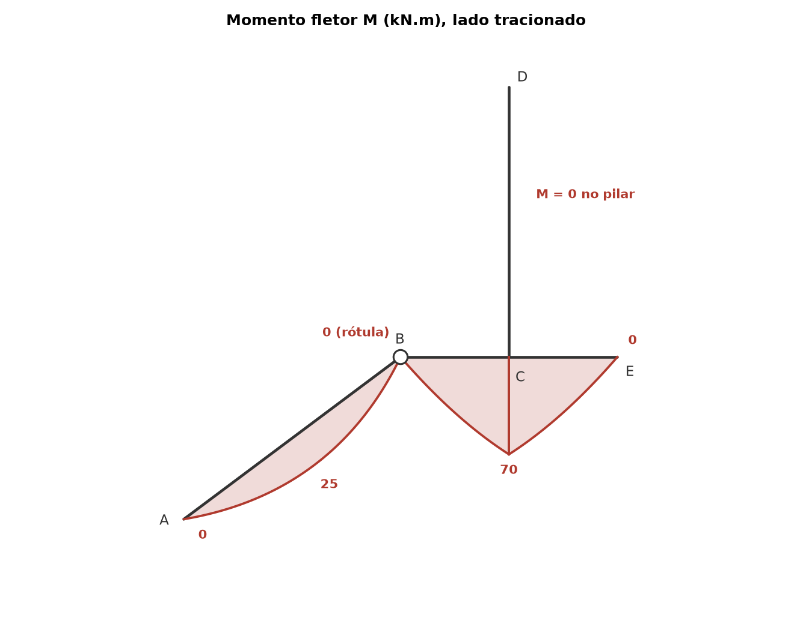

# Lista 3, exercício 11

## 1. Leitura da estrutura

Origem em A, x para a direita, y para cima. **i** e **j** são os unitários de x e y.

| Ponto | (x, y) em m | O que é |
|---|---|---|
| A | (0, 0) | apoio fixo (2º gênero): reações HA e VA |
| B | (4, 3) | rótula entre as chapas AB e BCDE: MB = 0 |
| C | (6, 3) | nó rígido onde o pilar CD encontra a viga BE |
| D | (6, 8) | extremidade livre do pilar |
| E | (8, 3) | apoio fixo (2º gênero): reações HE e VE |

Os dois apoios têm o mesmo desenho (triângulo direto sobre o chão hachurado, sem roletes), então os dois foram lidos como fixos. A única carga é o peso próprio das duas chapas, 10 kN/m, vertical e por metro de comprimento real de cada barra.

Comprimentos e pesos:

| Barra | Comprimento | Peso | Onde atua a resultante |
|---|---|---|---|
| AB (inclinada) | √(4² + 3²) = 5 m | 10 · 5 = 50 kN | meio da barra, x = 2 e y = 1,5 |
| BE (horizontal) | 4 m | 10 · 4 = 40 kN | meio da barra, x = 6 |
| CD (vertical) | 5 m | 10 · 5 = 50 kN | sobre a linha x = 6 |

A chapa BCDE pesa 40 + 50 = 90 kN e, como as duas resultantes estão em x = 6, o peso total dela atua em x = 6.

São 4 incógnitas externas (HA, VA, HE, VE) e 4 equações: as 3 de equilíbrio do pórtico inteiro mais MB = 0 da rótula. É um pórtico triarticulado (A, B e E não alinhados) e é isostático.

Ordem de resolução: momentos em B só na chapa BCDE dão VE direto (HE passa por B, porque E e B estão na mesma altura). Depois ΣFy global dá VA, momentos em B só na chapa AB dão HA e ΣFx global dá HE.

Convenção nas equações: forças para a direita e para cima positivas, momentos anti-horários positivos. O momento de uma força (Fx, Fy) aplicada a uma distância dx na horizontal e dy na vertical do polo é dx · Fy − dy · Fx.

## 2. Reações

### 2.1 Chapa BCDE, momentos em B

Forças na chapa BCDE e posição em relação a B:

- peso de 90 kN para baixo em x = 6, a 2 m à direita de B: momento −90 · 2 = −180 (horário)
- VE em E, a 4 m à direita de B: momento +4 · VE
- HE em E, mesma altura de B (dy = 0): não dá momento
- forças da rótula em B: passam pelo polo

ΣMB = 0 ⟹ 4 · VE − 90 · 2 = 0

**VE = 180/4 = 45 kN** (para cima)

### 2.2 Pórtico inteiro, forças verticais

ΣFy = 0 ⟹ VA + 45 − 50 − 90 = 0

**VA = 95 kN** (para cima)

### 2.3 Chapa AB, momentos em B

Posições em relação a B, que fica em x = 4 e y = 3:

- A está a dx = −4 e dy = −3: VA dá −4 · VA e HA dá −(−3) · HA = +3 · HA
- o peso de 50 kN está a dx = −2 e dy = −1,5: dá (−2) · (−50) = +100 (anti-horário, porque o peso está à esquerda de B)

ΣMB = 0 ⟹ 3 · HA − 4 · 95 + 100 = 0

3 · HA = 380 − 100 = 280

**HA = 280/3 = 93,33 kN** (para a direita)

### 2.4 Pórtico inteiro, forças horizontais

ΣFx = 0 ⟹ 93,33 + HE = 0

**HE = −93,33 kN**, ou seja, 93,33 kN **para a esquerda**.

Os dois apoios empurram o pórtico para dentro. É o empuxo típico de arco triarticulado: as duas chapas tendem a abrir sob o peso e os apoios seguram.

### 2.5 Forças na rótula B

Equilíbrio da chapa AB:

ΣFx = 0 ⟹ 93,33 + Bx = 0 ⟹ Bx = −93,33 kN

ΣFy = 0 ⟹ 95 − 50 + By = 0 ⟹ By = −45 kN

A chapa BCDE empurra AB com 93,33 kN para a esquerda e 45 kN para baixo. Pela ação e reação, AB empurra BCDE com **93,33 kN para a direita e 45 kN para cima**.

Conferência na chapa BCDE: ΣFx = 93,33 − 93,33 = 0 e ΣFy = 45 + 45 − 90 = 0. Confere.

### 2.6 Conferência com o pórtico inteiro

ΣMA: VE e HE em E (x = 8, y = 3): 8 · 45 − 3 · (−93,33) = 360 + 280 = 640

Pesos: 50 · 2 + 90 · 6 = 100 + 540 = 640 (horário)

640 − 640 = 0. Confere.

### Resumo

| Reação | Valor | Sentido |
|---|---|---|
| HA | 93,33 kN | para a direita |
| VA | 95 kN | para cima |
| HE | 93,33 kN | para a esquerda |
| VE | 45 kN | para cima |
| Bx (interna, rótula) | 93,33 kN | para a direita em BCDE, para a esquerda em AB |
| By (interna, rótula) | 45 kN | para cima em BCDE, para baixo em AB |
| ligação C (nó rígido, pilar sobre a viga) | N = 50 kN, V = 0, M = 0 | o pilar empurra a viga para baixo com 50 kN |

## 3. Esforços por barra

Convenções:

- cada barra tem um sentido de percurso. A seção é olhada pelo lado de onde o percurso vem (o "lado esquerdo" da barra)
- **t** é o vetor unitário do percurso e **n** é **t** girado 90° no sentido anti-horário
- N positivo quando traciona
- V positivo quando a resultante das forças antes da seção, projetada em **n**, aponta no sentido de **n**
- M positivo quando traciona a fibra do lado −**n**. O diagrama de M é desenhado do lado tracionado. Para uma barra horizontal percorrida da esquerda para a direita, **n** aponta para cima e isso é a convenção de viga: V positivo para cima, M positivo traciona embaixo

| Barra | Percurso | **t** | **n** | coordenada |
|---|---|---|---|---|
| AB | de A para B | 0,8 **i** + 0,6 **j** | −0,6 **i** + 0,8 **j**, para cima e para a esquerda | s, de 0 a 5 m |
| BE | de B para E | **i** | **j**, para cima | u = x − 4, de 0 a 4 m |
| CD | de C para D | **j** | −**i**, para a esquerda | w = y − 3, de 0 a 5 m |

### Barra AB (inclinada)

A carga é o peso próprio, 10 kN/m vertical por metro de barra. Com cos θ = 4/5 e sen θ = 3/5 (θ é o ângulo da barra com a horizontal):

- componente ao longo da barra: 10 · sen θ = 6 kN/m, apontando para A (desce a barra)
- componente perpendicular: 10 · cos θ = 8 kN/m, no sentido −**n** (para baixo e para a direita)

Reação de A projetada nas direções da barra:

- ao longo de **t**: 93,33 · 0,8 + 95 · 0,6 = 74,67 + 57 = 131,67 kN (empurra a barra na direção de B, comprime)
- ao longo de **n**: −93,33 · 0,6 + 95 · 0,8 = −56 + 76 = 20 kN

Esforços a uma distância s de A:

- N = −(131,67 − 6s) = −131,67 + 6s
- V = 20 − 8s
- M = 20s − 4s²

N(0) = −131,67, N(5) = −101,67 kN (compressão em toda a barra, diminui de baixo para cima porque o peso que vem de cima vai se somando ao descer)

V(0) = 20, V(2,5) = 0, V(5) = −20 kN

M(0) = 0, M(5) = 100 − 100 = **0** (confere com a rótula). V zera em s = 2,5 m, no meio da barra, onde está o máximo M = 20 · 2,5 − 4 · 6,25 = **25 kN.m**, tracionando o lado de baixo da barra.

Conferência em B: a força da rótula sobre AB, −93,33 **i** − 45 **j**, projetada em **t** dá −74,67 − 27 = −101,67 (comprime, confere com N(5)) e projetada em **n** dá 56 − 36 = 20, que é o oposto de V(5) = −20. Confere.

Para a flexão, AB funciona como uma viga biapoiada de 5 m com 8 kN/m perpendicular: Mmáx = 8 · 5²/8 = 25 kN.m.

### Barra BE (horizontal)

Forças vindas de antes da seção: a força da rótula sobre BCDE em B (93,33 para a direita, 45 para cima), os 10 kN/m da viga e, depois de C, os 50 kN que o pilar descarrega em C.

**Trecho BC (0 < u < 2):**

- N = −93,33 kN (os 93,33 kN de B empurram a viga, compressão)
- V = 45 − 10u
- M = 45u − 5u²

V(0) = 45, V(2−) = 25 kN

M(0) = 0 (rótula), M(2) = 90 − 20 = **70 kN.m**

V não zera no trecho (zeraria em u = 4,5), então M cresce o trecho todo.

**Trecho CE (2 < u < 4):** mais fácil olhar pela direita. Com r = 4 − u (distância até E), sobram VE = 45 para cima, HE = 93,33 para a esquerda e a carga 10r:

- N = −93,33 kN (HE empurra a ponta E para dentro da viga)
- V = −(45 − 10r) = −45 + 10r
- M = 45r − 5r²

V(2+) = −25, V(4) = −45 kN

M(2) = 70, M(4) = 0 kN.m

Em C, V salta de +25 para −25: salto de 50 kN para baixo, exatamente o peso do pilar descarregado no nó. Em E, V = −45 e a reação VE = 45 fecha o diagrama.

### Pilar CD (vertical)

A única carga é o próprio peso, que é vertical, ou seja, **paralelo** ao pilar. Não há componente perpendicular, então o pilar não flete. Olhando pelo lado de D (extremidade livre), a w de C:

- N = −10 · (5 − w): o peso do pedaço acima da seção comprime o pilar
- V = 0
- M = 0

N(0) = −50 kN, N(5) = 0

### Equilíbrio do nó C

Momentos que chegam em C: 70 kN.m da barra BC, 70 kN.m da barra CE e 0 do pilar. As fibras de baixo das duas barras horizontais estão tracionadas dos dois lados do nó, então os dois momentos se equilibram (70 = 70) e o pilar não recebe momento, o que confere com M = 0 em CD.

Forças em C: V salta 50 kN para baixo na viga e o pilar chega com N = −50 kN (empurra o nó para baixo com 50 kN). N da viga é −93,33 dos dois lados e o pilar não tem cortante, então nada muda na horizontal. Confere.

## 4. Diagramas

N e V estão desenhados com o sinal escrito. M está do lado tracionado, sem sinal: embaixo da viga BE e embaixo (lado direito) da barra AB.

| Ponto | N (kN) | V (kN) | M (kN.m) |
|---|---|---|---|
| A (barra AB) | −131,67 | 20 | 0 |
| meio de AB (s = 2,5) | −116,67 | 0 | 25 |
| B (barra AB) | −101,67 | −20 | 0 |
| B (barra BE) | −93,33 | 45 | 0 |
| C (antes, em BC) | −93,33 | 25 | 70 |
| C (depois, em CE) | −93,33 | −25 | 70 |
| E | −93,33 | −45 | 0 |
| C (pilar) | −50 | 0 | 0 |
| D | 0 | 0 | 0 |

Valores extremos: **Nmín = −131,67 kN** (compressão) no pé A da barra AB. **|V|máx = 45 kN** em B (barra BE) e em E. **Mmáx = 70 kN.m** no nó C, tracionando embaixo. Na barra AB o máximo é 25 kN.m no meio.

## 5. Por que as curvas têm essa forma

Em cada barra, com q⊥ a carga perpendicular (positiva no sentido −**n**) e q∥ a carga ao longo da barra:

- dV/ds = −q⊥: a inclinação de V é a carga perpendicular
- dM/ds = V: a inclinação de M é o cortante
- d²M/ds² = −q⊥
- dN/ds = −q∥ (q∥ positivo no sentido do percurso): a inclinação de N é a carga axial

Todas as cargas aqui são uniformes, então V é linear onde há carga perpendicular, M é parábola do 2º grau e N é linear onde há carga axial. Não há carga triangular, por isso não aparece V parabólico nem M cúbico.

**Barra AB:** a parte perpendicular do peso, 8 kN/m, faz V cair 8 kN por metro (reta de +20 a −20) e M virar parábola. A parte axial, 6 kN/m, aponta para A, contra o percurso, então N cresce 6 kN por metro em direção a B: de −131,67 sobe para −101,67. Ou seja, a compressão é maior embaixo, porque cada pedaço da barra carrega o peso do que está acima.

**Viga BE:** só carga perpendicular (10 kN/m), então N é constante (−93,33, o empuxo) e V cai 10 kN por metro, de 45 para 25 e de −25 para −45. M é parábola nos dois trechos.

**Pilar CD:** só carga axial. V = 0 e M = 0 e N é uma reta de −50 na base a 0 na ponta livre.

**Concavidade:** d²M/ds² = −q⊥ < 0. Como M é desenhado do lado tracionado, a "barriga" da parábola aponta no mesmo sentido da carga perpendicular, como um varal pesado. Na viga BE a barriga aponta para baixo. Na barra AB aponta para baixo e para a direita, que é o sentido da componente de 8 kN/m.

**Onde a curva é mais inclinada:** a inclinação de M é V. Na barra AB, V = ±20 nas pontas e 0 no meio, então M sai inclinado de A, fica horizontal no meio (vértice, 25 kN.m) e volta inclinado até zero em B. A parábola é simétrica porque a barra é uma biapoiada com carga uniforme. Na viga BE, V = 45 em B, então M sai de B subindo rápido. Em C, V = ±25, e a parábola ainda está inclinada quando chega no nó. Por isso o máximo 70 é um bico, e não um vértice de parábola: V troca de sinal de repente em C.

**Bicos e saltos:**

- **Força concentrada em C** (os 50 kN do pilar): V salta 50 kN (de +25 para −25) e M forma um bico, sem salto. O bico aponta para o lado tracionado, que é para baixo, o mesmo sentido da força.
- **Rótula B:** M = 0 nas duas barras que chegam nela. V e N passam pela rótula, mas como as barras AB e BE têm direções diferentes, os valores mudam ao trocar de barra: a mesma força 93,33 **i** + 45 **j** dá N = −101,67 e V = −20 na direção de AB e N = −93,33 e V = 45 na direção de BE.
- **Apoios A e E:** apoios fixos de extremidade não seguram momento, então M = 0. Em A e E os cortantes não são zero porque ali chegam reações.
- **Extremidade livre D:** N = V = M = 0, sem nada aplicado na ponta.
- **Nó rígido C:** os momentos das barras se equilibram (70 de um lado, 70 do outro, 0 no pilar).
