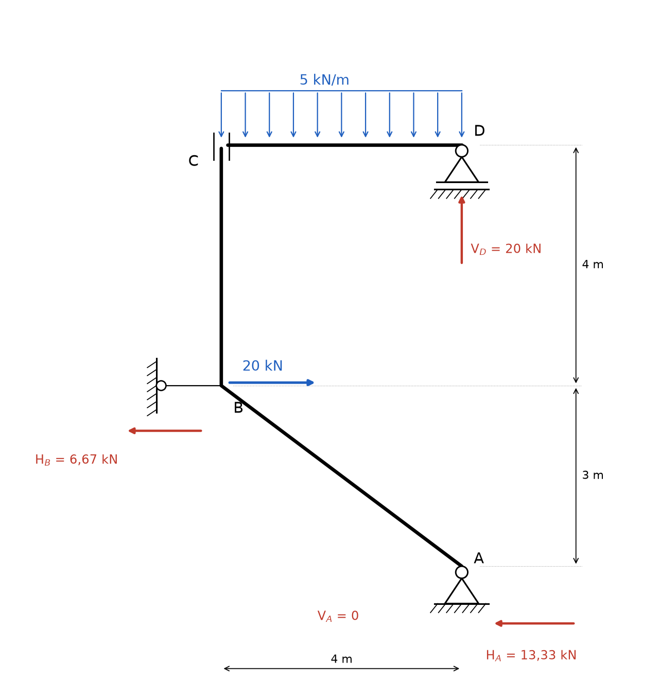
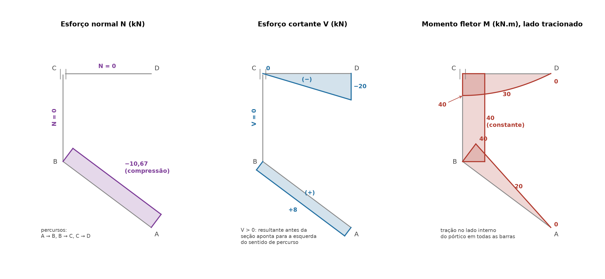

# Lista 3, exercício 12

## 1. Leitura da estrutura

Origem no prolongamento do pilar, na altura do apoio inferior. Eixo x para a direita, y para cima.

| Ponto | (x, y) em m | O que é |
|---|---|---|
| A | (4, 0) | apoio fixo (2º gênero): reações HA e VA |
| B | (0, 3) | nó rígido entre a barra inclinada AB e o pilar BC, preso à parede por uma biela horizontal (vínculo de 1º gênero): reação HB. Força de 20 kN para a direita aplicada aqui |
| C | (0, 7) | topo do pilar, ligado à viga por uma luva (os dois traços paralelos verticais) |
| D | (4, 7) | apoio móvel (1º gênero, base com folga): reação VD |

Carga distribuída de 5 kN/m em toda a viga CD (4 m), resultante de 20 kN em x = 2.

**Hipótese sobre a luva em C.** Os dois traços paralelos à volta da ligação representam um engaste deslizante: o pilar pode escorregar na vertical em relação à viga. A luva transmite força horizontal e momento, mas **não transmite força vertical**. É a liberação que torna a estrutura isostática.

**Hipótese sobre a carga.** As setas começam junto ao pilar e terminam sobre o apoio D, então a carga de 5 kN/m atua só na viga, nos 4 m entre C e D.

Contagem: 4 reações externas (HA, VA, HB, VD) e 4 equações (as 3 de equilíbrio do conjunto mais a condição da luva, força vertical nula em C). A estrutura é isostática.

Ordem de resolução: a viga CD só tem uma reação vertical (VD) e a luva não passa força vertical, então ela é resolvida primeiro. Depois o conjunto inteiro dá HB e HA.

Convenção nas equações: forças para a direita e para cima positivas, momentos anti-horários positivos.

## 2. Reações

### 2.1 Viga CD isolada

Forças na viga:

- carga distribuída: 5 · 4 = 20 kN para baixo, no meio, em x = 2
- VD, vertical, em x = 4
- da luva em C: força horizontal HC e momento MC (sem força vertical)

Forças verticais (só a carga e VD são verticais):

ΣFy = 0 ⟹ VD − 20 = 0 ⟹ **VD = 20 kN** (para cima)

Forças horizontais (o apoio móvel não tem reação horizontal):

ΣFx = 0 ⟹ **HC = 0**

Momentos em D (VD passa por D e não entra, a carga de 20 kN está a 2 m à esquerda de D):

ΣMD = 0 ⟹ MC + 20 · 2 = 0 ⟹ **MC = −40 kN.m**

O sinal negativo indica que o pilar aplica na viga um momento de 40 kN.m no sentido **horário**. Sem ele a carga faria a viga girar em torno de D, com a ponta C descendo (giro anti-horário). Pela ação e reação, a viga aplica no topo do pilar 40 kN.m **anti-horário**.

### 2.2 Estrutura inteira

Forças verticais: as únicas reações verticais são VA e VD.

ΣFy = 0 ⟹ VA + 20 − 20 = 0 ⟹ **VA = 0**

Momentos em A, que elimina HA e VA. Braços medidos a partir de A (4, 0):

- carga de 20 kN em (2, 7): braço horizontal 2 m, à esquerda de A. Força para baixo à esquerda do polo gira no sentido anti-horário: +20 · 2 = +40
- VD em (4, 7): está na mesma vertical de A, braço nulo
- 20 kN horizontal em B (0, 3): braço vertical 3 m. Força para a direita acima do polo gira no sentido horário: −20 · 3 = −60
- HB em B: mesmo braço de 3 m: −3 · HB

ΣMA = 0 ⟹ 40 − 60 − 3 · HB = 0

**HB = −20/3 = −6,67 kN**

O sinal negativo indica que HB aponta **para a esquerda**: a biela puxa o nó B em direção à parede (biela tracionada com 6,67 kN).

Forças horizontais:

ΣFx = 0 ⟹ HA − 6,67 + 20 = 0

**HA = −40/3 = −13,33 kN** (para a esquerda)

### 2.3 Conferência

ΣFx: −13,33 − 6,67 + 20 = 0. Confere.

ΣFy: 0 + 20 − 20 = 0. Confere.

Momentos em B (0, 3), com outro polo:

- HA = 13,33 para a esquerda em (4, 0), 3 m abaixo de B: força para a esquerda abaixo do polo gira no sentido horário: −13,33 · 3 = −40
- VD = 20 para cima, 4 m à direita: +20 · 4 = +80
- carga de 20 kN para baixo, 2 m à direita: −20 · 2 = −40
- HB e a força de 20 kN passam por B: zero

ΣMB = −40 + 80 − 40 = 0. Confere.

### 2.4 Forças nas extremidades das barras (ligações internas)

- **Luva C:** HC = 0, força vertical 0 (liberada), momento de 40 kN.m (horário sobre a viga, anti-horário sobre o pilar).
- **Barra AB, extremidade A:** a única força é a do apoio, 13,33 kN para a esquerda. Como AB não tem carga, ela transmite ao nó B uma força de 13,33 kN e um momento. Momento dessa força em relação a B: a força para a esquerda passa 3 m abaixo de B, giro horário de 13,33 · 3 = 40 kN.m.
- **Nó B:** chegam a barra AB, o pilar BC, a biela (6,67 kN para a esquerda) e a força de 20 kN para a direita. Força horizontal sobre o trecho abaixo de qualquer seção do pilar: −13,33 − 6,67 + 20 = 0. Portanto o pilar não tem força normal nem cortante, só o momento de 40 kN.m que vem da luva.

### Resumo

| Reação | Valor | Sentido |
|---|---|---|
| HA | 13,33 kN | para a esquerda |
| VA | 0 | |
| HB (biela) | 6,67 kN | para a esquerda (biela tracionada) |
| VD | 20 kN | para cima |
| HC (interna, luva) | 0 | |
| força vertical na luva | 0 | liberada pela luva |
| MC (interno, luva) | 40 kN.m | horário sobre a viga, anti-horário sobre o pilar |

## 3. Esforços por barra

### Convenções

Cada barra é percorrida num sentido: **AB de A para B**, **BC de B para C**, **CD de C para D**. A seção é olhada pelo trecho já percorrido (o "antes" da seção).

- N positivo quando traciona.
- V positivo quando a resultante das forças antes da seção aponta para a **esquerda do sentido de percurso**. Na viga CD (percurso para a direita) isso é "para cima", igual ao ex01. No pilar BC (percurso para cima) é "para a esquerda". Na barra AB (percurso subindo para a esquerda) é a direção perpendicular que aponta para baixo e para a esquerda.
- M positivo quando traciona o lado **direito** do percurso. Com esses percursos o lado direito é sempre o lado de dentro do pórtico (embaixo da viga, à direita do pilar, acima da barra inclinada). M é desenhado do lado tracionado.

### Barra AB (de A para B, comprimento 5 m)

Direção da barra: vetor unitário t com componentes x = −0,8 e y = 0,6 (sobe 3 m enquanto anda 4 m para a esquerda, em 5 m de barra). Perpendicular à esquerda do percurso: vetor n com componentes x = −0,6 e y = −0,8. Coordenada s medida a partir de A.

A barra não tem carga. Antes de qualquer seção só existe a reação em A, FA com componente x = −13,33 e componente y = 0. Decompondo:

- componente ao longo da barra: FA · t = (−13,33)(−0,8) = +10,67. Essa força, aplicada na ponta A, empurra a barra no sentido de A para B, ou seja, comprime. **N = −10,67 kN** (compressão, constante)
- componente perpendicular: FA · n = (−13,33)(−0,6) = **V = +8 kN** (constante)
- M = 8 · s

M(A) = 0, M(s = 2,5) = 20, M(B) = 8 · 5 = **40 kN.m**, tracionando o lado de cima (de dentro). Confere com o momento de 40 kN.m calculado em 2.4.

### Pilar BC (de B para C, comprimento 4 m)

Antes da seção estão A, a barra AB e o nó B com HB e a força de 20 kN. A resultante dessas forças é nula (item 2.4), então:

- **N = 0**
- **V = 0**
- **M = 40 kN.m** constante, tracionando o lado direito (de dentro)

Olhando por cima também fecha: acima de qualquer seção do pilar só existe a luva, que aplica 40 kN.m anti-horário e nenhuma força.

### Viga CD (de C para D, 4 m)

x medido a partir de C. Na ponta C a luva aplica o momento de 40 kN.m horário e nenhuma força. Momento horário aplicado antes da seção soma +40 em M.

- **N = 0** (HC = 0 e não há outra força horizontal)
- V = −5x
- M = 40 − 2,5x²

V(0) = 0, V(2) = −10, V(4−) = −20 kN. Em D o apoio soma +20 e V volta a 0.

M(0) = **40**, M(1) = 37,5, M(2) = 30, M(3) = 17,5, M(4) = **0** kN.m (confere com o apoio móvel de extremidade).

V é zero em x = 0, então o máximo de M fica exatamente na ponta C, com tangente horizontal.

### Equilíbrio dos nós

- **Nó B:** a barra AB chega com 40 kN.m e o pilar sai com 40 kN.m, os dois tracionando o lado de dentro. O momento passa de uma barra para a outra sem salto, como deve ser num nó rígido sem momento aplicado.
- **Luva C:** o pilar chega com 40 kN.m e a viga sai com 40 kN.m, os dois tracionando o lado de dentro. A luva transmite momento, então M não precisa ser zero ali.

## 4. Diagramas

| Barra | Seção | N (kN) | V (kN) | M (kN.m) |
|---|---|---|---|---|
| AB | A (s = 0) | −10,67 | +8 | 0 |
| AB | meio (s = 2,5) | −10,67 | +8 | 20 |
| AB | B (s = 5) | −10,67 | +8 | 40 |
| BC | B até C | 0 | 0 | 40 |
| CD | C (x = 0) | 0 | 0 | 40 |
| CD | x = 2 | 0 | −10 | 30 |
| CD | D (x = 4) | 0 | −20 | 0 |

Valores extremos: **Mmáx = 40 kN.m** (do nó B até a luva C e na ponta C da viga, tracionando o lado de dentro). **|V|máx = 20 kN** na viga junto a D. **Nmín = −10,67 kN** (compressão) na barra AB, única barra com força normal.

## 5. Por que as curvas têm essa forma

As relações diferenciais valem em cada barra, com x ao longo do percurso e q a carga perpendicular à barra (positiva no sentido contrário ao de V positivo):

- dV/dx = −q
- dM/dx = V
- d²M/dx² = −q

**Barra AB:** não tem carga, q = 0. V é constante (+8) e M é uma reta que sai de zero no apoio A (articulação de extremidade, não segura momento) e cresce 8 kN.m por metro até 40 em B. N também é constante porque nenhuma carga atua ao longo da barra. A barra é comprimida porque o apoio A empurra para a esquerda (13,33 kN) e a componente dessa força na direção da barra aponta de A para B.

**Pilar BC:** não tem carga e as forças abaixo dele se anulam. V = 0, então dM/dx = 0 e M é constante: o pilar está em **flexão pura**, carregando só o momento que vem da luva. O diagrama é um retângulo.

**Viga CD:** carga uniforme de 5 kN/m, então V é uma reta (cai 5 kN por metro) e M é uma parábola do 2º grau. A concavidade segue a regra prática do ex01: desenhado do lado tracionado, o diagrama "embarriga" no sentido da carga, ou seja, para baixo. Na ponta C, V = 0 (a luva não passa força vertical), então a parábola chega em C com **tangente horizontal**. É o vértice da parábola e o maior momento da viga. Indo para D a inclinação de M aumenta junto com |V|, e a curva cai cada vez mais rápido até zero no apoio móvel.

A viga se comporta como metade de uma viga biapoiada de 8 m: a luva faz o papel do eixo de simetria, onde o cortante é zero e o momento é máximo. Por isso MC = q · L²/2 = 5 · 4²/2 = 40, igual ao q · (2L)²/8 da viga inteira.

**Bicos, saltos e zeros:**

- **Apoio A e apoio D:** articulações de extremidade, M = 0.
- **Luva C:** transmite momento e libera a força vertical. Por isso M = 40 (não é zero, ao contrário de uma rótula) e V da viga começa em 0.
- **Nó B:** a força de 20 kN e a biela atuam no nó. Elas mudam N e V de uma barra para a outra (de N = −10,67 e V = 8 na barra AB para zero no pilar), mas não aplicam momento. M passa contínuo, 40 dos dois lados.
- **Apoio D:** a força concentrada de 20 kN faz V saltar de −20 para 0, fechando o diagrama.
- **Lado tracionado:** em todas as barras o momento é positivo na convenção adotada, ou seja, o pórtico inteiro tem o **lado de dentro tracionado**.
