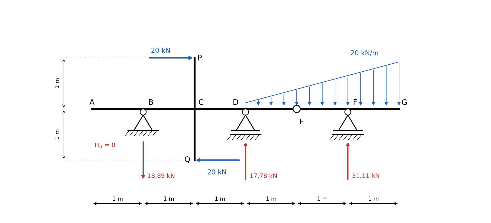
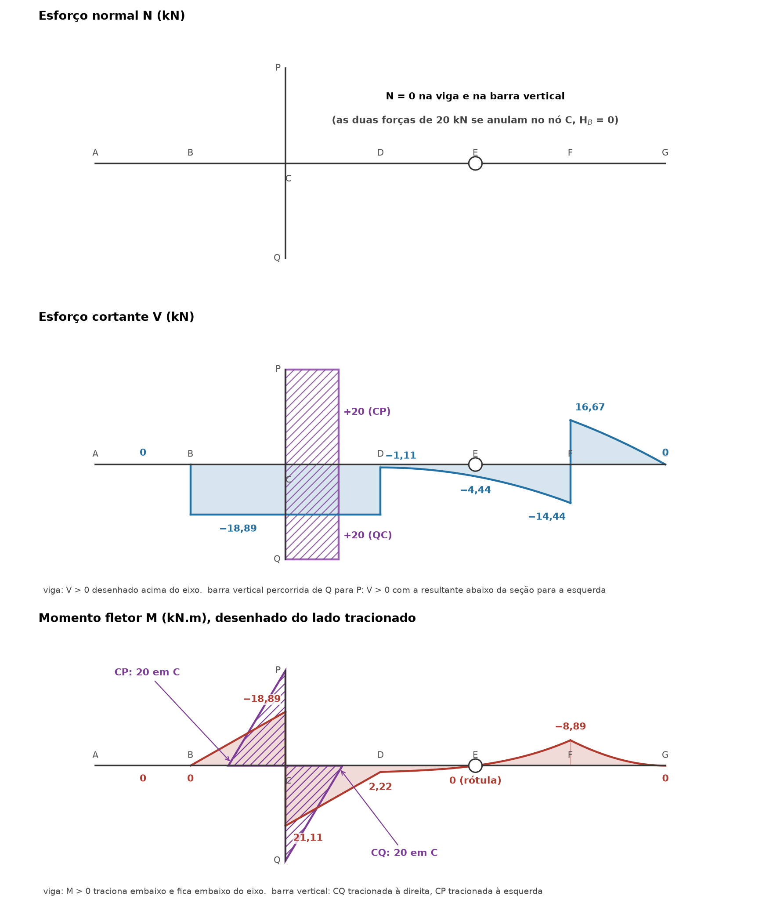
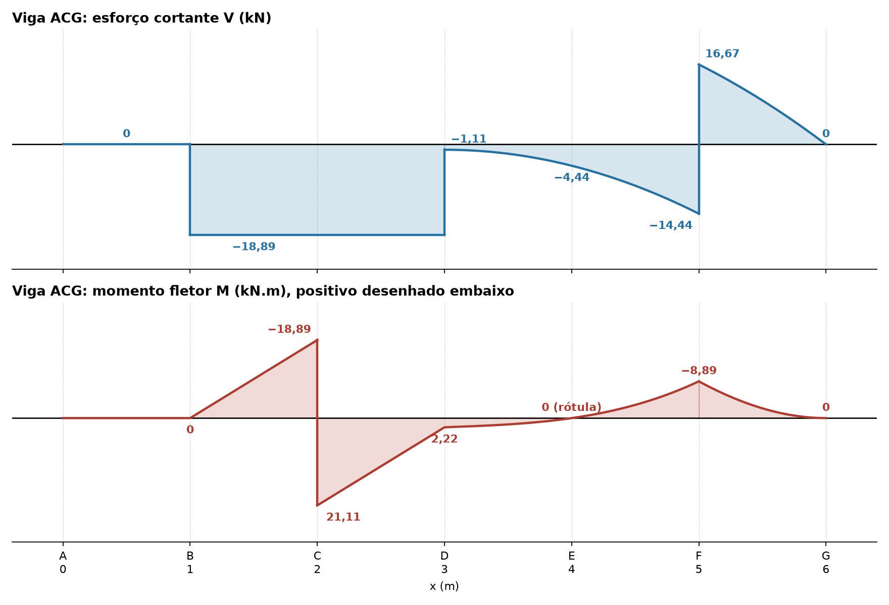

# Lista 3, exercício 13

## 1. Leitura da estrutura

Origem x = 0 na ponta esquerda A, eixo x para a direita, y para cima.

| Ponto | Posição (m) | O que é |
|---|---|---|
| A | x = 0 | extremidade livre da viga |
| B | x = 1 | apoio fixo (2º gênero): reações HB e VB |
| C | x = 2 | nó rígido onde a barra vertical PQ cruza a viga |
| P | (2, +1) | ponta de cima da barra vertical, força de 20 kN para a direita |
| Q | (2, −1) | ponta de baixo da barra vertical, força de 20 kN para a esquerda |
| D | x = 3 | apoio móvel (1º gênero): reação VD |
| E | x = 4 | rótula: ME = 0, transmite força vertical e horizontal |
| F | x = 5 | apoio móvel (1º gênero): reação VF |
| G | x = 6 | extremidade livre |

Carga distribuída triangular de x = 3 (zero) até x = 6 (20 kN/m): q(x) = 20 · (x − 3)/3.

São 4 incógnitas (HB, VB, VD, VF) e 4 equações: as 3 de equilíbrio da estrutura inteira mais ME = 0 da rótula. A estrutura é isostática.

Hipótese de leitura: no cruzamento C não há círculo de rótula, então a barra vertical é soldada (ligação rígida) na viga e passa momento para ela.

As duas forças de 20 kN têm o mesmo módulo, sentidos opostos e linhas de ação separadas por 2 m. Formam um **binário**: resultante nula e momento 20 · 1 + 20 · 1 = 40 kN.m. A de cima empurra para a direita acima do eixo e a de baixo para a esquerda abaixo do eixo, então o giro é **horário**. Para a viga, o efeito da barra PQ é um momento concentrado de 40 kN.m horário aplicado em C.

A rótula divide a viga em duas partes. A parte EG só fica parada porque se apoia em F e na parte AE (pela rótula), então ela é resolvida primeiro e a força da rótula vira carga para AE.

Convenção nas equações: forças para cima e para a direita positivas, momentos anti-horários positivos.

## 2. Reações

### 2.1 Força horizontal

ΣFx = 0 ⟹ HB + 20 − 20 = 0 ⟹ **HB = 0**

Na rótula também HE = 0, porque a parte EG não tem nenhuma carga horizontal.

### 2.2 Parte EG (de x = 4 a x = 6)

Em E a carga vale q(4) = 20/3 = 6,67 kN/m e em G vale 20 kN/m. O trapézio é dividido em um retângulo e um triângulo:

- retângulo: 20/3 · 2 = 40/3 = 13,33 kN, no meio do trecho, a 1 m de E
- triângulo: (20 − 20/3) · 2/2 = 40/3 = 13,33 kN, no centroide, a 2/3 · 2 = 4/3 m de E
- total: 80/3 = 26,67 kN

Momentos em E (ME = 0, então a força da rótula não entra):

ΣME = 0 ⟹ VF · 1 − 13,33 · 1 − 13,33 · 4/3 = 0

VF = 40/3 + 160/9 = 280/9

**VF = 31,11 kN** (para cima)

Forças verticais, com VE a força que AE faz em EG:

ΣFy = 0 ⟹ VE + 31,11 − 26,67 = 0

**VE = −40/9 = −4,44 kN**

O sinal negativo indica que AE **puxa EG para baixo**. O balanço FG carregado gira EG em torno de F e tenta levantar a ponta E, e AE a segura. Pela ação e reação, EG empurra AE **para cima** com 4,44 kN em x = 4.

### 2.3 Parte AE (de x = 0 a x = 4)

Cargas nesse trecho:

- binário de 40 kN.m horário em C (entra negativo)
- triângulo de x = 3 a x = 4, de 0 a 20/3 kN/m: resultante 20/3 · 1/2 = 10/3 = 3,33 kN, no centroide, a 2/3 m de D, ou seja em x = 11/3 = 3,67
- 4,44 kN para cima em x = 4 (vindo da rótula)
- VB em x = 1 e VD em x = 3

Momentos em B (braços medidos a partir de x = 1):

ΣMB = 0 ⟹ VD · 2 − 3,33 · (3,67 − 1) + 4,44 · 3 − 40 = 0

VD · 2 = 80/9 − 120/9 + 40 = 320/9

**VD = 160/9 = 17,78 kN** (para cima)

Forças verticais:

ΣFy = 0 ⟹ VB + 17,78 − 3,33 + 4,44 = 0

**VB = −170/9 = −18,89 kN**

O sinal negativo indica que VB aponta **para baixo**. O binário horário tenta girar a viga em torno de D, abaixando o lado direito e levantando o lado de B, e o apoio fixo segura puxando para baixo.

### 2.4 Conferência com a estrutura inteira

Carga triangular total: 20 · 3/2 = 30 kN, no centroide em x = 3 + 2/3 · 3 = 5.

ΣFy: −18,89 + 17,78 + 31,11 − 30 = 0. Confere.

ΣMB: 17,78 · 2 + 31,11 · 4 − 30 · 4 − 40 = 35,56 + 124,44 − 120 − 40 = 0. Confere.

ΣFx: 20 − 20 + 0 = 0. Confere.

### Resumo

| Reação | Valor | Sentido |
|---|---|---|
| HB | 0 | |
| VB | 18,89 kN | para baixo |
| VD | 17,78 kN | para cima |
| VF | 31,11 kN | para cima |
| VE (interna, rótula) | 4,44 kN | desce em EG, sobe em AE |
| HE (interna, rótula) | 0 | |
| ligação rígida em C (interna) | momento de 40 kN.m | a barra PQ aplica 40 kN.m horário na viga, força resultante nula |

## 3. Esforços por trecho

### Convenções

Viga ACG, percorrida de A para G (seção olhada pela esquerda):

- N positivo quando traciona
- V positivo quando a resultante das forças à esquerda da seção aponta para cima
- M positivo quando traciona a fibra de baixo, desenhado **embaixo** do eixo

Barra vertical, percorrida de Q (baixo) para P (cima). Girando a barra para que esse sentido fique "da esquerda para a direita", o "embaixo" da viga equivalente cai no lado direito da barra. Então:

- V positivo quando a resultante das forças abaixo da seção aponta para a esquerda (ou, olhando pelo lado de cima, quando a resultante acima da seção aponta para a direita)
- M positivo quando traciona a fibra da direita. No diagrama o M é desenhado do lado tracionado, e esse lado vem indicado em cada trecho

### Esforço normal

Na barra vertical só atuam forças horizontais, perpendiculares a ela: **N = 0** em PC e em CQ.

Na viga, as duas forças de 20 kN chegam ao nó C pela barra vertical e se anulam ali, HB = 0 e HE = 0. **N = 0 em toda a viga.**

### Barra QC (de Q, y = −1, até C, y = 0)

Abaixo da seção só há a força de 20 kN para a esquerda em Q. Chamando s a distância até Q:

- N = 0
- V = +20 kN (resultante abaixo para a esquerda)
- M = 20 · s, tracionando a face **direita** (a força empurra a ponta Q para a esquerda, a barra curva com a convexidade para a direita)

M(Q) = 0, M(C) = 20 kN.m

### Barra CP (de C, y = 0, até P, y = +1)

Olhando pelo lado de cima, só a força de 20 kN para a direita em P. Chamando t a distância até P:

- N = 0
- V = +20 kN (resultante acima para a direita)
- M = 20 · t, tracionando a face **esquerda** (a ponta P é empurrada para a direita, a convexidade fica à esquerda). Na convenção acima, M = −20 · t

M(P) = 0, M(C) = 20 kN.m (lado esquerdo)

### Trecho AB: 0 < x < 1 (balanço sem carga)

Nada à esquerda da seção: **V = 0 e M = 0**.

### Trecho BC: 1 < x < 2

Só VB à esquerda.

- V = −18,89 kN (constante)
- M = −18,89 · (x − 1)

M(1) = 0, M(2−) = −18,89 kN.m (traciona em cima)

### Trecho CD: 2 < x < 3

Entra o binário de 40 kN.m horário. Ele não muda V, mas faz M saltar. Momento horário aplicado à esquerda da seção soma +40 em M.

- V = −18,89 kN (constante)
- M = −18,89 · (x − 1) + 40

M(2+) = −18,89 + 40 = 21,11 kN.m, M(3) = −37,78 + 40 = 2,22 kN.m

### Trecho DE e EF: 3 < x < 5

Entram VD e a carga triangular. Chamando u = x − 3, a carga acumulada de D até a seção é o triângulo de base u e altura 20u/3: resultante 10u²/3, aplicada a u/3 da seção.

- V = −18,89 + 17,78 − 10u²/3 = −1,11 − 10u²/3
- M = 2,22 − 1,11 · u − 10u³/9

V(3+) = −1,11, V(4) = −1,11 − 3,33 = −4,44, V(5−) = −1,11 − 13,33 = −14,44 kN

M(3) = 2,22, M(4) = 2,22 − 1,11 − 1,11 = **0** (confere com a rótula), M(5) = 2,22 − 2,22 − 8,89 = −8,89 kN.m

O cortante na rótula vale −4,44 kN, exatamente a força transmitida por ela (EG puxa a seção para baixo, AE empurra para cima).

V é negativo em todo o trecho e não zera, então M só desce: o único zero é na rótula, e o mínimo do trecho fica em F.

### Trecho FG: 5 < x < 6 (balanço)

Pela direita só sobra a carga, um trapézio entre a seção e G. Com u = x − 3:

- V = 10/3 · (9 − u²) (resultante da carga à direita, para baixo, dá V positivo)
- M = 2,22 − 1,11 · u − 10u³/9 + 31,11 · (u − 2)

V(5+) = 10/3 · 5 = 16,67, V(6) = 0 kN

M(5) = −8,89, M(6) = 2,22 − 3,33 − 30 + 31,11 = 0 kN.m

Confere pela esquerda: V(5+) = −14,44 + 31,11 = 16,67.

### Equilíbrio de momentos no nó C

Momentos que as quatro barras aplicam no nó (anti-horário positivo):

- viga à esquerda, M(C−) = −18,89: aplica +18,89
- viga à direita, M(C+) = 21,11: aplica +21,11
- barras CP e CQ: as forças de 20 kN, com braço de 1 m cada, aplicam 20 + 20 = 40 horário, ou seja −40

18,89 + 21,11 − 40 = 0. O nó está em equilíbrio, e o salto de 40 kN.m em M na viga é exatamente o binário trazido pela barra vertical.

## 4. Diagramas

Diagramas desenhados sobre a geometria (viga em azul/vermelho, barra vertical hachurada em roxo):

Os mesmos diagramas só da viga, em gráfico x, para ler melhor as curvas:

| Seção | V à esquerda (kN) | V à direita (kN) | M (kN.m) |
|---|---|---|---|
| A (x = 0) | | 0 | 0 |
| B (x = 1) | 0 | −18,89 | 0 |
| C (x = 2) na viga | −18,89 | −18,89 | −18,89 → 21,11 |
| D (x = 3) | −18,89 | −1,11 | 2,22 |
| E (x = 4) | −4,44 | −4,44 | 0 |
| F (x = 5) | −14,44 | 16,67 | −8,89 |
| G (x = 6) | 0 | | 0 |
| barra CQ | V = +20 | | 0 em Q, 20 em C (traciona à direita) |
| barra CP | V = +20 | | 20 em C, 0 em P (traciona à esquerda) |

Valores extremos: **Mmáx = +21,11 kN.m** logo à direita de C (traciona embaixo) e **Mmín = −18,89 kN.m** logo à esquerda de C (traciona em cima). Na barra vertical, |M| = 20 kN.m em C. **|V|máx = 20 kN** na barra vertical e 18,89 kN na viga (trecho BD). **N = 0** em toda a estrutura.

## 5. Por que as curvas têm essa forma

Em qualquer trecho de barra (q positiva para baixo):

- dV/dx = −q: a inclinação do diagrama de V é a carga
- dM/dx = V: a inclinação do diagrama de M é o cortante
- juntando, d²M/dx² = −q

**Sem carga distribuída (A até D e a barra vertical):** q = 0, então V é constante e M é reta. Em BC e CD o V é o mesmo (−18,89), então as duas retas de M têm a mesma inclinação e são paralelas, só deslocadas pelo salto em C. Em AB não há nada à esquerda, então V = 0 e M = 0. Na barra vertical, V = 20 constante e M cresce linearmente de 0 na ponta até 20 em C.

**Carga triangular (D até G):** q cresce linearmente com x (q = 20u/3). Integrando uma vez, V é uma **parábola** do 2º grau. Integrando de novo, M é uma **cúbica**.

- V em DF: dV/dx = −q. Logo depois de D a carga é quase zero, então V começa quase horizontal (−1,11 e mal mudando) e vai ficando mais inclinado conforme a carga cresce, chegando a −14,44 em F. Em FG a carga é maior ainda, então V cai mais rápido, de 16,67 até 0 em G. A parábola de V tem concavidade para baixo (V'' = −dq/dx < 0).
- M em DG: d²M/dx² = −q < 0, então, desenhando o positivo embaixo, a curva de M "embarriga" para baixo, **no sentido da carga**, como um varal pesado. A curvatura é proporcional a q: perto de D (q pequeno) a curva é quase reta, e perto de G (q = 20) ela é bem curva. Por isso o trecho DE parece quase reto entre 2,22 e 0, e o trecho FG é bem arredondado.

**Onde M é mais inclinado:** a inclinação de M é V. Em BD, |V| = 18,89 é grande, então M varia rápido (19 kN.m por metro). Logo após D, V = −1,11, então M quase não muda (2,22 até 0 na rótula). Se V zerasse dentro de um trecho, ali haveria um máximo ou mínimo local de M. Isso não acontece aqui: o único zero de V fora das pontas seria dentro de um salto (em F, V passa de −14,44 para +16,67), e é por isso que F é um bico com o mínimo −8,89.

**Bicos e saltos:**

- **Forças concentradas** (VB, VD, VF): V salta o valor da força. A inclinação de M muda de repente e M forma um bico, sem salto. Em B o V vai de 0 a −18,89 e o M deixa de ser horizontal. Em F o V troca de sinal e o M para de descer e passa a subir: é o pico de −8,89.
- **Binário em C** (40 kN.m horário vindo da barra vertical): V não muda (−18,89 dos dois lados), mas M salta de −18,89 para +21,11. É o maior valor do problema, e ele aparece logo ao lado de um valor negativo grande: a viga é tracionada em cima à esquerda de C e embaixo à direita.
- **Rótula E:** não transmite momento, então M = 0. V passa direto, sem salto (−4,44), porque a rótula transmite força.
- **Extremidades livres A e G:** sem apoio e sem força concentrada, V = 0 e M = 0. Em G, como V = 0 ali, a cúbica chega tangente ao eixo. Em A, o balanço AB não tem carga, então V e M ficam nulos até o apoio B.
- **Pontas P e Q da barra vertical:** extremidades livres com força concentrada perpendicular. A força dá o valor de V (20) já na ponta, mas M = 0 ali, porque a força ainda não tem braço. O M cresce linearmente até C.
- **Nó rígido C:** os momentos das quatro barras se equilibram (18,89 + 21,11 = 20 + 20). O diagrama de M da barra vertical troca de lado em C (direita em CQ, esquerda em CP) porque as duas forças giram a barra no mesmo sentido (horário) e cada metade se curva para um lado.
