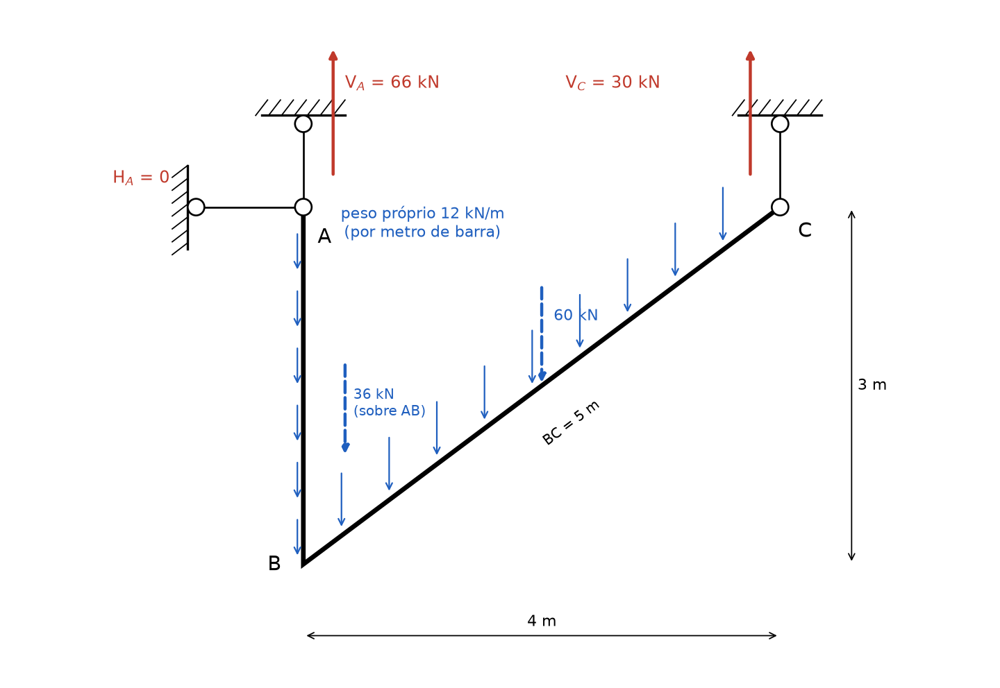
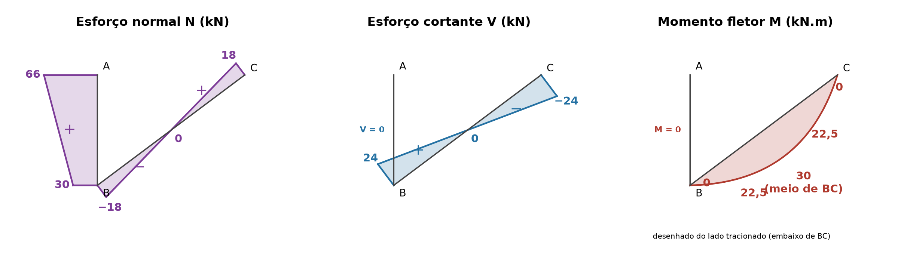

# Lista 3, exercício 14

## 1. Leitura da estrutura

Origem em B, x para a direita e y para cima. A chapa ABC é um corpo rígido formado por duas barras: AB vertical e BC inclinada, ligadas em B.

| Ponto | (x, y) em m | O que é |
|---|---|---|
| A | (0, 3) | ligação da chapa a duas bielas: uma vertical presa ao teto e uma horizontal presa à parede (círculos nas pontas, só transmitem força axial) |
| B | (0, 0) | nó rígido entre AB e BC |
| C | (4, 3) | ligação da chapa a uma biela vertical presa ao teto |

Comprimentos: AB = 3 m e BC = √(4² + 3²) = 5 m. A barra BC faz com a horizontal um ângulo α com cos α = 4/5 = 0,8 e sen α = 3/5 = 0,6.

A única carga é o peso próprio da chapa, 12 kN/m. **Hipótese:** é peso, então é vertical, para baixo e por metro de comprimento real da barra (não por metro de projeção horizontal).

- AB: 12 · 3 = 36 kN, sobre a reta x = 0
- BC: 12 · 5 = 60 kN, no meio de BC, em x = 2

Cada biela é uma barra com articulação nas duas pontas e sem carga no meio, então só faz força na própria direção. As três bielas dão 3 incógnitas: HA (biela horizontal em A), VA (biela vertical em A) e VC (biela vertical em C). As duas bielas de A juntas funcionam como um apoio fixo, e a de C como um apoio móvel. São 3 incógnitas e 3 equações de equilíbrio da chapa, as três bielas não são paralelas nem concorrentes no mesmo ponto: a estrutura é **isostática**.

Convenção nas equações: forças para a direita e para cima positivas, momentos anti-horários positivos.

## 2. Reações

### 2.1 Força horizontal

A única força horizontal possível é a da biela horizontal em A, e o peso é vertical:

ΣFx = 0 ⟹ **HA = 0**

A biela horizontal fica descarregada.

### 2.2 Momentos em A

VA e HA passam por A e não entram. Braços de alavanca são as distâncias horizontais até a reta x = 0, porque todas as forças restantes são verticais:

- 36 kN (peso de AB) está sobre x = 0, braço 0
- 60 kN (peso de BC) em x = 2, braço 2 m, gira no sentido horário (negativo)
- VC em x = 4, braço 4 m, para cima gira no sentido anti-horário (positivo)

ΣMA = 0 ⟹ VC · 4 − 60 · 2 − 36 · 0 = 0

**VC = 120/4 = 30 kN** (para cima, a biela de C está tracionada)

### 2.3 Forças verticais

ΣFy = 0 ⟹ VA + 30 − 36 − 60 = 0

**VA = 66 kN** (para cima, a biela vertical de A está tracionada)

### 2.4 Conferência com momentos em C

ΣMC = 66 · 4 − 36 · 4 − 60 · 2 = 264 − 144 − 120 = 0. Confere.

### 2.5 Reações internas

**Bielas:** biela vertical de A tracionada com 66 kN, biela horizontal de A com 0, biela de C tracionada com 30 kN.

**Ligação em B entre AB e BC:** isolando a barra BC inteira (de B a C), as forças são VC = 30 kN para cima em C, o peso de 60 kN em x = 2 e a força que AB faz em BC no nó B.

- ΣFx = 0 ⟹ HB = 0
- ΣFy = 0 ⟹ VB + 30 − 60 = 0 ⟹ VB = 30 kN (AB segura BC para cima)
- ΣMB = 0 ⟹ MB + 30 · 4 − 60 · 2 = 0 ⟹ MB = 0

O momento transmitido em B é nulo: o peso de BC fica exatamente no meio entre B e C, e as duas pontas recebem metade cada (30 kN). Por isso o resultado seria o mesmo se B fosse uma rótula. Pela ação e reação, BC puxa a ponta B da barra AB para baixo com 30 kN.

### Resumo

| Reação | Valor | Sentido |
|---|---|---|
| HA (biela horizontal) | 0 | |
| VA (biela vertical em A) | 66 kN | para cima (biela tracionada) |
| VC (biela vertical em C) | 30 kN | para cima (biela tracionada) |
| VB (interna, AB em BC) | 30 kN | sobe em BC, desce em AB |
| HB (interna) | 0 | |
| MB (interna) | 0 | |

## 3. Esforços por barra

Convenções:

- N positivo quando traciona
- em cada barra, s é a distância medida ao longo da barra a partir do ponto de partida do percurso. A seção é olhada pelo lado de onde se vem (a "esquerda" do percurso)
- V positivo quando a resultante das forças antes da seção, projetada na perpendicular à barra, aponta para o lado esquerdo do percurso (para BC, percorrida de B para C, é o lado de cima da barra)
- M positivo quando traciona a fibra de baixo de BC. M é desenhado do lado tracionado

### Barra AB (percurso de A para B, s de 0 a 3 m)

Antes da seção estão só a força da biela de A (66 kN para cima, ao longo do eixo da barra) e o peso do pedaço de barra já percorrido (12 · s para baixo, também ao longo do eixo). Não há força perpendicular à barra.

- N = 66 − 12s (tração)
- V = 0
- M = 0

N(A) = 66 kN, N(B) = 66 − 36 = 30 kN.

A barra AB funciona como um pendural: está pendurada na biela de A, carrega o próprio peso e, na ponta B, os 30 kN que BC descarrega nela. A tração cai linearmente de cima para baixo.

### Barra BC (percurso de B para C, s de 0 a 5 m)

Decomposição do peso q = 12 kN/m (por metro de barra) nas direções da barra:

- perpendicular à barra: q · cos α = 12 · 0,8 = 9,6 kN/m, para o lado de baixo da barra
- paralela à barra: q · sen α = 12 · 0,6 = 7,2 kN/m, apontando de C para B (desce a rampa)

Antes da seção estão a força de 30 kN para cima em B (vinda de AB) e o peso 12 · s para baixo. A resultante é vertical, R = 30 − 12s (para cima). Projetando:

- N = −R · sen α = −(30 − 12s) · 0,6 = −18 + 7,2s
- V = R · cos α = (30 − 12s) · 0,8 = 24 − 9,6s
- M = 30 · (0,8s) − 12s · (0,8s/2) = 24s − 4,8s²

No momento, os braços são distâncias horizontais: a força de B está a 0,8s da seção e o peso do pedaço (12s) atua no meio dele, a 0,4s.

| s (m) | N (kN) | V (kN) | M (kN.m) |
|---|---|---|---|
| 0 (B) | −18 | 24 | 0 |
| 1,25 | −9 | 12 | 22,5 |
| 2,5 (meio) | 0 | 0 | **30** |
| 3,75 | 9 | −12 | 22,5 |
| 5 (C) | 18 | −24 | 0 |

- V zera em s = 24/9,6 = 2,5 m, e ali M é máximo: Mmáx = 24 · 2,5 − 4,8 · 6,25 = 30 kN.m (confere com q⊥ · L²/8 = 9,6 · 25/8 = 30)
- N zera também em s = 2,5 m: de B até o meio a barra está comprimida, do meio até C está tracionada
- M(5) = 120 − 120 = 0, confere com a ponta C articulada na biela

Conferência em C: a força da biela (30 kN para cima) projetada na barra dá 30 · 0,6 = 18 kN puxando para fora (tração, N = 18) e na perpendicular 30 · 0,8 = 24 kN (|V| = 24). Confere.

### Equilíbrio do nó B

Momentos: AB chega com M = 0 e BC sai com M = 0. Confere.

Forças: AB puxa o nó para cima com N = 30 kN. BC chega com N = −18 e V = 24, cuja resultante é (24 · 0,8 + 18 · 0,6) = 30 kN na vertical e (−24 · 0,6 + 18 · 0,8) = 0 na horizontal. Confere.

## 4. Diagramas

| Ponto | N (kN) | V (kN) | M (kN.m) |
|---|---|---|---|
| A (barra AB) | 66 | 0 | 0 |
| B (barra AB) | 30 | 0 | 0 |
| B (barra BC) | −18 | 24 | 0 |
| meio de BC (s = 2,5) | 0 | 0 | 30 |
| C (barra BC) | 18 | −24 | 0 |

Valores extremos: **Nmáx = +66 kN** (tração) em A, **Nmín = −18 kN** (compressão) em B na barra BC, **|V|máx = 24 kN** nas pontas de BC e **Mmáx = 30 kN.m** no meio de BC, tracionando a fibra de baixo.

## 5. Por que as curvas têm essa forma

Em cada barra valem as relações, com s ao longo da barra, q⊥ a componente da carga perpendicular à barra (positiva para baixo da barra) e q∥ a componente paralela:

- dV/ds = −q⊥
- dM/ds = V, e portanto d²M/ds² = −q⊥
- dN/ds = −q∥ (com q∥ positiva no sentido do percurso)

**Barra AB:** o peso é paralelo à barra, então q⊥ = 0. Como não há força perpendicular nas pontas, V = 0 e M = 0 em toda a barra. A componente paralela é constante (12 kN/m no sentido do percurso A para B), então N é uma reta que cai 12 kN a cada metro, de 66 a 30.

**Barra BC, cortante:** q⊥ = 9,6 kN/m é constante, então V é uma reta com inclinação −9,6, de +24 a −24. Como a carga é simétrica e as duas pontas recebem 30 kN cada, V é antissimétrico e zera no meio.

**Barra BC, momento:** d²M/ds² = −9,6 é constante, então M é uma parábola do 2º grau. A concavidade segue a regra do varal: desenhado do lado tracionado, o diagrama "embarriga" no sentido em que a carga perpendicular empurra, ou seja, para baixo da barra. O vértice fica onde V = 0, no meio de BC, com 30 kN.m. Nas pontas a inclinação é |V| = 24, a maior do trecho, e a curva vai achatando até o vértice.

**Barra BC, normal:** a componente paralela do peso (7,2 kN/m) aponta de C para B, contra o percurso, então N cresce 7,2 kN a cada metro, de −18 a +18. A metade de baixo da barra é empurrada contra B (comprimida), a metade de cima fica pendurada na biela de C (tracionada).

**Pontas e nó:**

- **A e C** são ligações articuladas com bielas: não transmitem momento, então M = 0 ali.
- **B**: o nó é rígido, mas o momento que passaria por ele é nulo, porque BC é carregada simetricamente e suas pontas dividem o peso igualmente. Por isso M = 0 em B nas duas barras, e o diagrama de M existe só em BC, igual ao de uma viga inclinada biapoiada com carga uniforme.
- **Salto de N e V em B:** como as barras mudam de direção, os esforços mudam de valor de uma barra para a outra (N de 30 em AB para −18 em BC, V de 0 para 24), mas é a mesma força de 30 kN vertical decomposta em direções diferentes.
